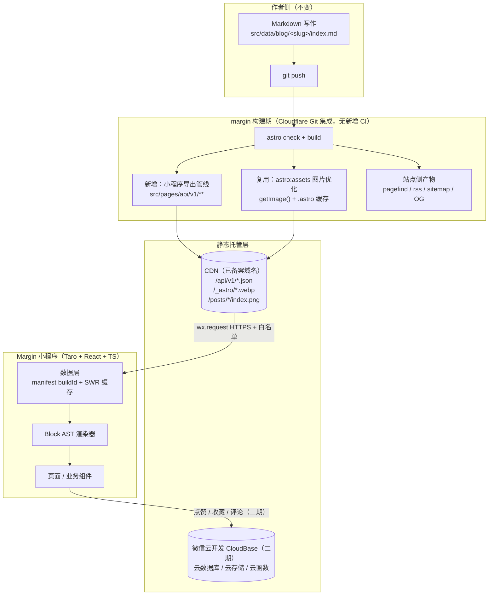

# Margin 小程序 · 需求文档

| 项 | 内容 |
| --- | --- |
| 项目代号 | margin-app（暂定） |
| 文档版本 | **v2.1**（v2.0 → v2.1：**Q1 闭环，补记 D35**——腾讯云客服答复留档、占位子域式 A 方案否决、处置回归 B；外部待办三项闭合：变更备案已发起、头像已更换、控制台核查无待办）。上一版 **v2.0**（v1.9 → v2.0：按 `E:\personal-project\margin` 源码与线上实测重做事实层勘误，落点见 §2.1 F4–F8、§6.3–§6.8、§11.1 R3/R7/R8/R10/R11、§11.4.2、§11.4.4；补全 §6.2 缺失的 7 类数据契约；§13 的 11 项已逐条答复并固化为 D19–D33） |
| 日期 | 2026-09-28 |
| 状态 | **架构方向不变（构建期导出 + Block AST 维持原判）。v2.0 走完三步**：① **事实层勘误** —— v1.9 有 4 条被列为「已验证事实」的结论经实测不成立（§6.3 的决定性理由断链、§6.4 的图片三档并非现成产物、§6.5 的 Segmenter 分词质量、§11.4.4② 备案号归因），前两条直接改变 M0 工期；② **闸门前置** —— M0 开工前先跑 2 个可行性探针（§9 M0-0）；③ **11 项待确认已逐条答复**（§13 答复表），据此补记 **D19–D34** 共 16 条决策。**其中 D28「文章卡不出图」是本轮收益最大的一条** —— 列表页每屏约 480 KB 的图片请求直接归零。**当前只剩 2 件未闭合**：Q3（免责声明初稿待你审）、Q8（tabBar 待真机定案）。~~Q1~~ **已闭环（D35）**：腾讯云客服答复判定「占位子域」式 A 方案不成立，处置回归 B——接受风险 + 端上快照兜底；变更备案已发起、头像已更换、控制台核查无待办。提交动作按你指示整体挂起（Q11） |
| 内容源 | `E:\personal-project\margin`（Astro 7 静态博客，线上 https://baiwumm.com/） |
| 视觉参考 | **demo 图（uni-halo v3.x 实机观感）**；本地 `E:\personal-project\uni-halo` 为 2.0.10，**仅作页面结构参考，视觉令牌以 demo 图为准**（§2.3） |
| 视觉稿 | `E:\personal-project\margin-app\demo\`（首页 / 分类 / 图库 / 瞬间 / 博主 共 5 张，1290×2796 @3x） |

---

## 0. 一句话

把 Margin 静态博客的内容，用**构建期导出静态 JSON + 结构化正文 AST**的方式喂给小程序，端上零后端、零运维地还原一个比 uni-halo 更精致的个人内容小程序。

---

## 1. 背景与目标

### 1.1 背景

- `margin` 是一个**纯静态**的技术博客 + 图片画廊站点：Astro SSG，内容以本地 Markdown/MDX 文件为源（`src/data/blog|galleries|moments`），部署在 Cloudflare Workers Static Assets，**不存在任何运行时后端**。
- 现有内容规模（实测）：文章 **74** 篇（54 篇为 `<slug>/index.md` 文件夹结构，内含 246 张正文图）、画廊 **3** 个（共 **75** 张图）、瞬间 **9** 条（含 16 张图）。
- 已有的机器可读产物只有 `rss.xml`、`comment-titles.json`、sitemap、OG 图，**没有面向客户端的 JSON 内容 API**；站内搜索依赖 Pagefind（浏览器 WASM 分片索引，小程序不可复用）。
- `uni-halo` 是一套成熟的 Halo 博客小程序客户端，页面结构可直接借鉴，但技术栈是 **Vue2 + HBuilderX 工程 + tm-vuetify（109 个组件）**，属上一代方案，不可沿用。

### 1.2 目标

| # | 目标 | 可验证标准 |
| --- | --- | --- |
| G1 | 内容零维护接入 | 发一篇文章 → 构建 → 小程序端看到更新，**人工操作 0 步** |
| G2 | 端上零后端 | 一期不新增任何服务器；静态内容全部走 CDN 静态文件 |
| G3 | 阅读体验优于参考项目 | 含代码 / 表格 / 图片 / 自定义块的 6 类文章在真机渲染正确且可调字号、行距、主题 |
| G4 | 视觉与 demo 稿一致 | 5 屏对照 demo 稿，设计令牌误差在可接受范围内（§8.1 给出实测值） |
| G5 | 包体与性能达标 | 主包 ≤ 1.5MB；冷启动 TTI < 1.5s（4G，缓存命中 < 500ms） |

### 1.3 非目标（明确不做）

- ❌ 不做多用户 / 注册登录体系（这是个人博客，不是社区）。
- ❌ 不做后台管理端（内容仍在 margin 的 Markdown 里写，不在小程序里管理）。
- ❌ 不把博客的 HTML 页面搬进小程序（详见 §6.3 —— 这是本方案的核心判断）。
- ❌ 一期不做评论 / 点赞云同步（降级为本地，二期视审核情况再定）。
- ❌ 不做 uni-halo 的「投票中心」「恋爱日记」等与 margin 内容无关的模块。

---

## 2. 输入调研结论（事实清单）

### 2.1 内容源 margin —— 决定数据层形态的 8 个事实

| # | 事实 | 对小程序的影响 |
| --- | --- | --- |
| F1 | 三套内容集合字段差异大：`blog` 有正文 body + TDK；`galleries` 无 body、图片靠目录 glob 收集；`moments` 正文在 frontmatter 的 `text` 字段、图片同样靠 glob | 导出层要出**三套不同结构**，不能套一个通用模型 |
| F2 | **没有 category 概念，只有 tags**（`AGENTS.md` 明确「只有 Tags，无 Categories」），合并 blog+galleries 去重后约 **62** 个标签 | 已确认（决策 D4）：**取消分类模块**，第二个 tab 直接用标签；不动 margin 的内容模型 |
| F3 | 内容**无 slug 字段**，URL 由文件路径推导（`src/utils/getPath.ts`） | 导出层必须输出显式 `slug` / `path`，端上不做路径推算 |
| F4 | 图片经 `astro:assets` 处理，产物为 `dist/_astro/<name>.<hash>_<w>.webp` 多宽度变体（实测 `dist/_astro/` 下图片文件 **1651 个**；v1.9 记 1685，随内容变动），源文件用「数字前缀+语义名」 | 端上不能猜图片地址，必须由导出层给**绝对 URL + 尺寸**。⚠️ **但 v1.9 假设的「三档现成可用」不成立，见 F7** |
| F5 | 正文里有 3 个自定义 remark 指令：`::link-card[]`（链接卡）、`::music{}`（音乐）、`::video{}`（视频） | 这三者**在标准 HTML 里无法表示**，是选 AST 而非 HTML 的决定性理由。**⚠️ 但 v1.9 说的「复用现有 remark 插件」拿不到结构化数据** —— 三个插件的最后一步都把节点降级成 HTML 字符串：`src/utils/remarkVideo.ts:87-89`（`node.type = "html"` + `delete req.node.children`）、`remarkMusic.ts:160`、`remarkLinkCard.ts:429`；且 `parseAttrs()`/`buildHtml()` 是**未导出的内部函数**（`remarkVideo.ts:40`、`remarkMusic.ts:44,78`）。→ 必须先做一次行为等价的小重构，见 §6.3 |
| F6 | 已有构建期派生能力可直接复用：`readingTime.ts`（阅读时长/字数）、OG 图静态文件（`/posts/<slug>/index.png`，实测 **74 个**已在 `dist`）、`getCollection`、`postFilter`（草稿+定时过滤） | 这些确实可直接调；OG 图可直接当分享卡图。**但「导出层几乎是组装既有能力」这句 v1.9 的估算要下修** —— 三处不是既有能力：① §6.3 的自定义指令解析要重构；② 全仓 `getImage()` **0 处使用**，图片档位选取要新写；③ `remarkLinkCard.ts:222 fetchTdk()` 会在**构建期发网络请求**抓外链 TDK（另有 `src/utils/music-cache.json`、`video-cache.json` 两个已入库的解析缓存）——导出层**不得**重跑联网，见 §6.3 末 |
| F7 | **图片实际档位与 v1.9 设想的三档不一致**（实测）：`astro.config.ts:66-69` 只设了 `responsiveStyles` / `layout:constrained`，**未配** service / formats / qualities / breakpoints，全用 Astro 默认。于是 blog 正文图 srcset = `640,750,828,1080,1280,1541`（`dist/posts/ccy3eh93/index.html` 实测，且受原图宽度截断，如 `03-panda-telescope-panorama` 只有 305w 一档）；画廊 = `400,800,1600`（`src/pages/galleries/[gallery].astro:246-253`，封面 `:217-224` 是 `800,1200,1600`）；瞬间 = **只有** `400,800`（`src/components/MomentCard.astro:94-101`） | **750 档在画廊与瞬间里根本不存在，1600 档在 blog 里不存在** → 不存在一组「全部集合都有」的固定三档。§6.4 据此从「生成固定三档」改为「**每集合内选取站点已有的最优档**」 |
| F8 | **域名与缓存头的线上现状**（实测，2026-09-28）：① `baiwumm.com` 的**所有路径 301 → `www.baiwumm.com`**（`/`、`/rss.xml`、`/comment-titles.json`、`/posts/abb988gt/index.png` 全中，`Location` 一致）；② 静态资源响应头确为 `Cache-Control: public, max-age=0, must-revalidate`（v1.9 §6.4 的这条判断**成立**）；③ 但同一响应**带 `ETag`**（实测 `/_astro/ClientRouter…IVsS7L8F.js` → `ETag: "06e9634d…"`） | ① 意味着 `assetBase` 事实上必须是 **`www.baiwumm.com`**，否则每个 JSON、每张图都白付一次 301 往返（境外 TTFB 200–400ms 下是实打实的体感损失）→ D19；③ 意味着 §6.7 的 `If-None-Match`/304 方案在 CDN 层**成立**，v1.9 的这个前提是对的 |

其他已确认事实：

- 部署：`wrangler.jsonc`（共 14 行）→ Cloudflare Workers Static Assets，`assets.directory = ./dist`，`html_handling = auto-trailing-slash`，`not_found_handling = 404-page`，`compatibility_date = 2026-09-12`；**无 adapter、无 `@astrojs/cloudflare`、无 `rules`/`cache`/`compatibility_flags`、无 worker main**（`astro.config.ts` 同样无 `output` 字段 → 走 Astro 默认 `static`）。由 Cloudflare Dashboard 连接 Git 仓库自动构建。**意味着新增的 Astro Endpoint 会自动随 `astro build` 落进 `dist/` 发布，无需新写 CI**（static 模式下全部预渲染，现有 6 个 Endpoint 均无 `export const prerender`，全仓该写法 0 处）。
- 构建脚本（`package.json:18` 原文）：`astro check && astro build && pagefind --site dist && node -e "fs.cpSync('dist/pagefind','public/pagefind',{recursive:true})"`。⚠️ **v1.9 记的是 `cp dist/pagefind public/pagefind`，已过期**；且末段会把产物**写回源码目录 `public/`** —— 导出脚本不要照抄这个模式。
- 依赖现状（实测 `package.json`）：`astro ^7.2.2`（实装 7.3.2）、`sharp ^0.35.3`、`satori ^0.29.0`、`@resvg/resvg-js`、`dayjs ^1.11.21`、`slugify ^1.6.9`、`pagefind ^1.5.2`、`@astrojs/mdx`、`@astrojs/rss`、`@astrojs/markdown-remark ^7.2.2`。⚠️ **两点要修正 v1.9 的判断**：① `sharp` 虽在依赖里但 **`src/` 内 0 处 import**（取平均色是新用法，不是既有用法）；② **没有顶层 `unified`/`remark-*`/`rehype-*`**，markdown 管线只通过 `@astrojs/markdown-remark` 提供。项目**无 `.npmrc`**、pnpm 默认严格 node_modules → 实测独立脚本 `import('unified')` **直接 `ERR_MODULE_NOT_FOUND`**。所以 §11.4 C 原拟的「独立 Node 脚本 + unified 离线验证」跑不起来，改法见 §11.4 C。
- ⚠️ **依赖新增需你批准**：`AGENTS.md:393-400` 硬约束「**不升级 / 不新增依赖，确有必要须先由用户决定**」，另禁止随意改 `astro.config.ts` / `content.config.ts` / `Layout.astro` / `src/config.ts`。✅ **本轮已批准（D29）**：加 `pinyin-pro`（devDependency）、**不加** `unified`。落地时把例外写回 `AGENTS.md`。
- 主题与品牌：`SITE.title = "Margin"`、`SITE.author = "白雾茫茫丶"`、`SITE.desc = "边白 · 记录代码、思考与灵感"`、`lang = zh-CN`、`timezone = Asia/Shanghai`、`postPerPage = 12`。
- 动态数据：`src/data/friends.ts`（4 组友链）、`src/data/projects.ts`（7 个项目，stars/forks 构建期经 GitHub API 刷新）—— 同样需要导出 JSON。

### 2.2 设计参考 uni-halo —— 借鉴与规避

**值得借鉴（4 条）**

1. **「配置中心 + 能力探测 + 默认兜底」**：远端配置与本地 `DefaultAppConfigs` 深合并，接口失败也能渲染。小程序版应保留这个思路（用 `manifest.json` 兜底内置一份）。
2. **请求层收口干净**：拦截器统一注入鉴权、统一解包、统一处理 401/403；业务 API 文件只声明 URL。小程序版照此分层。
3. **统一视觉令牌 + 原子工具类**：`app.base.scss` 的间距 scale / `.card-shadow` / `.text-sub-more-N` 让全站观感一致。小程序版用 CSS 变量 + Tailwind 复刻。
4. **`<tm-translate fadeUp :wait="index*50">` 列表逐项错峰入场**：成本极低、观感提升明显，值得抄。

**必须规避（5 条）**

1. **技术栈过时**：Vue2 + HBuilderX（非 CLI、无 Vite、无 TS）+ tm-vuetify 重型组件库（自带 md5/dayjs/echarts/lottie，靠 `require.context` 全量注册）。**不沿用。**
2. **`pages.json` 大量重复样板**、`navigationStyle` 首页 custom / 其他默认混用，状态栏与返回键行为不一致。
3. **死代码与硬编码**：`BASE_API` 三处重复、`config/main.js` 与 `config/article-detail.vue`（1500 行）未被引用、深色模式按钮被 `v-if="false"` 隐藏、`/pagesB/login/login` 是缺失的死链。
4. **分页状态位不统一**：`page` 有的从 1 开始有的从 0 开始，`hasNext` / `isLoadMore` / `loading` 各页各写一遍。→ 小程序版抽成统一的 `usePagination` hook。
5. **错误码判断依赖后端旧形态**（`response.data.status == 401/403`），且用正则从 URL 抠参数。→ 小程序版显式约定统一响应结构与错误码。

### 2.3 demo 图解读

**5 屏结构与模块（这是页面划分的验收基准）**

| 屏 | 结构（自上而下） |
| --- | --- |
| **首页** | ① Hero 大图（顶部叠加胶囊公告 + 日期文案，图下缘圆角）② 搜索胶囊（文案「哈喽，想看些什么 **内容** 呢~」，关键词高亮）③ 公告条（emoji + 「公告」+ 文案 + 「全部 →」）④ **快捷导航**（5 个圆形 emoji 图标 + 文字）⑤ **精选分类**（标题 + 右箭头；左侧跨行大卡 + 右侧两个小卡的双列错落网格）⑥ **最新推荐**（tabs：默认 / 置顶 / 最新 / 最旧 + 卡片列表：缩略图 + 标题 + 日期 + 浏览数） |
| **分类** | 居中标题「分类」+ 双列网格卡片（封面图 + 左下叠字标题 + 「共 N 篇笔记」）+ 空态「呜呜，没有更多数据了~」 |
| **图库** | 居中标题「图库」+ 横滚分类胶囊（「全部」/「壁纸(11)」）+ 双列图片网格（左下叠文件名）+ 空态 |
| **瞬间** | 左上角「2026 / 本月」双胶囊 + 居中标题「我的日常」+ **月份横滚选择器**（7月 … 12月，选中态高亮）+ 瞬间卡片（头像 + 昵称 + 日期 + 「详情」按钮 / 「N 张图」/ 3 列图片网格 / 点赞数 + 收藏）+ 右下悬浮「＋ 发布瞬间」 |
| **博主** | 顶部渐变 + 背景图 Hero（圆形头像 + 昵称 + 一句话简介）+ **八宫格功能入口**（联系博主 / 通知公告 / 我的收藏 / 恋爱日记 / 友情链接 / 笔记归档 / 投票中心 / 数据看板）+ 「其他功能」列表（偏好设置 / 免责声明 / 关于项目）+ 底部版权行 |

**全局交互元素**

- 底部 **胶囊式悬浮 tabBar**：5 个图标（首页 / 分类 / 图库 / 瞬间 / 我的），选中项图标带色，容器为白色悬浮胶囊（非通栏）。
- 右侧 **悬浮操作组**：向上箭头（返回顶部）+ 齿轮（功能/设置）+ 用户头像，竖向排列的胶囊组。
- 各屏均无原生导航栏（`navigationStyle: custom`），标题居中显示在内容流中。

> ⚠️ **demo 图的真实身份（已核实）**：这 5 张图是 **uni-halo v3.x 的实机截图**，不是为我们设计的稿子 —— 其中的品牌位与文案（「UniHalo v3.x 秋季正式发布」「小莫唐尼」「恋爱日记 / 投票中心」等）**必须全部替换为 margin 的真实内容**（品牌 Margin、作者 白雾茫茫丶，导航项按 §7.3 重映射）。
>
> **更要紧的一点**：本地仓库 `E:\personal-project\uni-halo` 是 **2.0.10**，其视觉体系（`--theme: #f79ea3` 粉、Material 蓝 `#03a9f4`、方正卡片）**与 demo 图完全不同** —— 全库搜不到 `#D7F94C`。所以：
>
> - **页面结构、功能清单、交互模式** → 参考本地仓库（有效）
> - **视觉令牌、配色、圆角、卡片形态** → **只能以 demo 图为准**（本地仓库无参考价值）

**设计令牌（从 demo 图程序化采样所得，非肉眼估计）**

| 令牌 | 实测值 | 采样依据 |
| --- | --- | --- |
| 强调色（主色） | `#D7F94C` | 首页黄绿像素直方图第一名（18792 次命中），即 tab 选中 / 胶囊 / 高亮底色 |
| 强调色-浅 | `#E0EF93` / `#EAEC80` | 首页 hero 顶部叠加层、博主页 hero 中段 |
| 页面底色 | `#F6F3EE`（暖白） | 5 屏中 4 屏的众数色（占比 16%～35%） |
| 卡片底色 | `#FCFAF8` ~ `#FDFDFB` | 卡片区采样 |
| 正文近黑 | `#2D2F2E` | 分类页次众数色（12.7%） |
| 次要文字 | `#909399`（灰，参考 uni-halo 实测值） | 日期 / 计数文案 |
| 画布基准 | 430 × 932 pt，@3x | demo 图 1290 × 2796 |
| 页面左右边距 | ≈ 24rpx | 实测 39px / 3 ≈ 13pt |
| 双列网格列间距 | ≈ 20rpx | 实测 32px / 3 ≈ 10.7pt |
| 卡片宽度（双列） | ≈ 341rpx | 实测 586px / 3 ≈ 195pt；校验 `(750 − 24×2 − 20) / 2 = 341` ✅ |

> 注：`#F6F3EE`（demo，暖白）与 margin 博客主题的 `#f2f5ec`（偏绿）不同。**建议小程序以 demo 的暖白为准**，与卡片/阴影系统更协调；这是有意的差异，不是遗漏。

---

## 3. 覆盖范围

### 3.1 一期范围（M0–M4）

内容浏览为主：首页、标签、图库、瞬间、博主 5 个 tab + 文章详情、搜索、归档、标签详情、友链、项目、关于、公告、偏好设置、收藏（本地）等二级页。

### 3.2 二期范围（M5，可选）

微信云开发承载 UGC：点赞 / 收藏云同步、评论（含内容安全校验）、订阅消息、作者侧发布瞬间。

---

## 4. 整体架构

### 4.1 架构总图



### 4.2 分层职责

| 层 | 职责 | 关键约束 |
| --- | --- | --- |
| **内容层** | Markdown 源文件，唯一事实来源 | 保持现有写作流程与 `AGENTS.md` 内容规范不变 |
| **导出层**（新增，位于 margin 内） | 把内容编译成面向小程序的 JSON + Block AST；给图片产出绝对 URL 与尺寸 | 纯构建期、只增不改，站点页面产物零变化 |
| **分发层** | CDN 静态分发 JSON 与图片 | 全部 `immutable` 强缓存；URL 内容化（含 hash / buildId） |
| **端上数据层** | manifest 版本比对、缓存、预取、失败降级 | 首屏不依赖网络（读本地缓存渲染） |
| **渲染层** | Block AST → 小程序原生组件 | 框架无关，纯数据驱动 |
| **交互层** | 页面、组件、偏好设置、动画 | 设计令牌统一，暗色模式可用 |

### 4.3 边界原则

> **内容（读）走静态 CDN，用户数据（写）走云开发。**

静态内容量大、更新低频、适合 CDN 强缓存，成本趋近于 0；用户数据量小、需鉴权与实时性，交给微信云开发（免备案域名、天然 openid、个人开发免费额度足够）。两条链路互不依赖 —— **二期不上云开发，一期功能也完整可用**。

> 「为什么不需要数据库」「每次启动到底同步了什么」→ 展开见 §6.11。

---

## 5. 技术选型

### 5.1 选型结论

| 维度 | 选型 | 理由 |
| --- | --- | --- |
| 小程序框架 | **Taro 4.x** | 见 §5.2 决策 |
| 语言 | **TypeScript 5+（strict）** | 数据契约需要类型约束；用户既有项目全部 TS |
| UI 运行时 | **React 19** | 与用户既有栈（Next.js / React / HeroUI）一致 |
| 构建 | **Taro 内置 Vite + SWC** | 冷启动与 HMR 优于 Webpack 方案 |
| 状态管理 | **Zustand + 自研 storage 持久化中间件** | 用户已在 `cover-magic` / `next-daily-hot` 使用；体积极小 |
| 数据请求 | **自研轻量 request（拦截器 + SWR 缓存 + 重试）** | 小程序无 fetch/cookie 心智负担，第三方库收益低 |
| 样式 | **CSS 变量设计令牌层 + Tailwind CSS v4 + `weapp-tailwindcss`** | 复用用户肌肉记忆；Tailwind 负责原子类，令牌层负责主题/暗色切换 |
| 基础组件 | **自研为主** | demo 视觉高度定制，第三方 UI 库会拖累而非加速（见 §5.4） |
| 富文本正文 | **自研 Block AST 渲染器（不引入 mp-html）** | 见 §6.3 |
| 代码高亮 | **构建期 Shiki 预高亮 → 端上按 token 上色** | 复用 margin 现有 Shiki 配置，端上零解析成本 |
| 图片 | **Taro `<Image>` + 自研 `CacheImage`（三态 + 占位色 + 懒加载）** | 参考 uni-halo 的 `cache-image` 思路 |
| 图表（数据看板） | **自研 canvas 轻量绘制**，必要时才引 echarts | 看板只有几个简单指标，引 echarts 会明显增包 |
| 云能力（二期） | **微信云开发 CloudBase** | 免备案域名、免服务器、免费额度够用 |
| 包管理 | pnpm | 与 margin 一致 |

### 5.2 关键决策：小程序框架选谁

**结论：Taro 4.x（React 19 + TypeScript）。—— 已于 2026-09-28 确认（决策 D5），不再讨论。**

理由按权重排序：

1. **匹配开发者的真实技术栈。** 用户 2026 年的项目几乎全是 React/Next/TS/Tailwind：`EasyAPI`、`better-admin`、`better-nav`、`better-next`、`better-status`、`next-daily-hot`、`cover-magic`、`ogimg`、`preview-craft`、`react-okr-tree`。选 Vue 系意味着每一次调试都在逆着肌肉记忆走。这是单人长期维护项目里权重最高的一条。
2. **本项目视觉高度定制，框架自带的组件生态价值低。** demo 稿里的胶囊 tabBar、错落双列网格、月份横滚选择器、悬浮操作组，任何 UI 库都不会有现成的；Taro 与 uni-app 在这个维度打平，于是框架选择应回归「语言与工具链」。
3. **Taro 4 的工程条件更好**：Vite + SWC 构建、TS 一等公民、React 19 支持；uni-app 的 Vue3 版虽然也上了 Vite，但生态文档与示例仍大量停留在 Vue2/HBuilderX 时代（参考项目 uni-halo 就是活证据）。
4. **跨端可能性未被牺牲**：Taro 同样支持 H5 / RN / 鸿蒙；未来要出 Web 版可复用同一套数据层与 Block 渲染器。

**已否决的备选（记录在案，避免后续反复）**

| 备选 | 否决理由 |
| --- | --- |
| **uni-app（Vue3 + Vite + TS + wot-design-uni）** | 否决。开发者既有栈全为 React/TS（见上面理由 1）。仅当未来确定要出 App 且重度依赖 uni-app 原生插件市场（uniCloud、离线打包）时才重新考虑。 |
| **微信原生小程序 + TS（+ Skyline）** | 否决。抽象层缺失会让第 3 个页面之后的开发成本反超。仅当确定只做微信单端且必须吃 Skyline 最新能力时才重新考虑。 |

> 无论选哪个，**§6 的数据契约与 Block AST 都与框架无关** —— 这也是本方案的抗风险设计：框架选错了，数据层不用重做。

### 5.3 明确不采用的技术

| 不采用 | 原因 |
| --- | --- |
| `mp-html` / `towxml` | ① 体积大（源码级别引入，压缩后仍显著吃包体）；② 无法表达 `::link-card` / `::music` / `::video` 这些非标准 HTML 的块；③ 样式不完全可控，与 demo 的定制排版冲突。 |
| `tm-vuetify` | Vue2 时代的重型组件库（109 组件 + 自带 md5/dayjs/echarts/lottie）。 |
| 直接魔改 `uni-halo` | 技术栈（Vue2 + HBuilderX）已过时，且项目内存在未引用的 1500 行死代码。 |
| 把 Pagefind 索引搬进小程序 | 索引是浏览器运行时分片（`.pf_index` / `.pf_fragment` + WASM + DOM 依赖），**技术不可行**。 |
| 为了小程序给静态站加 SSR / 接口服务 | 与「个人项目零运维」目标直接冲突；发文章这一低频动作不值得引入一个常驻服务。 |
| 引入 `@nutui/nutui-react-taro` 等全套 UI 库 | 见 §5.4；仅在遇到虚拟列表等硬骨头时按需引入单个组件。 |

### 5.4 关于「不引入组件库」的说明

这不是洁癖。理由是**收益为负**：

- demo 的视觉系统是**低对比、大圆角、暖白底、柠檬绿点缀、悬浮胶囊导航**，主流小程序 UI 库默认是 Material / Vant 风格，覆盖掉默认样式的工作量与自研等价，还多背了包体。
- 需求里真正复杂的组件只有 4 个：图片网格、月份横滚选择器、Block 渲染器、悬浮 tabBar —— 全都是「一次性、定制化」的，组件库帮不上忙。
- 反而是一批**基础设施**值得自研并长期持有：`request` / `CacheImage` / `usePagination` / `Empty` / `Skeleton` / `SafeArea`。

---

## 6. 数据层打通方案（核心）

### 6.1 核心判断

> **不要在运行时把博客站点当接口用。** 而是在 margin 的构建期增设一条「小程序内容导出管线」，产出面向小程序优化的静态 JSON + 结构化正文，与站点一起部署到同一个域名。小程序端只消费 JSON 与图片，**不解析 HTML、不依赖任何服务端**。

四条支撑理由：

1. **margin 本身就是纯静态**（Astro SSG + Cloudflare 静态资源），任何「接口化」方案都要新起运行时服务，与 G1「零维护」/ G2「零后端」直接冲突。
2. **构建期一次性算完更划算**：正文结构化、代码高亮、图片变体、阅读时长、标签聚合、搜索索引 —— 全部在构建期算好，端上零计算。这正是静态博客相对 Headless CMS 的天然优势。
3. **内容更新频率 = 发文章频率**（低频）。重新构建 + CDN 刷新完全可接受，且**与现有 Cloudflare Git 自动构建天然契合** —— 新增 Astro Endpoint 会随 `pnpm build` 自动落进 `dist/`，**不需要写任何新 CI**。
4. **失败模式更好**：CDN 静态文件没有「接口挂了」这一档，最坏情况是缓存旧版本，端上仍可读。

### 6.2 产出契约（`/api/v1/**`）

全部由 `src/pages/api/v1/` 下的 Astro Endpoint 生成，构建期落盘为静态文件。统一响应包一层元信息便于端上做版本与容错：

```ts
// 所有 /api/v1/** JSON 的公共外包装
interface ApiEnvelope<T> {
  schemaVersion: number;   // ⚠️ v2.0 变更（D24）：不匹配时**不弹「请更新小程序」**，改为「继续用本地缓存 + 只渲染认识的字段」；
                           // 硬提示更新在小程序场景是自我锁死——审核有滞后、用户自动更新更滞后，且旧版本仍在跑
  buildId: string;         // 构建标识：git short sha + 内容 hash（⚠️ 浅克隆下 short sha 会失真，故它**只作可读标签**，主键永远是内容 hash；热力图已改走 `pubDatetime`，与 git 深度无关 → D34）
  generatedAt: string;     // ISO8601
  data: T;
}
```

**版本并存（D24）**：契约变更时**新增 `/api/v2/**` 目录、`/api/v1/**` 保留不删**，构建期同时产出两版（成本只是在导出脚本里多跑一次前缀）。理由同 `schemaVersion` 那条 —— 端上存量版本不可控，覆盖式升级会让旧客户端直接读到不认识的字段。这条把「抗风险设计」（§5.2 末）从框架层补到了协议层。旧版本目录的下线时机 = 「后台里该 schemaVersion 的存量占比 < 1%」，属 M5 之后的运维动作。

**端点共 13 个（v1.9 在 §6.8 与 §9 写「11 个」，但同版本 §6.2 表内实列 15 行 —— 计数勘误，见 D20）**

| 端点 | 内容 | 体积预算（gzip 前） |
| --- | --- | --- |
| `GET /api/v1/manifest.json` | 版本与资源清单：`{ schemaVersion, buildId, generatedAt, assetBase, site, counts, resources: Resource[], searchIndex: { titlesPath, titlesHash, termsPath, termsHash, termsMinChars, strategy: "bigram" } }`（结构见下方类型草案；v1.9 的 `searchIndex: {...}` 是空占位，本轮定义） | < 4 KB |
| `GET /api/v1/site.json` | 站点配置：标题/描述/作者/头像/社交链接/导航/**`announcement`（v1.9 独立的 `site/announcements.json` 已并入此处，见 D20）**/首页 layout 开关/主题令牌 + **色板**（§6.6） | < 6 KB |
| `GET /api/v1/posts/index.json` | 文章列表元数据（**不含正文**）。**74 篇全量下发，端上不做服务端分页**（口径见下「分页」） | < 80 KB |
| `GET /api/v1/posts/<slug>.json` | 文章详情（含 Block AST 正文） | 单篇 5–200 KB |
| `GET /api/v1/galleries/index.json` | 画廊列表（含 `photoCount`、`cover`、`tags`） | < 4 KB |
| `GET /api/v1/galleries/<slug>.json` | 画廊详情（`photos: AssetRef[]`，**统一用 AssetRef 结构，不再单列一套 `src/thumb/w/h/alt/avgColor` 字段**，v1.9 该处与 AssetRef 重复定义，见下） | 20–200 KB |
| `GET /api/v1/moments/index.json` | 瞬间全量（9 条 / 16 图）。**v1.9 的「总索引 + `<YYYY-MM>` 按月分片」两个端点合并为一个**（分片留到有 50+ 条时再拆，D20）；月份分组由端上按 `pubDatetime` 做 | < 60 KB |
| `GET /api/v1/tags/index.json` | 标签聚合（blog + galleries 合并，含 `count`、`slug`、**`color` / `colorDark` / `ink`**）。⚠️ v1.9 的 `colorSeed` 语义含糊（下发种子＝端上还要跑 hash，与「构建期定死、端上零计算」矛盾）→ 改为直接下发三个色值，见 §6.6 / D22 | < 12 KB |
| `GET /api/v1/friends.json` | 友链分组 | < 8 KB |
| `GET /api/v1/projects.json` | 项目列表（stars/forks 构建期已刷新） | < 8 KB |
| `GET /api/v1/stats.json` | 数据看板：文章数/总字数/标签数/连续月数/写作热力图 | < 16 KB |
| `GET /api/v1/search/titles.json` | 检索索引**第一层**：标题/标签/摘要/小标题 + 拼音（§6.5） | < 40 KB |
| `GET /api/v1/search/terms.json` | 检索索引**第二层**：全文，输入 ≥2 字后懒加载（§6.5，**bigram 而非分词** → D21） | 150–400 KB |

**两条契约口径（v1.9 缺失，本轮补）**：

- **分页**：全部列表端点**一次给全量**，`ApiEnvelope` 里**不含** `page` / `hasNext` / `total` 字段。理由：74 篇文章的 `posts/index.json` 预算 80 KB，本就整份下发；§6.2 批评 uni-halo「分页状态位各页各写」的正解不是设计一套分页协议，而是**在 74 条的量级上取消分页**。§7.4 的 `usePagination` 因此降级为**纯端上切片**（页码从 1 开始、`hasNext = 已渲染 < 全量`），只负责滚动加载节奏，不参与网络。将来文章数超过单请求 400 KB 上限（§10）时，再引入 `?cursor=`，届时按新编号补记。
- **图片路径**：`AssetRef.src/md/thumb` 填的是**站点已产出的变体文件名**（§6.4），不保证宽度恰好等于目标值；缺档时按「≤目标宽度的最大可用档」回落，并如实写 `actualWidth`。

**关键结构化类型（草案，M0 冻结）**

```ts
/** 列表项元数据 —— 不含正文，首页/标签/归档/搜索复用同一结构 */
interface PostMeta {
  slug: string;              // 由 getPath 推导，端上不推算
  path: string;              // 站点相对路径，如 "/posts/r4ACa87S/"
  title: string;
  description: string;
  tags: string[];
  pubDatetime: string;       // ISO8601（Asia/Shanghai）
  modDatetime: string | null;
  featured: boolean;         // 对应 frontmatter featured
  draft: false;              // 导出层已过滤，恒为 false
  cover?: AssetRef;          // ⚠️ **D28：一期不下发这个字段**（文章卡不出图）。保留为可选，是为了将来「只给 featured 配封面」时不必升契约版本
  ogImage: string | null;    // "/posts/<slug>/index.png" 可作分享卡图（实测 dist 内 74 个已存在）。⚠️ D28 后 OG 图**只服务分享卡**，不再参与封面链路
  readingTime: number;       // 分钟（readingTime.ts）
  wordCount: number;
}

/** 图片资源引用：端上只认这个结构，不猜路径。
 *  ⚠️ v2.0 语义变更（D19/§6.4）：三个字段填的是「站点已产出的档位」，不保证宽度等于目标值。
 *  目标宽度是 400 / 800 / 集合内最大可用档，缺档时回落，并如实写实际宽度。 */
interface AssetRef {
  src: string;               // 绝对 URL，全屏预览用（该图可用的最大档）
  md: string;                // 绝对 URL，正文用（目标 ≤800px）
  thumb: string;             // 绝对 URL，列表卡用（目标 ≤400px）
  srcWidth: number;          // src 档实际宽度
  mdWidth: number;           // md 档实际宽度
  thumbWidth: number;        // thumb 档实际宽度
  width: number;             // 原始宽度（与 height 一起决定占位比例）
  height: number;
  format: 'webp' | 'avif' | 'png' | 'jpg';
  bytes: number;             // src 档字节数，端上做省流模式与流量判断
  avgColor: string;          // "#RRGGBB"，图片显色前的占位背景，避免白闪
}

/** 文章详情 */
interface PostDetail {
  meta: PostMeta;
  blocks: Block[];           // §6.3 结构化正文；图片块只存 assets 下标（D23）
  toc: TocItem[];            // { id, text, depth }
  assets: AssetRef[];        // 正文内所有图片的**唯一一份**定义，img 块按下标引用
  prev: PostMeta | null;     // 上一篇
  next: PostMeta | null;     // 下一篇
  canonicalURL: string;
}

/** 写作导航 */
interface TocItem { id: string; text: string; depth: 2 | 3 | 4 }
```

**v1.9 只冻结了 Post 系列，其余集合的类型草案全部缺失** —— M0 要「冻结 schema」就不能只写 1/3，本轮补齐如下（紧凑版，字段名 M0 落 `docs/api-contract.md` 时不再改动）：

```ts
interface Gallery {
  slug: string; path: string; title: string; description: string;
  tags: string[];                       // 画廊自身 frontmatter 的 tags
  photoCount: number;                   // 实测全集 3 个画廊 / 75 张
  cover: AssetRef;                      // 站点封面档为 800/1200/1600（galleries/[gallery].astro:217-224）
  photos: GalleryPhoto[];               // 一份文件内给全，不分片
}
interface GalleryPhoto { asset: AssetRef; alt: string; name: string }   // name = 去掉数字前缀的语义名，供网格左下叠字

interface Moment {
  id: string;                           // moments 无 slug，用文件名派生的稳定 id
  text: string;                         // 正文确在 frontmatter `text`（content.config.ts:48）
  pubDatetime: string;
  images: AssetRef[];                   // 靠 import.meta.glob 收集，档位仅 400/800（MomentCard.astro:94-101）
  tags: string[];
  music?: { platform: 'netease' | 'qq'; id: string; audio?: string };   // content.config.ts:54
  video?: { id?: string; src?: string; poster?: string; title?: string; ratio?: string };  // :64
  likes: null;                          // 一期恒 null，字段占位以免二期改结构（点赞属 D7/二期）
}

interface Tag {
  name: string; slug: string; count: number;
  color: string; colorDark: string; ink: string;   // D22：构建期定死三个色值，端上零 hash 零计算
}
interface FriendGroup { title: string; items: { name: string; url: string; desc: string; avatar: string | null }[] }
interface Project { name: string; url: string; desc: string; lang: string | null; stars: number; forks: number; topics: string[] }
interface Stats {
  postCount: number; galleryCount: number; momentCount: number; tagCount: number;
  totalWords: number; readingMinutes: number;
  streakMonths: number;                 // 连续写作月数
  heatmap: { date: string; count: number }[];   // ⚠️ D34：数据源是**文章 `pubDatetime` 按月/日聚合**，不读 git 历史（语义＝「本月发布了几篇」，非「本月提交了几次」）
  monthBuckets: { month: string; words: number; posts: number }[];
}

interface Resource { name: string; path: string; hash: string; bytes: number }
interface Manifest {
  schemaVersion: number; buildId: string; generatedAt: string;
  assetBase: string;                    // ⚠️ 固定为 "https://www.baiwumm.com"（D19，裸域会 301）
  site: { title: string; author: string; desc: string };
  counts: { posts: number; galleries: number; moments: number; tags: number; images: number };
  resources: Resource[];                // 端上按 hash 做细粒度失效
  searchIndex: { titlesPath: string; titlesHash: string; termsPath: string; termsHash: string;
                 termsMinChars: 2; strategy: 'bigram' };   // v1.9 的 `{...}` 空占位已定义
}
```

### 6.3 正文结构化：Markdown → Block AST

**这是整个方案里最关键的技术决策。**

**问题**：如果按常规做法在构建期把 Markdown 渲染成 HTML，再交给 `mp-html` 之类组件在端上解析，会踩三个坑：

1. margin 的正文不只是标准 Markdown —— 还有 `::link-card[]`、`::music{}`、`::video{}` 三个**自定义 remark 指令**（见 `src/utils/remarkLinkCard.ts` / `remarkMusic.ts` / `remarkVideo.ts`）。它们产出的结构在标准 HTML 里没有对应物，HTML 方案下必然丢失或需要 hack。
2. 富文本组件体积大、样式不可控，而 demo 的排版是深度定制的（字号 18–24px 可调、行距可调、暗色、代码块换行开关、图片圆角与占位色）——**HTML 里塞满了内联样式时，端上主题切换几乎无法实现**。
3. 端上解析 HTML 是纯浪费：构建期有充裕的算力做 Shiki 高亮、尺寸计算、目录抽取。

**方案（v2.0 修订：多出一个「前置重构」步骤，v1.9 漏了）**

构建期把 Markdown 先经 unified 归一为 **hast**，再把 hast **降维成小程序友好的 Block JSON**。但 **hast 这条路上有三个坑，v1.9 的判断不成立**：

1. **不能直接复用三个 remark 插件。** 它们的最后一步会把指令节点**降级成原始 HTML 字符串**（F5 附的 `remarkVideo.ts:87-89` 等三处证据），hast 里拿到的是一坨 `type: "html"` 的串，结构化属性（platform / id / src / poster）在插件内部被序列化时**丢掉了**。
2. **`remarkLinkCard.ts:222 fetchTdk()` 会在构建期发网络请求**抓外链标题/描述/图标，另有 `src/utils/music-cache.json`、`video-cache.json` 两个已入库的元数据缓存。
3. **顶层没有 `unified`**（§2.1 依赖实测），独立脚本无法按 §11.4 C 原拟方式 import。

**因此导出管线的真实形态是**：

- **步骤 0（前置重构，改站点文件）**：在 `remarkLinkCard.ts` / `remarkMusic.ts` / `remarkVideo.ts` 里把已有的内联解析逻辑**抽成导出函数**（`parseLinkCard(attrs, node)` / `parseMusicCard(attrs)` / `parseVideoCard(attrs)`），插件本体改为「调 parse → 再 `buildHtml`」。每个文件约 3–5 行，**行为必须等价**（验收标准：站点 HTML 产物字节级不变，见 §6.8 硬性约束）。导出层的 Block 构建器直接调这三个 `parse*` 产出结构化块，**不经过 HTML 字符串**。
- **步骤 1（取 hast）**：`remarkRemoveTocMarker` + `rehypeExternalLinks` 可原样复用；三个自定义指令**不进导出管线**，改由步骤 0 的 `parse*` 旁路处理（即在 Markdown AST 层先摘出指令节点，剩下的走 hast）。
- **步骤 2（降维）**：hast → `Block[]`，`p` / `h` / `img` / `code` / `quote` / `list` / `table` / `hr` 逐类映射。
- **禁止联网**：导出层的 `linkcard` 块只填 `href` + 正文里作者手写的标题/备注；站点侧已解析出的 TDK **从 `music-cache.json` / `video-cache.json` 这类已入库文件读**，不在导出层重发请求。理由：§11.4 C 已记录 margin 本地 build 会随机卡死、进程零 CPU，而 Cloudflare 构建容器对耗时和内存更紧 —— 把 74 篇 × N 个外链的网络抓取再跑一遍，是拿一个已知的不稳定环节去赌发布成功率。

```ts
type Block =
  | { t: 'p';    i: Inline[] }
  | { t: 'h';    d: 2 | 3 | 4; i: Inline[]; id: string }
  | { t: 'img';  a: number; alt?: string }   // ⚠️ D23：assets 下标，不内嵌 AssetRef（见下「为什么」）
  | { t: 'code'; lang?: string; file?: string; lines: number;
                 tokens: CodeToken[][];       // 构建期 Shiki 预高亮结果
                 highlighted: true }          // ⚠️ 删掉 v1.9 的 `code: string` 字段：`tokens.map(t=>t.v).join('')` 即可复原纯文本，复制功能照用；高亮失败时 tokens 仍存在（每行一个无 c 的 token），不需要 highlighted 开关
  | { t: 'quote'; i: Inline[] }
  | { t: 'list'; ordered: boolean; items: Inline[][] }
  | { t: 'table'; head: Inline[][]; rows: Inline[][][] }
  | { t: 'hr' }
  // ── 以下三类来自自定义指令，HTML 方案无法表达；数据由 §6.3 步骤 0 的 parse* 直接给出 ──
  | { t: 'linkcard'; href: string; title: string; desc?: string; icon?: string }
  | { t: 'music';    platform: 'netease' | 'qq'; id: string; audio?: string }
  | { t: 'video';    id?: string; src?: string; poster?: string; title?: string; ratio?: string }
  // ── 兜底：遇到未识别的节点不丢内容 ──
  | { t: 'unknown'; raw: string };

interface Inline {
  t: 'text' | 'code' | 'br';
  v: string;
  bold?: boolean; italic?: boolean; strike?: boolean;
  link?: { href: string; external: boolean };
}

/** 紧凑的代码着色：颜色走索引，配色表由 manifest 下发，避免重复颜色字符串 */
interface CodeToken { v: string; c?: number }
```

> **D23 的两处瘦身，都是冲着「单篇 ≤ 200 KB / 单 key ≤ 1 MB / 总存储 10 MB」这三条上限去的**（§10 与 §6.7）：
> - `img` 引用 `assets` 下标而非内嵌 AssetRef —— 一个 AssetRef 含 3 条绝对 URL + 9 个字段 ≈ 250 B，而 54 篇文件夹型文章里有 **246 张正文图**，同一份定义在 `blocks` 和 `assets` 里各存一遍等于白翻倍。
> - `code` 块只发 `tokens` 不发 `code` —— 代码是本博客的主要内容，一份 1000 行代码的 tokens 体积约为原文 1.5–2 倍，再存一份原文就是 3 倍；删掉后直接省掉 40–50% 的代码块载荷，R7（超长文章单文件过大）跟着缓解。
> - ⚠️ 这两处都要在 M0 用 6 篇样文实测「gzip 前后字节数」来验证省了多少，别只按推算下结论。

**这个设计换来的能力**（全部是 HTML 方案做不了或做得很丑的）：

- 字号 / 行距 / 段落间距 / 主题色全部由端上令牌驱动 —— 直接支撑 demo 里的「偏好设置」。
- 图片自带 `width` / `height` / `avgColor`，**布局不抖动、加载不白闪**（这是 demo 观感的关键细节）。
- 代码块只发 `tokens`（颜色走索引），端上仅上色、不做解析；复制与行号由 tokens 复原；配合「换行 / 滚动」开关是纯 CSS 切换。
- 表格可做横向滚动容器 + 首列吸附。
- 目录 `toc` 与阅读进度天然可算。
- **遇到没见过的 Markdown 语法不会崩**：落到 `unknown` 块并原样展示，同时构建期输出告警清单。

**构建期校验（必须做）**：导出脚本要对每篇正文跑一遍「AST → Block」转换，收集所有 `unknown` 块与缺失字段，在构建日志里汇总；CI 上把「出现 unknown 块」视为警告但不阻断发布（避免一次写作阻塞上线）。

### 6.4 图片管线

**问题**：站点图片经 `astro:assets` 后变成 `dist/_astro/<name>.<hash>_<w>.webp` 多宽度变体（实测 `dist/_astro/` 下图片文件 **1651 个**，v1.9 记的 1685 已随内容变动），文件名不稳定、尺寸与小程序需求不匹配（列表卡要 ~400px、正文要 ~800px、预览要原图上限 1600px）。

**方案（v2.0 改为「只选择、不生成」，D19）**：复用 Astro 已产出的变体，导出层**按「≤目标宽度的最大可用档」从集合自身的档位集合里挑**，而不是新造一套固定三档。理由就是 F7 那组实测数字 —— **不存在一组三个集合都有的档**（blog 有 750 无 1600，gallery 有 1600 无 750，moment 只有 400/800），v1.9 的「thumb400/md750/src1600」一旦落地，就等于给画廊和瞬间**新增一批变体文件**，直接撞上 R3（构建耗时与变体膨胀），还把「复用 Astro 缓存」这个前提给违反了。

| 档位 | 目标宽度 | blog 正文图实际命中 | galleries / moments 实际命中 | 用途 |
| --- | --- | --- | --- | --- |
| `thumb` | ≤400px | 400（若原图更窄则取最大档） | **400**（站点已产出） | 画廊卡、瞬间图网格、标签/画廊封面。**⚠️ D28 后不再服务文章卡**（文章卡无图） |
| `md` | ≤800px | **750 / 828** | **800**（gallery/moment 已产出） | 正文内图片、瞬间图片 |
| `src` | 该图可用的最大档 | **1080 / 1280 / 1541** | **1600**（gallery）/ **800**（moment，已是上限） | 全屏预览 |

格式随站点产物（webp），**不新增 avif 档**：Astro 默认 formats 未改，新增格式＝新增一整批文件。体积目标（`thumb` ≤40 KB / `md` ≤120 KB / `src` ≤400 KB）保留为**验收阈值**而非生成参数 —— 超阈值时在 M0 报告里点名具体图片，由你决定是否回头调 `astro.config.ts` 的 image 配置（⚠️ 那是 AGENTS.md 列的禁改文件，与 D29 的依赖批准是**两回事**，需要单独请你点头）。

> **⚠️ 本节有一个 v1.9 完全没提、但决定成败的未验证前提**：全仓 `getImage()` **0 处使用**，而 Astro 的图片优化产物**历来是由页面渲染触发的**。在一个只输出 JSON 的 Endpoint 里调 `getImage()`，被选中的变体文件**到底会不会落盘到 `dist/_astro/`**、URL 是否可 200 访问 —— 没有实测证据。**所以 M0 的第 0 项不是写端点，是这个探针（§9 M0-0）**：
>
> - **探针 A**：建一个临时 Endpoint，对 2 张本地本地图（1 张 blog 正文图 + 1 张画廊图）调 `getImage()` 并输出 URL，push 后在 **Cloudflare 预览构建**上 `curl` 验这些 URL 是否 200。
> - 通过 → 按「只选择、不生成」落地，导出层零新增图片文件。
> - **不通过 → 三条退路（按优先级）**：① 导出层只引用站点 HTML 里已经出现过的 URL（从 `dist` 的 srcset 反向建表，零风险但要把「图片→档位」映射也写进 manifest）；② 用自定义 Vite 插件在 `buildEnd` 阶段 `emitFile` 补写缺失变体；③ 导出改成 build 后脚本。三条都能保住「端上零后端」，区别只在复杂度。

配套三件事：

1. **绝对 URL**：JSON 里写成 `<assetBase>/_astro/xxx.<hash>.webp`。`assetBase` 由 `manifest.json` 下发，端上拼接 —— 将来换 CDN / 换域名不用改端上代码。**⚠️ v2.0 修订：`assetBase` 的值必须是 `https://www.baiwumm.com`**（裸域会 301，F8 / D19），且 `path` 类字段仍保持站点相对路径不变。
2. **`avgColor` 占位色**：构建期用 `sharp` 对每张图做 1×1 缩采样取平均色，写进 `AssetRef`。列表与正文图先用 `avgColor` 铺底再淡入，**彻底消除白闪**。⚠️ 注意 `sharp` 虽在 `package.json:37` 里但**`src/` 内 0 处 import** —— 对导出层这是新用法，需要在探针 A 里一并验「Cloudflare 构建容器能跑起 sharp」（sharp 是原生依赖，`pnpm-workspace.yaml` 的 `onlyBuiltDependencies` 已放行，但构建镜像里的 glibc 版本是另一回事）。
3. **尺寸元信息**：写入 `width` / `height` + 三个档的实际宽度，端上据此计算占位高度，避免瀑布流跳变。

**为什么不用自建确定性镜像？** 起初考虑过按 `img/<collection>/<slug>/<seq>-<name>.<w>.webp` 产出独立镜像，但它是重复劳动：Astro 已经在做同样的事且带缓存。真正需要它的场景只有两个 —— 需要 CDN 侧参数化裁剪（如云存储图片处理），或需要跨构建稳定可预测的 URL。当前都不需要，**先不做**；契约里预留 `assetBase` 就是为将来切换留的口子。

**域名策略**：图片与 API **同域**。理由：微信 `request` 合法域名上限 20 个，同域最省事，且 `<image>` 加载网络图不校验域名白名单。

> ⚠️ **v2.0 修订（D19）：`assetBase` 不能直接取 `SITE.website`。** v1.9 写的「`assetBase` 默认 = `SITE.website`」有两处错：① `src/config.ts:18` 的实际值是 **`"https://baiwumm.com/"`（裸域）**，而实测该域名的**每一个路径都 301 到 `www.baiwumm.com`** → 照 v1.9 落地，JSON 与图片**每张都要多付一次 301 往返**，在境外 TTFB 200–400ms 的前提下这是纯粹的浪费；② 该值带**尾斜杠**，拼接 `_astro/...` 会产出 `//_astro/`。
>
> **改法**：导出层写死 `assetBase = "https://www.baiwumm.com"`（**无尾斜杠**），并在 M0 的 schema 校验里加一条断言：产物 JSON 中任何 URL 都不得出现 `//_astro/`、不得出现 `https://baiwumm.com/`。**「重定向目标域名是否也必须进合法域名白名单」需 M1 真机验证**，但无论验证结果如何，直接用 `www` 都能同时消掉这次往返与这个不确定性 —— 所以不必等验证结果。
>
> ✅ **配套后台动作已完成（2026-09-28，你办的）**：三类服务器域名里 `https://baiwumm.com` 与 `https://www.baiwumm.com` **两条都已配置**（Q2 闭环）。留两条备注：① 保留裸域无害，且将来若把某类资源挪回裸域不用重配；② M1 仍要真机验一次「301 到未白名单域名是否报错」，只为留证据，不为绕路（§9 M1 验收⑤）。

> ✅ **已定（D17，2026-09-28）**：**放弃 `cdn.baiwumm.com`，一期到后续全部同域。** 用户明确不打算维护对象存储桶（实测桶为空）。删掉一个未使用的白名单域名**零风险**。⚠️ v1.9 提到「nslookup 仍能解析到 Cloudflare IP」只是 DNS 缓存或 Cloudflare 记录未删（留着无害，D17 已判定），不影响结论。

**⚠️ 同域下的一个必修项：静态资源缓存头（实测发现，比 CDN 域名重要得多）**

探测 `baiwumm.com` 的线上响应头，**所有静态资源**（`/_astro/*.js`、`/_astro/*.woff2`、HTML 本身）当前都是：

```
Cache-Control: public, max-age=0, must-revalidate
```

这是 Cloudflare Workers Static Assets 的**默认值，等于没设缓存**。而 `_astro/` 下的文件名是**内容哈希**的（如 `ClientRouter.astro_astro_type_script_index_0_lang.IVsS7L8F.js`），**内容变则文件名必变、文件名不变则内容必不变** —— 本该是 `immutable` 长缓存。

**现状代价**：端上每次加载都要发条件请求（304）重验证。⚠️ **v2.0 按 D28 更新这一段的量级**：文章卡不再出图后，「列表页 12 张缩略图 = 12 次多余往返」这个例子**从文章列表转移到了图库页与瞬间页**（画廊 75 张、瞬间 16 张仍是缩略图网格，且首页 Hero 图仍在）。所以修长缓存头的收益**没有消失，只是换了承载页面** —— 图库 tab 一屏 6–8 张、翻页更多，仍是实打实的体感损失。

**修法（已验证机制可用）**：margin 的 `public/_headers` **是生效的**（文件存在、共 5 行、`/giscus/*` 的 `Access-Control-Allow-Origin: *` 确实回传了，且已被构建复制进 `dist/_headers`），所以只需追加：

```
/_astro/*
  Cache-Control: public, max-age=31536000, immutable
```

**归属**：M0 顺手做掉（改 margin 一次，端上零改动）。⚠️ 只对 `/_astro/*` 加 —— **不要给 HTML 或 `/api/v1/*.json` 加长缓存**，那两类的正确策略是短缓存 + `ETag` 再验证（§6.7）。

### 6.5 检索方案（已确认：自建，替代 Pagefind）

**结论：自建双层索引，端上本地检索。** 这是 74 篇文章量级下的最优解，不是权宜之计 —— 内容只读且全量已知，索引可以 100% 预计算，端上零请求、零延迟、断网可用。

**先排除三条路**

| 方案 | 否决理由 |
| --- | --- |
| Pagefind | 索引是浏览器运行时分片（`.pf_index` / `.pf_fragment` + WASM + DOM 依赖），**小程序技术不可用**。 |
| Algolia / Meilisearch / Typesense | 需要常驻服务或第三方 SaaS。Algolia 在国内访问不稳定；Meilisearch / Typesense 要自己运维服务器 —— 与「零后端零运维」直接冲突。74 篇文章的规模完全不值得。 |
| 云开发数据库查询 | 云开发数据库只有 `db.RegExp` 正则匹配，**没有全文索引**，等同于全表扫描，文章一多就慢。 |

**第一层 `search/titles.json`（随首屏加载，< 40 KB）**

```ts
interface TitleIndex {
  buildId: string;
  docs: {
    slug: string;
    title: string;
    tags: string[];
    desc: string;
    headings: string[];
    pinyin: string;      // 标题+标签的拼音全拼与首字母，如 "weixinxiaochengxu wxlcx"
    pubDatetime: string;
  }[];
}
```

用途：用户输入第一个字就立刻出结果（标题 / 标签 / 摘要 / 小标题命中）。支持输入 `wxlcx` 或 `weixin` 命中「微信小程序」—— 拼音在构建期用 `pinyin-pro` 生成（纯 JS，无原生依赖）。

**第二层 `search/terms.json`（输入 ≥ 2 字后懒加载，150–400 KB）**

```ts
interface TermIndex {
  buildId: string;
  fields: ['title', 'tags', 'description', 'headings', 'body'];
  terms: Record<string, string>;   // term → 紧凑 postings "docId:weight,docId:weight"
  strategy: 'bigram';              // D21：term 由 bigram 滑窗产出，端上查询串必须用同一函数切
}
```

- **切词（v2.0 改：中文 bigram 滑窗，不用 `Intl.Segmenter`，D21）**。**v1.9 选 Segmenter 的前提经实测不成立** —— 本机 Node（v24.15，`icu_small=false` 即 full-icu）跑 `'zh-CN'` word 粒度的结果：

  | 输入句子 | Segmenter 实际切出的中文词 |
  | --- | --- |
  | 本文介绍微信小程序的登录流程 | `本文\|介绍\|微\|信\|小\|程序\|的\|登录\|流程` |
  | 使用 React Hooks 优化列表渲染性能 | `使用\|优\|化\|列表\|渲染\|性能` |
  | Cloudflare 静态站点部署与缓存策略 | `静态\|站\|点\|部署\|与\|缓\|存\|策略` |
  | 记录一下今天排查内存溢出的过程 | `记录\|一下\|今天\|排\|查\|内存\|溢出\|的\|过程` |

  **ICU 中文词典把「微信」「小程序」「优化」「站点」「缓存」「排查」全切成了单字。** 按这个 token 建倒排，用户搜「小程序」搜不到本博客里最多的一类文章 —— 而这正是 v1.9 定 D3 时想要的效果。此外 Segmenter 还多背一个「构建镜像的 ICU 数据完整度」未知量（Cloudflare 构建容器是否 full-icu 未验证）。
  **改法**：中文按 **2 字滑窗**（「小程序」→ `小程` + `程序`），拉丁/数字按词（小写、去标点），单字查询交给第一层 `titles.json`（标题/标签/摘要子串匹配，本来就是即时响应那一层）。查询串用**同一个函数**切，term 对齐是确定性的。
  **为什么这样更好，而不只是「也能用」**：① 召回稳定，不受词典质量摆布；② 体积可预测（term 数 ≈ 中文字数 × 2，与文章数线性）；③ **零新增依赖、零 ICU 风险**；④ 建索引和检索共用一个纯函数，端上与构建期的切法不可能漂移。74 篇量级下排序质量只高不低。
- **权重**：标题 5 / 标签 4 / 摘要 3 / 小标题 2 / 正文 1。
- **排序**：**不用 BM25**（过重且在这个规模收益有限）。简化打分 = `Σ(命中词 × 字段权重) × 时间衰减 + featured 加成`，74 篇量级下排序质量完全够用。
- **高亮**：端上用命中的 term 反向标注原文，取首个命中前后约 20 字作为结果摘要行。
- **体积控制**：超 400 KB 就裁剪 —— ① 正文只索引前 N 个段落；② 或按 `docs` 范围分片懒加载。⚠️ 改 bigram 后 term 数会比分词方案**更多**（约 2 倍），所以「预计 300 KB 内」这个 v1.9 估算要重新实测；M0 若实测超 400 KB，先启用「正文只索引前 N 段」这条，而不是放宽上限（§10 的单请求 ≤400KB 是硬线）。

**端上检索流程（已确认 D12：双层全做）**：输入 → 第一层即时匹配并渲染 → 若关键词 ≥ 2 字且第二层未加载，后台拉取 → 合并去重并按分数重排。**全程无阻塞、无 loading 白屏。**

**缓存**：两份索引随 `buildId` 缓存进 `wx.setStorage`；`buildId` 不变则永不重复下载。

**未来扩展**：真要涨到几千篇时，再考虑「云开发 + 云函数 + 预置索引」。当前不做。

### 6.6 标签口径（已确认：取消分类模块）

**决策（2026-09-28，D4）：去掉「分类」模块，第二个 tab 改为「标签」，与 margin 的内容模型对齐。**

margin 本来就只有 tags、没有 categories；之前设计的人工分类层是为了迁就 demo 版式而引入的多余概念 —— 取消后**方案更简单、维护项更少、数据源单一**。

| 项 | 口径 |
| --- | --- |
| 数据源 | blog + galleries 合并去重，**62** 个（实测：三集合原始 tag 去重是 **64** 个，但站点 `src/pages/tags/index.astro:13-15` 与 `[tag]/[...page].astro:16-18` 只聚合 blog+galleries，**moments 的 2 个标签不进标签页**。小程序沿用站点口径 = 62，否则会出现「标签页里有个标签点进去空列表」。⚠️ 若想让瞬间也进标签，属内容模型变更，需另开决策） |
| slug 规则 | 沿用 margin 的 `slugify.ts`：拉丁字符走 `slugify(lower)`，CJK 走 `lodash.kebabcase`（中文标签的 slug 仍是中文） |
| 计数 | 构建期算出每个标签的文章数，写进 `tags/index.json` |
| 排序 | 默认按 `count` 降序；可切换「最新 / 名称」 |

**标签页视觉（已确认 D11）：设计化色块卡**

demo 的分类卡靠封面图撑视觉，而标签没有封面。已确认采用：

> **每个标签从预设柔和色板取一个色作为卡片底色，卡片内容为「标签名 + N 篇」。**

- **零维护**：新增标签自动获得配色，不需要人工干预。
- **多处一致 + 端上零计算（v2.0 修订 D22）**：v1.9 写的是「`hash(slug)` 取色、构建期把 `colorSeed` 写进 JSON」—— 语义自相矛盾（下发种子就意味着端上还要跑 hash，违反 §4.2「渲染层框架无关、纯数据驱动」与「构建期一次性算完更划算」）。**改为构建期直接把三个色值下发**：`color`（浅色底）、`colorDark`（暗色底）、`ink`（卡上文字色）。端上只做 `theme ? colorDark : color` 的取值，不做任何计算。
- **色板不靠手挑**（避免肉眼估计）：由公式生成 —— 10 档色相均匀分布 `h = (index * 36) % 360`，固定 `S/L` 让明度统一（浅色 `hsl(h, 58%, 80%)`、暗色 `hsl(h, 22%, 26%)`），`ink` 浅色配 `#2D2F2E`、暗色配 `#EDEFEA`。`index = 该标签在按 count 降序后的序号 % 10`（**用序号而非 hash**：新增标签只会在尾部插色，不会把已有 62 个标签的配色全部打乱重排）。
  > ⚠️ 这组 S/L 是**按「与 `#D7F94C` 同族、明度统一」的约束推出的起点，不是终值**。M1 打样时必须按 §8.4④ 的方式在真机校准，并对 10 档 × 明暗两套各跑一次 WCAG 对比度断言（构建期直接算 `ink` 与底色的对比度，`< 4.5:1` 就报错 —— 这条断言是硬的，见 §10 无障碍）。色板的 10 个色值（明暗两套共 20 个）最终写进 `docs/api-contract.md`。✅ **Q4 你已接受「按公式生成 + 真机校准」这条路（D31）**，所以待定的是**校准后的数值**，不是方法。
- **暗色适配**：`colorDark` 与 `ink` 同批产出，避免暗色模式下色块刺眼（与 D10 的暗色令牌一起出，见 §8.1 的暗色补全）。

（已否决：给高频标签人工配封面 —— 维护成本高，且长尾永远是色块、视觉不统一。）

**页面归并**：原「分类 tab + 分类详情页」合并为「标签 tab + 标签详情页」。标签详情页复用文章列表组件（`PostCard`），底部可加「相关标签」推荐（按共现频率计算）。

### 6.7 版本、缓存与增量

| 机制 | 设计 |
| --- | --- |
| 版本标识 | `buildId` = git short sha + 内容 hash（构建期写入 `manifest.json`）。⚠️ **内容 hash 才是主键，short sha 只是可读标签** —— Cloudflare 构建容器若是浅克隆，short sha 会退化成「每次构建都变的最新 commit」—— **但这条只影响可读性，不影响失效判断**（内容 hash 才是主键）。⚠️ **D34：热力图数据源已改为按 `pubDatetime` 聚合，不再读 git，浅克隆风险随之消失（R17 关闭）** |
| 服务端缓存 | ⚠️ **v1.9 此句自相矛盾，已纠正**：v1.9 写「JSON 与图片路径含内容 hash，一律 immutable」，但 §6.2 给出的 JSON 路径（`/api/v1/posts/index.json`）**根本不含 hash** —— 文件名固定却设 1 年强缓存，等于让新版发布后端上继续读到旧版。**正确口径分两类**：<br>① **图片**（`/_astro/<name>.<hash>_<w>.webp`）文件名天然含 hash → `max-age=31536000, immutable`（§6.4 的 `_headers` 追加项，M0 必修）；<br>② **JSON**（`/api/v1/**`）路径固定 → **维持现状 `max-age=0, must-revalidate`，不加 `_headers` 规则**，靠实测已存在的 `ETag` 做再验证（304 只回头部，成本极低）。真要更强的一致性，再把 JSON 也做「文件名含 buildId 的不可变副本 + manifest 指向」，本轮**不做**（收益不抵复杂度） |
| 端上启动流程 | ① 读本地缓存直接渲染（**首屏 0 等待**）② 后台 `GET manifest.json`（带 `If-None-Match`）③ 304 → 结束；200 且 `buildId` 变更 → 后台刷新数据并清理旧版本缓存 |
| 存储键规范 | `api:<name>:<buildId>`、`manifest`、`prefs`（偏好设置，跨版本保留） |
| 正文缓存 | 按需下载 + **按字节预算的 LRU**（v1.9 写的「上限 30 篇」这个单位不对：单篇正文 5–200 KB，30 篇可能是 150 KB 也可能是 6 MB）。改为「正文缓存总预算 **4 MB**，超出淘汰最旧；单篇 >1 MB 不缓存（只留内存），因为撞不上也存不进」。⚠️ **依据是微信 `wx.setStorage` 的两条硬上限 —— 单 key ≈1 MB、总配额 ≈10 MB（v1.9 全文未提，属契约缺口）**。数值必须在 M1 真机复核（§13 Q7），代码侧不写死常量而是 `wx.getStorageInfo` 读实际值 |
| 存储水位守卫 | 冷启动时读 `getStorageInfo`，已用 >70% 配额则提前触发 LRU 淘汰；>90% 则禁用预取并在「偏好设置」里给一行清理入口。**不写这段 = 用户用到一段时间后被 `setStorage` 的 `exceed size` 报错砸脸**，这是最容易在提审后被投诉的一类问题 |
| 预取 | 列表页可见首屏时预取前 3 篇正文；WiFi 下放宽到 6 篇 |
| 省流模式 | 偏好设置里可开；开启时列表用 `thumb`、正文用 `thumb` 而非 `md`、不预取 |

> 依赖一个前提：`manifest.json` 的 `resources[].hash` 允许端上做细粒度失效判断（例如只有新文章时才拉 `posts/index.json`，图片未变则不动）。

### 6.8 margin 侧改造清单（纯新增 + 3 处**行为等价**重构）

> ⚠️ v1.9 的标题「只增不改」不准确：§6.3 步骤 0 的 parse 函数抽取**必须改站点文件**。这不违反原则，但把验收口径从「不碰站点文件」收紧成了「**碰了但产物必须字节一致**」，二选一时以后者为准。

| # | 改动 | 位置 | 是否影响站点 |
| --- | --- | --- | --- |
| 1 | 新增导出端点 | `src/pages/api/v1/**`（**13 个 `.ts`**，对应 §6.2 的 13 个端点；v1.9 的「约 11 个」是计数错误） | ❌ 纯新增，站点页面产物不变 |
| 2 | 抽取共享的 AST 转换器 | `src/utils/export/toBlocks.ts`（hast → `Block[]`）。⚠️ **不能 import `unified`**（顶层无此依赖，实测 `ERR_MODULE_NOT_FOUND`），走 `@astrojs/markdown-remark` 暴露的处理链，或按 §13 Q5 提升依赖 | ❌ 站点不引用 |
| 3 | **重构三个 remark 插件：抽出并导出 `parse*Card()`** | `src/utils/remarkLinkCard.ts`、`remarkMusic.ts`、`remarkVideo.ts`（各 3–5 行） | ⚠️ **改站点文件**，但要求**行为等价**：插件对外的 HTML 产出必须逐字节不变，由 #7 的 diff 闸门守 |
| 4 | 抽取图片导出工具 | `src/utils/export/toAssetRef.ts`（**档位选取** + `getImage` + `sharp` 取平均色）。⚠️ `getImage` 与 `sharp` 在站点侧**都是 0 处使用的新用法**，且 `getImage` 在 Endpoint 内是否落盘未验证 → **M0 探针 A 先撞这关**（§6.4） | ❌ 站点不引用 |
| 5 | 抽取检索索引生成器 | `src/utils/export/buildSearchIndex.ts`（**bigram 纯函数** + `pinyin-pro`）。⚠️ v1.9 写的 `Intl.Segmenter` 已按 D21 作废；bigram 是**构建期与端上共用的同一份实现**，所以要放成一份可被 Taro 直接复用的源（建议放在 margin 里由 Taro 侧拷贝，或反向由 `margin-app/src/utils/tokenize.ts` 单一实现 + margin 侧同步，M0 定一种） | ❌ 站点不引用 |
| 6 | `package.json` 增加脚本 | `"export:mp": "node scripts/export-mp.mjs"`（可选，用于本地校验产物；**注意不要照抄 build 脚本末尾那个把产物写回 `public/` 的模式**，§2.1） | ❌ |
| 7 | 新增缓存头配置 | `public/_headers`（现 5 行）**只追加一组**：`/_astro/*` → `Cache-Control: public, max-age=31536000, immutable`（M0 必修，§6.4）。⚠️ **v1.9 说的「② `/api/v1/*` → 短缓存 + ETag」这条不要写**：实测 JSON 现在就是 `max-age=0, must-revalidate` 且**已带 ETag**，追加规则只会引入误设长缓存的风险（§6.7） | ⚠️ 仅追加 2 行，**必须回归确认 HTML 与 JSON 未被误设长缓存** |
| 8 | **`buildId` 与内容 hash 生成** | `scripts/export-mp.mjs` 或端点内：git short sha + 对 `dist/api/v1/**` 全量内容排序后取 hash | ❌ 纯新增。⚠️ short sha 仅作标签，主键是内容 hash（D34 已让热力图脱离 git） |

**依赖变更（需你批准，AGENTS.md:393-400）**：候选新增 **2 个**，均为**构建期专用**、不进小程序包：

| 包 | 用途 | 是否必须 |
| --- | --- | --- |
| `pinyin-pro` | `titles.json` 的拼音与首字母（支持 `wxlcx` 命中「微信小程序」） | **建议要**。纯 JS、零依赖、体积小；不加就得手写映射表（本博客 74 标题 + 62 标签的量手写也许可行，但每次发新文章都要维护） |
| `unified`（及 `hast` 类型） | 让 §6.3 的独立脚本与单测能跑 | **可省**。优先走 `@astrojs/markdown-remark` 的导出 API；只有它不满足时才提升为直接依赖 |

其余复用现有依赖（`sharp` / `dayjs` / `slugify` / `satori`）。**取消分类模块后不需要任何新数据文件**；公告也按 §11.4.2② 并入 `site.json`，同样不新增文件。

**硬性约束**：`astro check` 必须保持 0 错误；站点 HTML 产物在改造前后做一次 diff 对比（排除 `_astro`、`/api/v1`、以及 build 脚本自己写回的 `public/pagefind`），**确认字节级一致**。这条现在是**唯一能证明 #3 那处重构无害的证据**，不能省。

### 6.9 发布与合规（P0 已解决）

**已确认（2026-09-28）**：`baiwumm.com` **已 ICP 备案**，DNS 在 Cloudflare；小程序主体为**个人**（决策 D1 / D2）。

#### 6.9.1 域名与接入

| 项 | 结论 |
| --- | --- |
| ICP 备案 | ✅ 已备案 → 走**路径 A**：API 与图片同域分发。**⚠️ v2.0 勘误（D19）：`assetBase` 不是 `https://baiwumm.com` 而是 `https://www.baiwumm.com`** —— 实测裸域所有路径 301 到 www（§2.1 F8）。备案详情：粤ICP备2023007649号，主办单位「谢明伟」，性质「个人」，审核通过 2024-01-04，无前置审批项 |
| HTTPS | ✅ Cloudflare 默认提供 |
| request 合法域名 | ✅ 已配 `https://baiwumm.com`（三类齐配，2026-09-28），`cdn.` 已按 D17 删除。**✅ D19 的配套动作已完成**：`www.baiwumm.com` 与裸域**两条都已在白名单**（你 2026-09-28 追加，Q2 闭环）。「重定向目标域名是否也须在白名单内」仍留作 M1 真机验证项（§9 M1 验收⑤），但端上反正直接用 www，不依赖该结论 |
| ⚠️ 接入商 / 托管位置风险 | **风险不在「接入商」，在「内容实际由境外节点提供」** —— 站点跑在 Cloudflare Workers（境外 Anycast），而 ICP 备案的实质要求是「服务在境内」。**风险后果**：管局批量整改 → 极端情况注销备案 → **`request` 合法域名立即失效，小程序彻底不可用**。**处置：接受风险 + 做兜底（端上离线快照），不做架构迁移（✅ D35 已闭环）**。完整论证见 §11.4.3 ②③④、答复留档 §11.4.4③ |
| ⚠️ 国内访问延迟 | Cloudflare 在中国大陆无节点，国内访问绕行海外，TTFB 常在 200–400ms。**几十 KB 的 JSON 可以接受；图片量大时会明显拖慢体验** —— 这是把图片迁移列为优化项的直接原因 |

#### 6.9.2 个人主体的硬限制（官方口径，必须写进需求）

| 限制 | 影响 | 我们的应对 |
| --- | --- | --- |
| **不支持配置业务域名 → `web-view` 完全不可用**<br>（微信官方原文：仅支持非个人主体类型的小程序账号可配置业务域名） | 无法内嵌任何网页，H5 素材不能原样复用，**所有页面必须用小程序的语法原生重写** | 本方案本来就是全原生渲染（Block AST → 原生组件），**不受影响**。但外链（友链、项目主页、文章原文）只能「复制到剪贴板」或 `wx.navigateToMiniProgram` |
| ~~不支持微信认证~~ → **勘误：个人主体可以微信认证** | ❌ **本文档 v1.4–v1.6 此条错误**。实测后台：本小程序**已于 2026-07-02 通过微信认证审核**，微信认证主体类型 = 个人。**认证的实际价值**：① 改名次数用尽后可走认证流程改名，且**认证通过后改名次数重置为 2 次**（§11.4.1 ③）；② 部分开放能力与认证状态挂钩 | **已认证是资产，保持即可**。⚠️ 但注意：**认证 ≠ 变更主体类型**，认证后主体仍是「个人」，所以上面 `web-view` 的结论**不受影响** |
| **不支持微信支付** | — | 不涉及 |
| **类目受限** | 不能选「新闻资讯」「社交-社区/论坛」「电商平台」等 | ✅ **已按 `工具 > 备忘录` 申报**（2026-09-28 核实，工具大类，定位吻合）；内容文案写「个人技术笔记记录」，**不要写成博客资讯站** |
| **UGC 审核风险** | 评论、用户发布内容在个人主体下审核风险高 | 一期**全部只读** + 本地收藏；点赞 / 评论 / 发布整体放二期并单独评估 |
| ⚠️ 隐私保护指引 | 「保存图片到相册」「获取昵称头像」等接口，**必须先在小程序后台配置《用户隐私保护指引》**，且声明项要与代码实际调用一致，否则提审被拒 | ✅ **一期要做（D16）** → **必须先配好指引**，声明 `saveImageToPhotosAlbum`。本项已列为 M0 前置 |
| 🎨 画面与动效上限 | 原生画面 / 动效上限与主体类型**无关**，只取决于基础库与设备 | **视觉还原度不受个人主体限制**（详见 §8.4） |

#### 6.9.3 分发路径（✅ 已定：全程同域，D17）

> ✅ **2026-09-28 定案**：**不启 `cdn.baiwumm.com`，一期到后续都走 `baiwumm.com` 同域。** 用户不打算维护对象存储桶（实测桶为空）。本决策**取消了下表原来的「优化」阶段**，并把它降级为「仅在出现以下触发条件时才重开」。

| 项 | 结论 |
| --- | --- |
| 一期（**已确认 D13 / D17**） | **JSON 与图片全部走 `baiwumm.com`（Cloudflare）**，只占 1 个白名单名额。接受国内 TTFB 200–400ms |
| 「上 CDN」这件事是否没做？ | ❌ **误区**。`baiwumm.com` **本身就已经在用 Cloudflare CDN**（实测 `CF-Cache-Status: HIT`）。`cdn.` 子域的作用**不是「加 CDN」**，只是「独立缓存策略 + 与站点产物解耦」—— 一期这两项都不需要 |
| 所以真正的优化是什么 | **补 `/_astro/*` 的 `immutable` 长缓存头**（§6.4）。这是**零成本、端上零改动**的收益，远大于换域名 |
| 何时才重开独立图片域名 | ① 图片总量或单篇图片数明显增长，导致站点构建产物过大；② 国内访问延迟成为明确投诉点；③ 需要 CDN 侧参数化裁剪。**三者未出现前不做** |
| 若将来要做 | 备选：境内对象存储 + CDN（如腾讯云 COS，子域名继承主域名备案，需办一次「新增接入」）；或微信云开发云存储（默认域名 **免备案**，可直接进白名单，代价是接受托管计费） |

> 图片域名与接口域名**保持独立可配**（由 `manifest.assetBase` 下发），所以将来若要重启独立域名，**不需要改端上代码** —— 这也是它当年被列为「后置优化」而非「前置阻塞」的原因，现在这个口子依然有效。

### 6.10 端上数据层设计

```
src/services/
├── request.ts        # 统一请求：baseURL 收敛、超时、重试、错误码归一、并发去重
├── api/
│   ├── manifest.ts   # 版本比对（唯一入口）
│   ├── site.ts
│   ├── posts.ts
│   ├── galleries.ts
│   ├── moments.ts
│   ├── tags.ts
│   └── search.ts
└── cache.ts          # storage 读写 + buildId 失效 + LRU + 体积统计
```

| 关注点 | 设计 |
| --- | --- |
| 统一响应 | ⚠️ **v1.9 此条是残留错误**：写了「端上约定 `{ code: 0, data }`」，而本方案**没有后端**，不存在业务错误码 —— 那恰恰是 §2.2 第 5 条批评 uni-halo 依赖 `status == 401/403` 的地方。**改为**：`request.ts` 只认 HTTP 状态 + `ApiEnvelope`，把 4xx/5xx/超时/JSON 解析失败/`schemaVersion` 不认识这 5 类归一成端上自定义的 `LocalError` 枚举，业务层不接触 HTTP 细节 |
| 并发去重 | 同一资源在飞行中的请求共享同一个 Promise，避免首页多处同时拉 `posts/index.json` |
| 降级策略 | 网络失败 → 用缓存；无缓存 → 内置一份最小 `site.json` 兜底 + 空态 + 重试按钮（借鉴 uni-halo 的 `DefaultAppConfigs` 思路）。⚠️ **内置兜底快照要单独设防**：这是备案万一失效时的唯一出路（§11.4.3④），所以「上一次成功的全量快照」也写进 storage，与 `prefs` 同批**不随 `buildId` 变更清空** |
| Schema 校验 | ⚠️ **v2.0 改为软降级（D24）**：`schemaVersion` 高于端上已知版本时，**不弹「请更新小程序」**，而是 ① 继续用本地缓存渲染；② 只读认识的字段、未知字段忽略；③ 静默上报一条本地日志。真正的版本隔离靠 §6.2 的 `/api/v1` 与 `/api/v2` 目录并存 |
| 域名 | `assetBase` 与 API baseURL **同取 `manifest.assetBase`（= `https://www.baiwumm.com`）**，端上代码里不出现任何硬编码域名（§6.4 / D19） |
| 存储水位 | `wx.getStorageInfo` 读实际配额并做守卫，见 §6.7 的「存储水位守卫」行 |
| 错误上报 | 仅本地记录 + 微信自带数据，**不接第三方埋点** |

### 6.11 数据同步机制：为什么不需要数据库

**结论：不需要为小程序建数据库。博客内容永远不进数据库。**

数据库在这套架构里被三样东西替掉了：

| 传统方案里的角色 | 本方案中由谁承担 | 位置 |
| --- | --- | --- |
| 源库（唯一事实来源） | **Git 仓库里的 Markdown 文件**（`src/data/**`） | 本地 + GitHub |
| 只读副本 / 物化视图 | **CDN 上的静态 JSON**（`/api/v1/**`） | Cloudflare |
| 端上查询缓存 | **小程序 `wx.setStorage`**（按 `buildId` 分键） | 用户手机 |
| 全文索引 | **构建期预生成的倒排 JSON**（`search/*.json`） | CDN |

**为什么可以这样省**

1. **只有一个写者。** 内容只有你在写，通过 `git push`。没有第二个写入方、没有并发写入 —— 所以**不存在同步冲突，不需要事务、不需要行锁**。数据库最核心的几样价值在这里全都用不上。
2. **读多写极少。** 内容一天最多更新几次，却会被读成千上万次。数据库擅长的「随机读 + 强一致」不是瓶颈；CDN 擅长的「批量分发 + 免费扛量」才是刚需。
3. **数据量小到可以全量重算。** 74 篇文章的导出产物 gzip 后只有几百 KB。每次构建**全量重新生成**，比设计增量同步更简单、更不容易出错。
4. **失败模式更好。** CDN 没有「服务挂了」这一档 —— 最坏情况是端上读到上一次构建的缓存，功能仍然可用。数据库挂了就是白屏。

**同步时序（实际发生的四步）**

```
你:    编辑 src/data/blog/<slug>/index.md  →  git push
         ↓ 触发
CF:    astro build  →  dist/api/v1/** 与 dist/_astro/**
         ↓ 原子发布
CDN:   /api/v1/manifest.json        max-age=0, must-revalidate（实测已带 ETag → 304 只回头部）
       /api/v1/posts/index.json     同上，**不是 immutable**（路径不含 hash，见 §6.7 勘误）
       /_astro/<name>.<hash>.webp   immutable（文件名含 hash，M0 补 `_headers`）
         ↓ 小程序每次冷启动
端上:  ① 读本地缓存 → 立刻渲染（0 等待，不依赖网络）
       ② 后台 GET manifest.json（带 If-None-Match）
       ③ 304 → 结束，什么都不做
          200 且 buildId 变了 → 后台刷新数据，清理旧版本缓存
```

**关键点：小程序没有「轮询」、没有「推送」、也没有「同步」这个动作。** 它每次启动只是问一句「版本变了吗」，答案是「没变」就零开销（一个 304 响应）。这就是不需要数据库的根本原因 —— **不存在需要持续保持一致的第二份状态**。

**什么时候才真的需要数据库（写入路径）**

| 能力 | 需要数据库吗 | 说明 |
| --- | --- | --- |
| 浏览文章 / 图库 / 瞬间 | ❌ | 静态 JSON |
| 搜索 | ❌ | 预生成倒排索引，端上算 |
| 归档 / 标签 / 友链 / 项目 / 统计看板 | ❌ | 静态 JSON |
| 收藏 / 阅读记录 | ❌（一期） | `wx.setStorage`，纯本地 |
| **点赞 / 收藏云同步 / 评论 / 发布瞬间** | ✅ | **二期**，用微信云开发 |

二期上云开发时，边界是硬性的：**云开发只存用户产生的数据（`openid` + 目标 `id` + 时间戳），博客内容一个字都不入库。** 所以即使云开发挂了，浏览功能完全不受影响 —— 这正是「内容走 CDN、用户数据走云开发」这条边界的真正价值（§4.3）。

> ⚠️ 一个容易踩的误区：**不要把内容也塞进云开发数据库。** 那样会同时失去 CDN 的免费扛量能力、给每次构建新增一个「写数据库」的失败点，还得自己处理增量更新与一致性 —— 等于把已经解决的问题重新引入一遍。

---

## 7. 页面与模块划分

### 7.1 目录结构（Taro 工程）

```
margin-app/
├── config/                      # Taro 编译配置（dev / prod）
├── docs/
│   ├── requirements.md          # 本文档
│   └── api-contract.md          # M0 产出的数据契约（含 JSON Schema）
├── src/
│   ├── app.tsx / app.config.ts / app.scss
│   ├── assets/                  # 图标、tabbar 图标、内置兜底图
│   ├── components/
│   │   ├── base/                # Card Pill Tag Empty Skeleton NavBar SafeArea Footer
│   │   ├── block/               # Block 渲染器：Paragraph Heading Image Code Quote List Table
│   │   │                        #                 LinkCard Music Video Divider Unknown
│   │   ├── media/               # CacheImage ImageGrid VideoPlayer AudioCard
│   │   └── business/            # PostCard PostListItem TagCard GalleryCard MomentCard
│   │                            # MomentCard FloatingActions TabBar SearchBar MonthPicker
│   ├── constants/               # 设计令牌、枚举、常量
│   ├── hooks/                   # usePagination useTheme usePreference useFavorite
│   │                            # useManifest useReadingProgress
│   ├── services/                # 见 §6.10
│   ├── store/                   # zustand：config / preference / cache / favorite
│   ├── styles/                  # tokens.css（CSS 变量）、暗色、Tailwind 入口
│   ├── types/                   # 与 /api/v1 契约对齐的类型（可由 schema 生成）
│   ├── utils/                   # 日期、格式化、检索、存储、节流
│   └── pages/                   # 页面（见 §7.2）
└── project.config.json
```

### 7.2 页面清单

**主包（5 个 tab，自定义 tabBar）**

| 页面 | 路径 | 对应 demo | 数据来源 |
| --- | --- | --- | --- |
| 首页 | `pages/home/index` | 首页 | `site.json` + `posts/index.json` + `tags/index.json` |
| 标签 | `pages/tags/index` | 分类 | `tags/index.json`（含 count，色块渲染 —— §6.6） |
| 图库 | `pages/gallery/index` | 图库 | `galleries/index.json` + `galleries/<slug>.json`。⚠️ v1.9 此格写「含按 tag 分组」但契约里没有该结构，且画廊 `tags` 是**画廊级**（一个画廊约 25 张共享同一组 tag），与 demo 的「壁纸(11)」**照片级**筛选不是同一粒度 → **已按 D27 定案：一期改为「按画廊」筛选** |
| 瞬间 | `pages/moment/index` | 瞬间 | `moments/index.json`（**全量单文件**，D20：月份分组由端上按 `pubDatetime` 算，不再拉分片） |
| 我的 | `pages/mine/index` | 博主 | `site.json` + `stats.json` + 本地收藏/记录 |

**分包 A（`pagesA`，内容与浏览）**

| 页面 | 路径 | 数据来源 |
| --- | --- | --- |
| 文章详情 | `pagesA/post/index` | `posts/<slug>.json` |
| 搜索 | `pagesA/search/index` | `search/titles.json`（第一层，随首屏）+ `search/terms.json`（≥2 字懒加载）+ `posts/index.json`。⚠️ v1.9 此格写的 `search/index.json` **在 §6.2 契约里不存在** |
| 归档 | `pagesA/archive/index` | `posts/index.json`（端上按年月分组） |
| 标签详情 | `pagesA/tag-detail/index` | `tags/index.json` + `posts/index.json` 过滤 + 相关标签推荐 |
| 画廊详情 | `pagesA/gallery-detail/index` | `galleries/<slug>.json` |
| 图片浏览 | `pagesA/photo-view/index` | 画廊/瞬间 `photos[]` |
| ~~公告列表 / 公告详情~~ | ~~`pagesA/notice/index`、`pagesA/notice-detail/index`~~ | **一期移除（D20）**：`site/announcements.json` 端点已并入 `site.json.announcement`，而 margin 里**没有任何历史公告**（§11.4.2② 实测）。只有 1 条内容却做「列表页 + 详情页」= 空壳页，而空壳页正是 §11.4.2② 自己点名的「提审时功能不完整减分项」。一期首页公告条点击 → 直接进「关于」页或复制文案，不做独立页 |
| 友链 | `pagesA/friends/index` | `friends.json` |
| 项目 | `pagesA/projects/index` | `projects.json` |
| 关于 / 免责声明 | `pagesA/about/index`、`pagesA/disclaimer/index` | `site.json` |

**分包 B（`pagesB`，个人与设置）**

| 页面 | 路径 | 说明 |
| --- | --- | --- |
| 偏好设置 | `pagesB/preference/index` | 首页布局、卡片样式、字号、行距、主题、代码换行、省流模式 |
| 我的收藏 | `pagesB/favorite/index` | 一期本地存储；二期云同步 |
| 阅读记录 | `pagesB/history/index` | 本地 |
| 数据看板 | `pagesB/stats/index` | `stats.json`（构建期统计），图表自绘 |
| 联系博主 | `pagesB/contact/index` | 复制微信号/邮箱到剪贴板 |

### 7.3 各屏模块拆解与「demo → margin」映射

| 屏 | 模块 | 数据来源 | 备注 |
| --- | --- | --- | --- |
| 首页 | Hero（大图 + 胶囊 + 日期） | `site.json`（hero 配置）+ `posts/index.json` 取 featured 首篇 | 图下缘圆角，顶部叠加浅绿渐变 |
| 首页 | 搜索胶囊 | — | 点击进搜索页；文案「哈喽，想看些什么 **内容** 呢~」 |
| 首页 | 公告条 | `site.json.announcement` | ⚠️ **v2.0 按 D20 调整**：`announcement` 为**单条或 null**，故右侧不再是「全部 →」进公告列表（该页已移除），而是**整条可点** → 进「关于」页；`announcement === null` 时**整条隐藏不占位**（一期默认，见 §13 Q3） |
| 首页 | 快捷导航（5 圆图标） | `site.json`（可配） | **demo 项要重映射**：恋爱日记→图库、联系博主→关于、我的收藏→收藏、友情链接→友链、关于项目→项目 |
| 首页 | 热门标签（错落双列） | `tags/index.json` 按 `count` 取 top N | 左大卡跨两行 + 右侧两小卡；色块渲染（§6.6） |
| 首页 | 最新推荐（tabs） | `posts/index.json` | tabs：默认 / 置顶(featured) / 最新 / 最旧，端上排序。⚠️ **D28：卡片是纯文字卡（标题+摘要+标签+日期+阅读时长），无缩略图** —— demo 的有图卡在此处**有意偏离**，视觉重量靠排版撑（§11.4.2 定案块） |
| 标签 | 双列色块卡 + count | `tags/index.json` | 「共 N 篇笔记」= count；底色**直接用下发的 `color` / `colorDark`**（端上不跑 hash，D22） |
| 图库 | 筛选胶囊（全部 / 按画廊） | `galleries/index.json` | ⚠️ **v2.0 按 D27 调整**：demo 的「壁纸(11)」原被理解为「tag 分组 + 计数」，但 margin 的 `tags` 挂在**画廊级**（一个画廊约 25 张共用一组 tag），做不出照片级筛选。一期胶囊 = 「全部」+ 3 个画廊名 + 各自 `photoCount`，形态与 demo 一致、数据无需新增。将来若要照片级筛选，得先给 margin 的照片补 tag（属内容模型变更，需另开决策） |
| 图库 | 双列图片网格 + 叠文件名 | 同上 | 与画廊详情网格复用同一组件 |
| 瞬间 | 年/月导航 | `moments/index.json`（端上按 `pubDatetime` 聚合出月份轴） | demo 的月份横滚选择器。⚠️ v1.9 的「`moments/index.json` 给月份→分片指针」已按 D20 取消（9 条数据不分片） |
| 瞬间 | 瞬间卡片 | `moments/index.json`（**全量单文件**） | 头像 + 昵称 + 日期 + 详情 / N 张图 + 3 列图网格 + 点赞收藏 |
| 瞬间 | 发布入口 | — | **一期隐藏**（个人主体 UGC 风险）；二期做作者白名单 |
| 我的 | Hero（头像 + 昵称 + 简介） | `site.json` | |
| 我的 | 八宫格入口 | `site.json`（可配） | **重映射**：我的收藏、阅读记录、笔记归档、友情链接、数据看板、关于项目、联系博主、免责声明（去掉 demo 的投票中心 / 恋爱日记）。⚠️ **v2.0：「通知公告」按 D20 从八宫格里去掉** —— v1.9 自己已论证「没有历史公告却做独立页 = 空壳页，是提审减分项」，却又把它列进八宫格，本轮统一为「不做」。补齐的第 8 格用「免责声明」（页面已在 §7.2 分包 A 里）；若你更想留 7 格，M4 再定 |
| 我的 | 其他功能列表 | — | 偏好设置 / 免责声明 / 关于项目 |
| 全局 | 悬浮 tabBar | — | 自定义 tabBar 组件，白色悬浮胶囊 |
| 全局 | 悬浮操作组 | — | 返回顶部 + 偏好设置；仅在滚动超一屏后出现 |

### 7.4 核心组件清单

| 组件 | 职责 | 复杂度 |
| --- | --- | --- |
| `BlockRenderer` | AST → 组件树分发，`unknown` 兜底 | 高 |
| `CodeBlock` | 按 token 上色、行号、语言角标、复制、换行/滚动切换 | 高 |
| `CacheImage` | 三态（loading/error/success）+ `avgColor` 占位 + 懒加载 + 预览 | 中 |
| `ImageGrid` | 3 列 / 2 列 / 九宫格自适应、间隙与圆角统一 | 中 |
| `MonthPicker` | 横滚月份选择、滚动居中、边界吸附 | 中 |
| `TabBar` | 自定义悬浮胶囊、选中态、路由拦截 | 中 |
| `FloatingActions` | 竖排胶囊组、滚动显隐、展开子菜单 | 中 |
| `Skeleton` | 骨架屏（首页 / 列表 / 详情三种形态） | 低 |
| `Empty` | 空态 + 错误态 + 重试 | 低 |
| `usePagination` | **纯端上切片**（页码从 1 开始、`hasNext = 已渲染 < 全量`、`loading` 三态）。⚠️ 不承担网络分页 —— §6.2「分页」口径已定：列表端点一次给全量 | 中 |
| 瞬间月份轴数据 | 瞬间改单文件全量后，月份轴由端上从 `pubDatetime` 聚合生成（v1.9 的「总索引给月份→分片指针」已取消，D20） | 低 |

---

## 8. 视觉与交互规范

### 8.1 设计令牌（建议写入 `src/styles/tokens.css`）

> 以下**浅色**数值全部由 demo 图**程序化采样**得出，非肉眼估计。**已确认（D10）以 demo 图为唯一视觉基准，本节即为最终视觉基线。** margin 的品牌元素（名称 / logo / 作者信息）直接嫁接；**站点的终端风装饰一律不用** —— Maple Mono 字体、光标光晕、颗粒噪点、`#f2f5ec` 底色都不进小程序。
> ⚠️ **v2.0 补一句边界**：demo 5 张稿**只有浅色**，所以「本节是最终基线」只对 `:root` 成立；`.theme-dark` 那一段是推导值，需 M1 真机校准（见该段注释）。

```css
:root {
  /* 品牌 */
  --c-accent:        #D7F94C;   /* 柠檬绿，主强调色（demo 实测） */
  --c-accent-soft:   #E0EF93;   /* 浅强调，hero 叠加 / 选中底 */
  --c-accent-ink:    #2D2F2E;   /* 强调色上的文字（柠檬绿底用深字） */

  /* 表面 */
  --c-bg:            #F6F3EE;   /* 页面底色（暖白，demo 实测） */
  --c-surface:       #FCFAF8;   /* 卡片 */
  --c-surface-alt:   #F2EFEB;   /* 次级卡片 / 输入框 */
  --c-border:        #ECEBEB;

  /* 文字 */
  --c-text:          #2D2F2E;
  --c-text-sub:      #909399;
  --c-text-weak:     #B8B8B8;

  /* 圆角 */
  --r-sm: 12rpx; --r-md: 20rpx; --r-lg: 28rpx; --r-full: 999rpx;

  /* 间距（对齐实测：页面边距 24rpx、列间距 20rpx） */
  --sp-page: 24rpx; --sp-gap: 20rpx;
  --sp-1: 8rpx; --sp-2: 16rpx; --sp-3: 24rpx; --sp-4: 32rpx; --sp-5: 48rpx;

  /* 阴影（暖白底 → 极淡投影 + 描边，避免发灰） */
  --sh-card: 0 2rpx 24rpx rgba(45, 47, 46, 0.04);
  --sh-float: 0 8rpx 32rpx rgba(45, 47, 46, 0.10);

  /* 字号（正文可调，见偏好设置） */
  --fs-body: 30rpx; --fs-cap: 24rpx; --fs-title: 34rpx; --fs-h1: 40rpx;
  --lh-body: 1.75;
}

/* 暗色：跟随系统 + 手动覆盖
   ⚠️ v2.0 补全：v1.9 的暗色块漏了 --c-accent / --c-accent-soft / --c-accent-ink / --c-text-weak / --sh-float 五项，
   等于暗色下继续用 #D7F94C（明度极高的柠檬绿）铺大面积 → 刺眼且对比度失控。
   ⚠️ 且 **demo 5 张稿没有暗色版本**，下面这些值不是采样来的，是按「同色相降明度、降饱和」推导的**起点值**，
   必须在 M1 与 §8.4④ 的打样一起真机校准；构建期对每个 accent 系背景 × ink 组合跑 WCAG 对比度断言（≥4.5:1 正文 / ≥3:1 大字）。 */
.theme-dark {
  --c-bg: #1A1B19; --c-surface: #232522; --c-surface-alt: #2A2C29;
  --c-text: #EDEFEA; --c-text-sub: #9AA09A; --c-border: #33362F;
  --c-accent:      #A8C63A;   /* 降明度版柠檬绿，大面积填充用 */
  --c-accent-soft: #35401F;   /* 选中底/hero 叠加：改为「暗底 + 亮字」而非「亮底 + 深字」 */
  --c-accent-ink:  #D7F94C;   /* 暗色下强调位文字反用最亮的那支绿 */
  --c-text-weak:   #6E726C;
  --sh-card: 0 2rpx 24rpx rgba(0, 0, 0, 0.35);
  --sh-float: 0 8rpx 32rpx rgba(0, 0, 0, 0.55);
}
```

> **暗色下 `#D7F94C` 的正确用法（本轮定调，避免实现时来回）**：浅色模式它是**大面积底色 + 深字**；暗色模式反过来 —— 只做**描边、图标、小面积高亮 + 亮字**。这条差异必须在 M1 打样的「tab 选中态」和「标签色块卡」两处一起验，否则暗色验收会集中返工（对应 §6.6 的 `colorDark` 由构建期同批下发）。

### 8.2 关键交互

| 交互 | 规范 |
| --- | --- |
| 列表入场 | 逐项错峰上浮（`delay = index * 50ms`，封顶 300ms），借鉴 uni-halo 的 `tm-translate` |
| 下拉刷新 / 上拉加载 | 页面级 `enablePullDownRefresh`；`onReachBottom` 触发 `usePagination.next()`，无更多时 toast |
| 图片预览 | 统一 `Taro.previewImage({ current, urls, indicator: 'number', loop: true })` |
| 长按图片 | 转发 / 保存到相册（需 `downloadFile` 白名单，见 §6.9） |
| 长按正文 | 复制文本 |
| 返回顶部 | 滚动超一屏后显示悬浮按钮，点击平滑回顶 |
| 空态文案 | 区分「未输入」与「无结果」（借鉴 uni-halo 搜索页的细节） |
| 分享 | `onShareAppMessage` 用 `/posts/<slug>/index.png`（margin 构建期已生成的 OG 图）作为分享卡图 —— **现成红利，无需额外渲染** |
| 深色模式 | `Taro.onThemeChange` 跟随系统；偏好设置可强制浅色 / 深色 |

### 8.3 字体策略

- **不打包中文字体**。margin 站点的 Maple Mono CN 全量引入会显著吃包体（中文字体即使子集化也常在 1MB+）。
- 正文用系统字体栈：`-apple-system, "PingFang SC", "HarmonyOS Sans SC", "Microsoft YaHei", sans-serif`。
- 代码块可用**仅含拉丁字形**的 Maple Mono 子集（约 20–40 KB）以保住博客的等宽视觉连续性；若包体紧张则直接降级为系统 `monospace`。

### 8.4 Taro 4 能否保证与参考视觉一致？（对齐结论）

**结论：能，但瓶颈不在 Taro，而在小程序自身的 CSS 能力边界。**

Taro 只是编译层（React → 小程序原生组件 + WXSS），它既不放大也不缩小还原度的上限 —— 最终渲染的仍是小程序原生组件。所以「用 Taro 会不会画不出那个效果」是个伪命题。真正要盯的是下面四件事。

**① 目标基准已唯一（D10）**

**基准 = demo 图**（暖白 `#F6F3EE` + 柠檬绿 `#D7F94C` + 大圆角 + 悬浮胶囊）。margin 站点的终端风装饰（Maple Mono 字体、光标光晕、颗粒噪点、`#f2f5ec` 底色）**一律不进入小程序**，只嫁接品牌元素（名称 / logo / 作者信息）。这条定死之后，下面几条约束才有明确靶子。

**② 5 个小程序硬约束 —— 必须在 M1 打样阶段就撞到**

| 约束 | 影响 | 应对 |
| --- | --- | --- |
| `backdrop-filter`（毛玻璃） | 安卓低版本 / 部分机型不支持 → demo 悬浮 tabBar 的毛玻璃会失效变透明 | 降级为「半透明白 + 1rpx 描边 + 淡阴影」，观感接近且全机型稳定 |
| `position: sticky` | 安卓不稳 | 吸顶改用 `scroll-view` + 动态 class 切换 |
| 选择器限制 | 不支持 `*` 通配、部分伪类与属性选择器 | 样式显式书写，禁用通配符 |
| webfont | 不支持普通 `@font-face` 外部字体（`wx.loadFontFace` 兼容性差） | 已定：正文用系统字体栈，代码块可选拉丁子集（§8.3） |
| 大面积 `filter: blur()` | 安卓性能差、掉帧 | 装饰性模糊改用静态图或缩小作用范围 |

**③ Tailwind 的使用边界（重要）**

`weapp-tailwindcss` 能解决 px→rpx 与选择器转义，但**不能把 Tailwind 的全部能力带进小程序**。建议的用法：

- ✅ 用 Tailwind 写间距、圆角、字号、颜色、flex 布局等原子类（覆盖日常约 80%）。
- ❌ **不要**指望这些类在小程序可用：`space-x-*` / `divide-*` / `group-hover` / `peer` / 复杂 arbitrary value。这些手写 WXSS。
- ✅ 设计令牌一律走 CSS 变量（§8.1）—— 这样暗色模式与「偏好设置」只需换根变量，不用改类名。

**④ 落地策略：先打样，再铺量**

M1 不要一上来铺 5 个页面。**先用真机把这 6 样做出来并验收**（v1.9 是 4 样，v2.0 补 2 样，都是会在 M3 集中爆雷的类型）：

| # | 打样项 | 通过判据 |
| --- | --- | --- |
| 1 | 设计令牌在真机的实际显色（浅色） | 与 demo 逐屏对照，`#F6F3EE` / `#D7F94C` / 卡片底 / 近黑正文四类无明显偏差 |
| 2 | **同一组令牌的暗色显色**（新增） | §8.1 的 `.theme-dark` 推导值校准完成，且 `--c-accent` 按「暗色只做小面积」的定调落地；10 档标签色块 × 明暗两套对比度断言全过 |
| 3 | 悬浮胶囊 tabBar | 见下方「⑤ tabBar 的实现路线二选一」 |
| 4 | demo 的错落双列网格（左跨行大卡 + 右两小卡） | 341rpx 卡宽实测对得上；跨行卡在窄屏（iPhone SE 375pt）不溢出 |
| 5 | 月份横滚选择器 | 滚动居中 + 边界吸附 + 9 条瞬间/约 1 个月的真实数据下不空转 |
| 6 | **`backdrop-filter` 降级形态**（新增） | 按 ② 的应对，在**不支持毛玻璃的安卓机**上验「半透明白 + 描边 + 淡阴影」这套 fallback 是否可接受 —— 这条不打样就等于把最坏情况留给用户发现 |

**这 6 个是视觉与交互难度的天花板，通过了后面全是量的堆叠。** 跳过这一步，风险会在 M3 集中爆发。

**⑤ tabBar 的实现路线（v2.0 新增待定项，§13 Q8）**：demo 的底部是「白色**悬浮胶囊**、非通栏」，而原生 tabBar 做不到悬浮 —— 只有两条路：

| 路线 | 做法 | 代价 |
| --- | --- | --- |
| **A. `tabBar.custom = true` + `custom-tab-bar/` 组件** | 保留 `switchTab` 语义与 tab 页面缓存，胶囊样式自绘 | 需**手动**在每次 `onShow` 里同步选中态（小程序不会自动更新自定义组件的 `selected`）；键盘弹出遮挡、cover-view 层级这些老坑仍在 |
| **B. 完全页面内自绘，5 个页面走普通 `navigateTo`/`redirectTo`** | 样式最自由，悬浮定位随便做 | **失去 tab 页面缓存** —— 从「瞬间」切回「首页」会重建页面、滚动位置丢失，且 Taro 侧要自己维护栈 |

> **倾向 A**：「切 tab 保留滚动位置」在这个内容型产品里是体感底线，不该用视觉换取。B 只作为 A 在真机上做不到悬浮胶囊时的退路。**这条必须在打样第 3 项当场定案**，因为它决定 `app.config.ts` 的路由结构，铺量后再改是全量返工。

---

## 9. 关键实现路径（里程碑）

| 里程碑 | 内容 | 交付物 | 验收标准 |
| --- | --- | --- | --- |
| **M0-0 可行性探针（v2.0 新增，先于一切编码）** | 只回答两个问题：① **探针 A**：一个临时 Endpoint 里对 1 张 blog 正文图 + 1 张画廊图调 `getImage()`，push 到 Cloudflare 预览构建后 `curl` 验产出的变体 URL 是否 200，并确认 sharp 在该构建镜像能跑（§6.4）；② **探针 B**：把三个 remark 插件的 parse 逻辑抽成导出函数后，对 `::link-card` / `::music` / `::video` 各 1 篇产出结构化 Block，**且站点 HTML 字节不变**（§6.3 步骤 0） | 两个探针的结论 + 留存脚本（放仓库外，按既有约定） | ① 探针 A **通过** → 按 §6.4「只选择、不生成」推进；**不通过** → 当场在三条退路里选一条并补记决策，**不得带着未验证的前提进 M0-1**；② 探针 B 必须给出「HTML 产物 diff = 空」的证据；③ 两项各 ≤ 0.5 天，超时即说明方向有问题，停下来重新判 |
| **M0 数据契约与导出管线** | 冻结 `/api/v1` schema；在 margin 实现 **13 个**导出端点（v1.9 写 11，与 §6.2 表内行数不符 → D20 勘误）+ AST 转换器 + 图片 AssetRef（档位选取，非生成）+ **bigram** 双层检索索引；**补 `/_astro/*` 的 `immutable` 缓存头**（§6.4）；`assetBase` 定为 `https://www.baiwumm.com`（D19） | `docs/api-contract.md`；`dist/api/v1/**` 全部产物；更新后的 `public/_headers` | ① **AST 转换层**：跑 6 篇含代码/表格/图片/自定义块的文章，产出无 `unknown` 块 + 单测通过。⚠️ **v1.9 说的「独立 Node 脚本 import `unified`」实测不可行**（顶层无该依赖，`ERR_MODULE_NOT_FOUND`）→ 改走 `@astrojs/markdown-remark` 的导出 API，或按 §13 Q5 提升依赖；② **产物层**：以 **Cloudflare 预览构建**的 JSON 为准，全部端点通过 schema 校验与体积预算，并断言**无 URL 含 `//_astro/` 或裸域**；③ 站点产物 diff 一致（排除新增目录），以线上预览比对；④ `astro check` 0 错误；⑤ **实测 `/_astro/*` 回传 `Cache-Control: …, immutable`，且 HTML / JSON 未被误设长缓存**；⑥ 记录构建耗时与 dist 体积增量，评估是否触及 Cloudflare 构建上限（§11.4 C）；⑦ **实测三组体积数字**：6 篇样文 gzip 前后的 Block 载荷（验证 D23 的两处瘦身省了多少，以及 **D28 删掉封面后 `posts/index.json` 实际小了多半**）、`terms.json` 在 bigram 下的实际体积（对照 §10 的 400 KB 硬线）、`stats.json` 各字段非空（**D34 后热力图基于 `pubDatetime`，与克隆深度无关，所以这条只是普通数据校验**）；⑧ **对比度断言**：10 档标签色 × 明暗两套与 `ink` 的 WCAG 比值全部达标 |
| **M1 视觉打样 + 工程基座 + 首页** | **先做视觉打样并单独验收**（§8.4④ 已从 4 项扩到 **6 项**：浅色显色、**暗色显色**、悬浮胶囊 tabBar、错落双列网格、月份横滚选择器、**毛玻璃降级形态**）；再做 Taro 工程、Tailwind/weapp-tailwindcss、request+cache、`usePagination`（端上切片）、Block 渲染器（基础块）、首页全部模块 | 视觉基线确认 + **tabBar 路线定案**（§8.4⑤，§13 Q8）+ 可运行的小程序 | ① **6 个打样项真机验收通过**（此即后续所有页面的视觉基准）；② 真机首屏 < 1.5s；③ 缓存命中 < 500ms；④ 首页 6 个模块数据正确、无白闪；⑤ **真机复核两条平台限制并写回本文档**：`wx.setStorage` 的单 key / 总配额实际值（§6.7，代码侧不写死常量）、以及「301 重定向到未白名单域名」是否报错（§6.4 D19）；⑥ **切 tab 回首页时滚动位置保留**（tabBar 路线 A 的验收判据） |
| **M2 文章详情与阅读体验** | 详情页（Block 全量块 + TOC + 阅读进度 + 字号/行距/主题 + 代码块 + 图片预览）、上下篇、分享 | 详情页 | ① 10 篇抽样文章渲染与站点视觉一致（含 `::link-card` / `::music` / `::video`）；② 代码块 1000 行不卡顿；③ 分享卡图正确 |
| **M3 图库与瞬间** | 画廊列表 + 画廊详情 + 图片浏览；瞬间年月导航 + 卡片 + 图片组 + 视频/音乐块 | 图库 / 瞬间 两 tab | ① 75 张画廊图 + 16 张瞬间图全部可浏览；② 月份切换与计数正确；③ 大图浏览手势顺畅 |
| **M4 检索、归档与个人中心** | 搜索（bigram 双层索引 + 拼音 + 高亮 + 历史）、归档、标签详情、友链、项目、关于（**含小程序备案号展示**，§11.4.4④）、我的页（统计看板 + 收藏 + 记录 + 偏好设置）。⚠️ v1.9 此行的「公告」已按 D20 移除（无内容源，不做空壳页） | 全部一期功能 | ① 第一层索引 < 40KB 即时可用、第二层懒加载 ≤ 400KB，拼音首字母（`wxlcx`）可命中；② 偏好设置全部生效并持久化；③ 主包 ≤ 1.5MB；④ 「关于」页底部备案编号可见且可复制（个人主体无 web-view，复制代替跳转，§11.4.4④）；⑤ **存储水位守卫生效**：连续读 30+ 篇正文后不出现 `setStorage exceed size` 报错 |
| **M5 云能力与发布（二期）** | 云开发：点赞/收藏云同步、评论（含 `msgSecCheck`）、订阅消息、作者发布瞬间；提审发布 | 线上版本 | ① 审核通过；② 内容安全自检通过；③ 云开发权限按 openid 隔离 |

**关键路径**：**M0-0 双探针是新的第一硬前置**（v2.0 调整）—— 它决定 §6.3 与 §6.4 的前提是否成立，两项各 ≤0.5 天，且都在现有 Cloudflare 预览构建流程里跑，不动端上代码。探针过了才是 M0 冻结契约；M0 完成并经你确认后启动 M1 打样。**先撞墙再铺量，顺序不能反。**

**与里程碑并行的外部流程（不阻塞编码，但别拖到提审前）**：

| 事项 | 最晚时点 | 说明 |
| --- | --- | --- |
| ✅ **备案号悬挂（已闭环）** | ~~立即~~ **已完成 2026-09-28 11:38** | `1d6c198` 已提交推送、Cloudflare 已重建、线上复抓已命中 ICP 与公网安备。字号你已定保持 11px 不改（Q9②）。§11.4.4② |
| ✅ **后台追加 `https://www.baiwumm.com` 到三类服务器域名** | **已完成 2026-09-28** | v2.0 新增（D19 / Q2）：你已把裸域与 www **两条都配上**。留一条 M1 真机验证项：301 跨域名行为（§9 M1 验收⑤） |
| ✅ **发起「小程序变更备案」** | **已发起（2026-09-28，7 日时限内）** | 官方明确时限。变更期间小程序可正常使用，无需注销原备案（§11.4.4 ①）。⚠️ 审核期间不得再改名称（次数已为 0，客观安全） |
| ✅ **登录腾讯云备案控制台检查核查状态** | **已完成（2026-09-28，你确认「备案没问题」）** | 控制台无核查待办 + 预留手机号 / 邮箱可达 = B 方案的两件前置已齐（D35 / §11.4.4 ③） |
| 更换小程序头像 | M1 前 | 纯后台操作，1 分钟（§11.4.1 ④） |
| 配置《用户隐私保护指引》（声明 `saveImageToPhotosAlbum`） | **M5 提审前** | D16 已定要做，指引未配则含保存图片的功能一提交就被拒 |
| 补 `/_astro/*` 的 `immutable` 缓存头 | **M0 顺手做** | margin 的 `public/_headers` 追加 3 行，端上零改动（§6.4） |
| 小程序「关于」页展示备案号 | M4 | 微信《备案承诺书》明确要求（§11.4.4 ④） |

---

## 10. 非功能性需求

| 类别 | 要求 |
| --- | --- |
| 包体 | 主包 ≤ 1.5MB；总包 ≤ 6MB；搜索索引等大资源一律走网络 + 缓存，不进包 |
| 性能 | 冷启动 TTI < 1.5s（4G）；缓存命中首屏 < 500ms；列表滚动 60fps；长文（>5000 字）分段渲染 |
| 网络 | 单次请求 ≤ 400KB；首页所需 JSON 合计 ≤ 120KB（gzip 后）；弱网（2G/断网）下走缓存可读。⚠️ v1.9 未提但必须补的一条：所有请求走 **`www.baiwumm.com`**，**不得依赖 301**（一次重定向＝一次完整的境外 RTT，§6.4 D19） |
| 存储 | ⚠️ **v2.0 新增（v1.9 完全没约束这一层）**：以微信 `wx.setStorage` 的 **单 key ≈1 MB / 总配额 ≈10 MB** 为设计边界（实际值 M1 真机复核，代码读 `getStorageInfo` 不写死）。正文缓存预算 4 MB、索引 0.5 MB、快照 + prefs 预留 1 MB，其余留余量；70% 水位触发淘汰、90% 停预取（§6.7） |
| 兼容 | 微信基础库 ≥ 2.30；iOS 14+ / Android 8+；横竖屏仅竖屏。⚠️ 该下限是**推定值**，M1 前需按实际用到的 API 逐条核对：`Taro.onThemeChange`（暗色）、`previewImage` 的 `loop/indicator`、`tabBar.custom`（§8.4⑤ 路线 A）各自的基础库要求 |
| 暗色 | 跟随系统 + 手动覆盖，全部页面可读性达标。⚠️ `.theme-dark` 的令牌是推导值、demo 无暗色稿，须在 M1 打样第 2 项真机定稿（§8.1） |
| 无障碍 | 正文最小字号 26rpx、最大 40rpx 可调；关键操作有文字标签；**对比度**：正文 ≥4.5:1、大字/图形 ≥3:1，10 档标签色块 × 明暗两套由构建期断言，不靠肉眼（§6.6 / §9 M0 验收⑧） |
| 安全 | 内容源只读，端上不含任何 token；云开发数据按 openid 隔离（RLS） |
| 隐私 | 不采集设备信息；不接第三方埋点；不请求非必要权限 |
| 可维护 | 站与小程序共用同一份内容源；内容结构变更由构建期校验提前暴露 |

---

## 11. 风险与决策记录

### 11.1 风险登记

| # | 风险 | 等级 | 缓解措施 |
| --- | --- | --- | --- |
| R1 | ~~域名备案不明~~ **已解决（D1）**：已备案（粤ICP备2023007649号，谢明伟 / 个人，2024-01-04）。**残留风险（已重述）**：站点由 Cloudflare 境外节点提供服务，与「境内服务」的备案实质要求存在张力 → 极端情况注销备案 → `request` 合法域名失效。**处置：接受 + 端上离线快照兜底，不做迁移**（§11.4.3 ②③④）。另一残留：国内访问绕行海外的延迟 | P2 | 确认原接入商以便接收整改通知；端上冷启动失败回退本地快照；**补 `/_astro/*` 长缓存头压低往返次数**（§6.4） |
| R2 | **个人主体硬限制**：无 `web-view`、类目受限、UGC 审核风险<br>（~~无法微信认证~~ **已勘误：可认证，本小程序 2026-07-02 已认证**） | **P0（需求约束）** | 已写入 §6.9.2。一期全只读 + 本地存储；类目已申报 **`工具 > 备忘录`**（工具大类，不走教育方向）；定位写「个人技术笔记记录」而非「资讯站」；发布/评论放二期单独评估 |
| R3 | ~~导出管线给构建增加耗时与图片变体~~ **v2.0 风险重新定义**：D19 改成「只选择站点已有档位、不新生成」后，**图片变体增量应为 0**（这是该决策的主要收益）。剩下的增量是 13 个端点的 JSON 序列化 + 对全部图片（正文 + 画廊 75 + 瞬间 16）跑 sharp 取 `avgColor`。⚠️ 这里有个**必须先对齐的口径**：v1.9 §1.1 记「246 张正文图」，而实测 `blog/**` 下**图片文件数 228**、正文里**图片引用数 249**（存在一图多引与引用未落盘文件两种情况）—— 三个数各自含义不同，M0 的导出脚本要按「引用」还是「文件」统计并写进 `counts.images`，不能沿用 246 这个含糊值 | P1 → **P2** | ① 变体零新增（§6.4 档位表）；② `avgColor` 结果写进 JSON 持久化，按「文件 hash → 色值」缓存，未变图不重算；③ M0 验收⑥ 实测构建耗时与 dist 体积增量再判是否触顶（§11.4 C）；④ 若确实变慢，导出层加开关（v1.9 原措施保留） |
| R4 | 内容结构漂移导致渲染器缺块 | P1 | `unknown` 兜底块 + 构建期告警清单 + 契约版本号 |
| R5 | 音乐块不可播（网易云无直链） | P1 | 降级为「卡片展示 + 复制链接」；或作者自托管 mp3（margin 的 `music.audio` 字段已支持显式音频地址） |
| R6 | 视频块不可播（B 站 iframe 在小程序里不可用） | P1 | 降级为跳转卡片 + 封面；或自托管 mp4（margin 的 `video.src` 已支持） |
| R7 | 超长文章单文件过大（>200KB） | P2 | **v2.0 已前置缓解**：D23 两处瘦身（`img` 走 assets 下标 + `code` 只发 tokens）预计砍掉 30–50% 的代码重型文章载荷，**具体数字由 M0 验收⑦ 实测，不按推算定论**。仍超限再上「分块传输 / 按需渲染 + 正文骨架先出首屏」 |
| R8 | 依赖 Astro 内部 API（`getImage` / 集合 API）随版本变动 | P2 | 导出层与站点解耦为独立 `utils/export/`；契约带 `schemaVersion`。**⚠️ 但当前更靠前的风险不是「版本变动」而是「`getImage` 在 Endpoint 里到底落不落盘产物」—— 这是 v1.9 没识别的空白前提，由 M0-0 探针 A 专门验，不通过则走 §6.4 三条退路** |
| R9 | ~~框架选型反复~~ **已确认 Taro 4（D5）** | — | 数据层与 Block 渲染器框架无关，换框架不必重做数据层 |
| **R10** | ~~首页未悬挂 ICP 备案号~~ **✅ 已闭环（2026-09-28 11:38 之后复测）**。过程值得留档：v1.9 判「源码里没写、要改 5 行」→ 我复核时发现**代码早已写好但处于未提交状态**（`Footer.astro` / `config.ts` 均为 ` M`），因此线上抓不到；**随后你于 11:38 自行提交并推送（`1d6c198 feat(footer): 添加 ICP 与公安备案信息并优化页脚底部布局`），Cloudflare 已完成重建，线上复抓 200 / 133,020 字节，命中 `2023007649` / `ICP` / `beian`×2 / `粤公`** | ~~P1~~ → **已消除** | 无剩余动作。⚠️ 唯一残留是**视觉强度**：备案号字号仍是 `text-[11px]`（`Footer.astro:144`、`:155`），合规只要求「移动端缩放后可辨认」，11px 属「能看见但费劲」→ 是否调到 12–13px 并入 §13 Q9。另：这次连**公网安备**一起挂了（`粤公网安备44030402006402号`），比最低要求做得多 |
| **R11** | **「服务解析非腾讯云」** —— 域名在腾讯云备案（接入商 = 腾讯云），实际解析到 Cloudflare 境外 IP，不满足「实际解析 IP 归属须与接入服务商一致」 | **✅ 已闭环（D35，2026-09-28）→ 降为接受项**：客服答复判定占位子域式 A 不成立，处置回归 B（接受风险 + 快照兜底），性质为「低概率、慢变量、有通知期」 | ✅ **闭环（D35）**：腾讯云智能客服答复「仅新增一个不承载业务的境内子域名，无法保证核查通过」→ A 否决、回归 B；B 的两件前置（控制台无核查待办 + 联系方式可达）已确认。⚠️ 客服末句「可考虑取消腾讯云接入」**不可照做**（= 放弃备案 → 小程序数据域失效）。答复原文留档与升级路径（A′：子域承载真实业务；或迁 CloudBase）见 §11.4.4③。以下 v2.0 定性过程留作记录：⚠️ **v2.0 重新定性：这不是「你选 A 还是 B」，而是「先问一句再选」。** v1.9 留了两处互斥口径（§11.4.3④ 说 B、§11.4.4③ 说推荐 A）；我补齐腾讯云可查原文后确认 **A 能否成立取决于一个官方未明示的判定口径** —— FAQ 原文「在哪个服务商有备案，就需要在哪个服务商有对应的解析记录」支持「有一条即可」，但没有页面明说「主域不必指腾讯云」。**所以第一步是那句免费的在线咨询**，答复决定 A 成不成立。**另：v1.9 的「10–15 天整改期」我在 3 个官方页面均未找到出处，已从决策依据剔除**（只保留可查的延期规则：最多 2 次、每次 ≤5 工作日）。完整对照与 **Cloudflare 橙云必须改灰云** 这个坑在 §11.4.4③ |
| **R12** | **备案预留手机号 / 邮箱失效** —— 一旦为空号，管局或工信部抽测发现会以「备案信息不准确」直接注销 | **P1（比接入商更易踩）** | 登录腾讯云备案控制台核对联系方式（§11.4.4 ③） |
| **R13** | **小程序名称变更后未同步变更备案** → 平台违规警告 / 限制功能 / 严重时封禁下架 | **P1（流程，7 日内可消除）** | 小程序后台 → 设置 → 小程序备案 → 变更；⚠️ 预防「名称与主体无关联」驳回，在服务内容说明里写清名称来源（§11.4.4 ①）。**✅ 已消除（2026-09-28）：变更备案已在 7 日时限内发起。** 剩余注意点：审核期间不得再改名称（当前次数为 0，客观安全） |
| **R14** | **`getImage()` 在 Astro Endpoint 内是否把变体落盘到 `dist/_astro/` —— 未验证**。全仓 `getImage` 0 处使用，Astro 的图片产物历来由页面渲染触发。若不落盘，§6.4 整条「AssetRef 给绝对 URL」的设计失去地基 | **P0（M0-0 探针 A 的直接目标）** | 先探针再编码（§9 M0-0）。三条退路按优先级：① 只引用站点 HTML 里已出现的 URL；② 自定义 Vite 插件 `emitFile` 补写；③ 改成 build 后脚本。三条都不破坏「端上零后端」，区别只在复杂度 |
| **R15** | **三个 remark 插件把自定义指令降级成 HTML 字符串**（F5 证据），v1.9 §6.3「复用现有插件拿 Block AST」的路径走不通，而这三类块正是选 AST 的**决定性理由** | **P0（M0-0 探针 B 的直接目标）** | §6.3 步骤 0：抽出并导出 `parse*Card()`，导出层旁路调用、不经过 HTML 串。验收硬闸门 = 站点 HTML 产物**字节不变**（§6.8 #3 + #7） |
| **R16** | **`wx.setStorage` 的 1 MB / 10 MB 上限**（v1.9 全文未提）。30 篇正文 LRU + 400 KB 索引 + 离线快照，很容易撞；`setStorage` 超限是**运行时报错**，用户侧表现为「收藏丢失 / 白屏」 | P1 | §6.7 改为**按字节预算**的 LRU + `getStorageInfo` 水位守卫；M1 真机复核实际配额；M4 验收⑤ 有对应判据 |
| **R17** | ~~`buildId` 与写作热力图都读 git 历史，而 CF 容器可能浅克隆~~ **✅ 风险已消除（D34，你答 Q6「按我的推荐」）**：热力图与连续月数的数据源改为**按文章 `pubDatetime` 聚合**（内容已有字段，零 git 依赖、构建耗时不增）。`buildId` 那边仍以**内容 hash 为主键**、short sha 仅作可读标签（§6.7），所以浅克隆最坏也只影响一个可读标签 | ~~P2~~ → **已消除** | 无剩余动作。⚠️ 探针 A 执行时会顺带在预览构建里打一条 `git log --oneline \| wc -l` 计数**仅作留档**，不再作为决策输入。**语义变化要向你确认过一次**：改数据源后热力图表达的是「**本月发布了几篇文章**」而非「本月提交了几次」——一个人写作与发布经常不同天，两者形态会不同（我选前者是因为它零成本且不会因克隆深度而失真，若你更想要「提交节奏」，那是另一条路：构建期跑 `git fetch --unshallow`，代价是构建时长与失败点都增加） |
| **R18** | ~~`pinyin-pro` 触发 AGENTS.md 的「不新增依赖须先由用户决定」~~ **✅ 已批准（D29）** | ~~P2~~ → **已消除** | 你答「按你的推荐」= **加 `pinyin-pro`（devDependency）、不加 `unified`**。⚠️ 剩余动作只有一条：**把这条例外写回 margin 的 `AGENTS.md:393-400`**，否则下次动依赖还要重议（归 M0 执行项） |

### 11.2 已确认决策（2026-09-28）

| # | 决策项 | 结论 |
| --- | --- | --- |
| **D1** | 域名与备案 | `baiwumm.com` **已 ICP 备案**，DNS 在 Cloudflare → 走路径 A（API 与图片同域分发） |
| **D2** | 小程序主体 | **个人**（且**已通过微信认证**，2026-07-02，认证主体类型仍为个人 → 不改变主体性质）。据此收敛：`web-view` 不可用 → 外链只能复制剪贴板；一期全部只读；类目避开资讯/社区（§6.9.2） |
| **D3** | 检索方案 | **自建双层索引**（标题级 + 全文倒排），端上本地检索。否决 Pagefind / Algolia / Meilisearch / 云开发正则（§6.5） |
| **D4** | 分类模块 | **取消**。第二个 tab 改为「标签」，纯标签体系；标签卡用设计化色块（§6.6） |
| **D5** | 框架 | **Taro 4（React 19 + TypeScript）**，不再讨论（§5.2） |
| **D6** | 音乐 / 视频块 | 一期降级为「卡片 + 复制链接 / 封面 + 跳转」，不追求站内播放 |
| **D7** | 点赞 / 收藏 | 一期纯本地；云同步放二期 |
| **D8** | 端 | 一期只做微信小程序；跨端能力保留但不在范围内 |
| **D9** | demo 品牌与文案 | 全部替换为 margin（品牌 Margin / 作者 白雾茫茫丶），导航项按 §7.3 重映射 |
| **D10** | **视觉基准** | **以 demo 图为唯一基准**（暖白 `#F6F3EE` + 柠檬绿 `#D7F94C` + 大圆角 + 悬浮胶囊）。margin 站点的终端风装饰一律不进小程序，只嫁接品牌元素 |
| **D11** | 标签页卡片 | **设计化色块卡**：`hash(slug)` → 预设柔和色板，卡片为「标签名 + N 篇」；`colorSeed` 构建期定死以保证多处配色一致。**⚠️ v2.0 由 D22 修订**：产品形态（色块卡）不变，但**取色机制**改为「按 count 降序的序号 % 10」且下发最终色值而非 seed —— 原机制会让新增标签打乱全部已有配色 |
| **D12** | 检索深度 | **双层索引全做**：第一层随首屏（< 40 KB）即时出结果；第二层全文倒排懒加载（≤ 400 KB） |
| **D13** | 图片分发 | **一期先走 `baiwumm.com` 同域**（Cloudflare），接受国内 TTFB 200–400ms；`assetBase` 保持可配，图片优化后置到 M4 前 |
| **D14** | 小程序载体 | **复用现有 AppID `wxab2feaffc36b3190`**（变更信息 + 覆盖代码），**不注销重注册**。理由：注销 ≈ 14 天不可逆 + 需重走小程序备案（管局 1–20 个工作日），合计约一个月；而个人主体注册上限 5 个，不存在占名额问题（§11.4.1） |
| **D15** | 小程序名称 / 简称 | 名称 = **`白雾茫茫丶`**（与个人公众号同名，同主体可重名 → 唯一性校验零风险），简称 = **`白雾茫茫`**。⚠️ 前提：公众号主体须与小程序主体为同一身份证（§11.4.1 ①） |
| **D16** | 保存图片到相册 | **一期要做**。成本仅「后台配置《用户隐私保护指引》 + 声明 `saveImageToPhotosAlbum`」，代码侧约 20 行。⚠️ 隐私指引的声明项必须与代码实际调用**逐项一致**，否则提审被拒（§11.4 B1） |
| **D17** | 图片分发域名 | **放弃 `cdn.baiwumm.com`，只保留 `baiwumm.com`，一期到后续全部同域**（2026-09-28 用户决定：不维护对象存储桶）。理由：`baiwumm.com` 本身已经走 Cloudflare CDN（实测 `CF-Cache-Status: HIT`），`cdn.` 子域不提供额外 CDN 能力，只提供「独立缓存策略 + 解耦」，而这两项在一期**是负担而非收益**（图片与 JSON 同一次构建发布，不存在版本错配）。配套动作：后台删除三类域名里的 `cdn.baiwumm.com`（可选删 DNS 记录与桶）；**同时把 `/_astro/*` 的缓存头补上**（§6.4） |
| **D18** | 服务类目 | **`工具 > 备忘录`**（用户实际配置，2026-09-28 采纳）。放弃本文档此前建议的「工具 → 效率」（§11.4 B2） |

**v2.0 新增决策（D19–D27）** —— 依据你「按你觉得最佳的方案更新文档」的授权，属技术选型层面；凡涉及你的账号操作、花钱、或内容供给的，一律**没有**写成决策，而是进了 §13 的 Q 编号。

| # | 决策项 | 结论 |
| --- | --- | --- |
| **D19** | **`assetBase` = `https://www.baiwumm.com`（不是裸域）** | 实测 `baiwumm.com` 所有路径 301 到 www（`/`、`/rss.xml`、`/comment-titles.json`、`/posts/*/index.png` 全中），而 `src/config.ts:18` 的 `SITE.website` 恰好是**裸域 + 带尾斜杠**。照 v1.9 落地 = 每个 JSON、每张图白付一次 301 RTT，且拼出 `//_astro/`。导出层写死 www（无尾斜杠），M0 加 URL 断言。**配套后台动作已完成（裸域 + www 两条都在白名单，Q2）**（§6.4、§6.9.1、F8） |
| **D20** | **端点收敛到 13 个 + 计数勘误** | v1.9 在 §6.8/§9 写「11 个」而 §6.2 表内列 15 个，二者都对不上。本轮：**取消 `moments/<YYYY-MM>.json` 分片**（9 条数据做月分片属过度设计，改端上按 `pubDatetime` 聚合）、**取消 `site/announcements.json`**（并入 `site.json.announcement`）、**一期不做公告列表/详情页**（无历史公告内容，空壳页是提审减分项 —— 用的就是 §11.4.2② 自己的论证）。§7.2 里 `search/index.json` 这个不存在的端点引用同步修正（§6.2、§7.2） |
| **D21** | **检索切词由 `Intl.Segmenter` 改为 bigram 滑窗** | 实测本机 Node（v24.15 / full-icu）：`'zh-CN'` word 粒度把「微信」「小程序」「优化」「站点」「缓存」「排查」**全切成单字**，按此建倒排则搜「小程序」搜不到本博客最多的一类文章。改中文 2 字滑窗 + 拉丁按词，建索引与端上检索共用同一纯函数。收益：召回稳定、体积可预测、**零依赖、零「构建镜像 ICU 完整度」未知量**（§6.5） |
| **D22** | **标签配色由 `colorSeed` 改为直接下发 `color` / `colorDark` / `ink`** | v1.9 的「构建期定死 colorSeed」自相矛盾 —— 下发种子就意味着端上还要跑 hash，违反 §4.2「纯数据驱动、构建期一次算完」。同时**取色依据从 `hash(slug)` 改为「按 count 降序的序号 % 10」**：hash 会让新增标签打乱全部 62 个已有配色。色板用公式生成（色相均匀 36°、S/L 固定）并配 WCAG 对比度断言，不靠手挑（§6.6） |
| **D23** | **Block 载荷瘦身两处** | `img` 块改为引用 `PostDetail.assets` 的**下标**（同一份 AssetRef 含 3 条绝对 URL ≈ 250B，246 张正文图在 blocks 与 assets 里各存一遍是白翻倍）；`code` 块**删掉 `code: string` 字段**，纯文本由 `tokens` join 复原，复制功能不受影响。直接服务于「单篇 ≤200KB / 单 key ≤1MB」两条上限与 R7。⚠️ 节省比例须 M0 验收⑦ 实测，不按推算定论（§6.3） |
| **D24** | **契约变更走 `/api/v1` 与 `/api/v2` 目录并存，不做覆盖式** | v1.9 的「`schemaVersion` 不匹配就提示请更新小程序」在小程序场景是**自我锁死**：提审有滞后、用户自动更新更滞后、旧版本仍在跑。改为端上**软降级**（继续用缓存 + 只读认识的字段），版本隔离放到 URL 前缀层。旧目录下线时机 = 该 schemaVersion 存量占比 <1%（§6.2、§6.10） |
| **D25** | **图片「只选择、不生成」** | v1.9 的固定三档 400/750/1600 **没有任何一组能在三个集合里同时存在**（F7 实测：blog 有 750 无 1600，gallery 有 1600 无 750，moment 只有 400/800）。改为「≤目标宽度的最大可用档」+ AssetRef 如实写 `srcWidth/mdWidth/thumbWidth`。收益：新增变体数≈0，R3 从 P1 降到 P2；代价：档位在集合间不完全一致（端上不感知，反正按 URL 显示）（§6.4） |
| **D26** | **列表不分页，`usePagination` 降级为纯端上切片** | v1.9 §6.10 一面批评 uni-halo「分页状态位各页各写」，一面在契约里**一个分页字段都没定义**，而 §7.4 又保留了 `usePagination` —— 三处不自洽。74 篇文章的 `posts/index.json` 预算 80KB 本就整份下发，正解是**取消分页**而不是设计分页协议。将来超 400KB 硬线再引入 `?cursor=`（§6.2「分页」口径、§7.4） |
| **D27** | **图库筛选胶囊 = 「全部」+ 3 个画廊名，不做照片级 tag 筛选** | v1.9 §7.2 写图库 tab 的数据源「`galleries/index.json`（含按 tag 分组）」、§7.3 又把 demo 的「壁纸(11)」解释成 tag 分组 + 计数 —— 但 margin 的 `tags` 只挂在**画廊级**（`content.config.ts:30-42`，一个画廊约 25 张共用一组 tag），**做不出照片级筛选**，而契约里也没有那个结构。一期就用现成的画廊维度：胶囊形态与 demo 一致、零新增数据、`photoCount` 已有。要照片级 tag 得先给每张图补 tag（内容模型变更 + 75 张手工标注）→ 不开 |

**本轮你已答复、据此固化的决策（D28–D34，依据均为你 2026-09-28 的逐条答复）**

| # | 决策项 | 结论 |
| --- | --- | --- |
| **D28** | **文章卡不出图 —— 封面链路整条作废** | 你的原话：「**文章去掉封面图，博客定位就是没有封面图**」。**不是**在 A/B/C/D 里挑一个，而是**四个都不做**：`PostMeta.cover` 降级为可选且一期不下发、`coverSource` 字段删除、导出层不再实现「coverImage→正文首图→占位」优先级链。⚠️ 这是本期**收益最大的一条改动**：列表页每屏 12 张缩略图（约 480 KB）的图片请求归零，比换域名、补缓存头都更直接影响首屏。连带影响见 §11.4.2① 的定案块与 §9 M1 验收 |
| **D29** | **依赖批准口径** | 按你「按你的推荐」的答复：**`pinyin-pro` 加**（`devDependencies`，仅构建期用、不进小程序包）、**`unified` 不加**（改用 `@astrojs/markdown-remark` 暴露的处理链）。⚠️ 落地时要把这条例外**写回 margin 的 `AGENTS.md:393-400`**，否则下次动依赖还要重议 |
| **D30** | **存储与缓存策略** | 按你「接受」：**正文预算 4 MB 按字节不按篇数 + 离线快照与 `prefs` 不参与淘汰 + 70%/90% 双水位守卫**；实际配额 M1 真机复核后写回本文档，代码侧读 `getStorageInfo` 不写死常量（§6.7、§10、R16） |
| **D31** | **标签色板按公式生成** | 按你「可以接受」：10 档色相每 36°、S/L 固定、**取色依据 = 按 count 降序的序号 % 10**、构建期跑 WCAG 对比度断言。**明度统一 ≠ 好看**，所以真机校准仍挂在 M1 打样第 2 项，校准后把 20 个色值写进 `docs/api-contract.md`（§6.6、D22） |
| **D32** | **公告置 null + 免责声明由我起草你审** | 按你「可以，你起草，我来审核」：① 一期 `site.json.announcement = null`，前端整条隐藏、不占位；② **免责声明文案见 §11.4.2③（我的初稿，待你审）**，措辞已按 §6.9.2 避开「资讯 / 出版 / 博客」类表述 |
| **D33** | **线上旧版已暂停服务** | 按你「已开暂停服务」：R10 之外唯一还挂着的空壳风险已消除，动作完成。⚠️ 记录一条顺序事实供以后复盘：你是在**变更备案提交之前**暂停的 —— 暂停服务不影响备案流程，但**新版上线前记得取消暂停**，否则备案审核通过后小程序仍是「暂停」态（§11.4.1 ③ 表末新增待办行） |
| **D34** | **数据看板的热力图改用 `pubDatetime` 聚合，不读 git 历史** | 按你 Q6「按你的推荐」。**⚠️ 这是一次语义变更，不是单纯换数据源**：热力图从此表达「**本月发布了几篇文章**」而非「本月提交了几次」——写作与发布对你来说常常不同天，两张图的形状会不一样。选它是因为：零新增成本、不受构建容器克隆深度影响、且 `stats.json` 其余指标（总字数/阅读时长/连续月数）本来就出自 frontmatter，口径从此全站一致。`buildId` 仍以内容 hash 为主键（short sha 降为可读标签，§6.7）。留档动作：探针 A 里顺手打一条 `git log --oneline \| wc -l`，但**只作记录、不再作为决策输入**（R17 关闭） |
| **D35** | **Q1 闭环：备案接入商处置回归 B（接受风险 + 端上快照兜底），占位子域式 A 否决** | 依据 = 腾讯云智能客服 2026-09-28 答复原文（截图留档，全文见 §11.4.4③）：规则是「已备案服务的主域名或实际使用的子域名，至少有一条解析指向腾讯云中国大陆资源；核查不是只看根域名，也不是把全部 DNS 记录逐条判定」，但**明确警告**「如果主域名及实际网站仍全部通过境外 CDN 提供服务，仅新增一个不承载业务的境内子域名，无法保证核查通过，仍可能按实际服务解析判定」。→ 便宜的 A（灰云占位子域）恰好命中预写的失败形态「花了一点钱仍不过」；能可靠过核查的是 **A′（子域承载真实业务 = 部分内容真迁境内）**，属架构迁移，§11.4.3④ 已按「成本远高于风险」否决。**处置 = B**：控制台无核查待办 + 预留联系方式可达（你已确认「备案没问题」）+ 端上离线快照兜底（§6.10）。⚠️ 客服末句「若业务全程使用境外资源，可考虑取消腾讯云接入」**对本项目不可照做**——取消接入 → 无接入信息 → 空壳网站 → 注销备案 → `request` 合法域名失效 → 小程序不可用。升级路径（仅真收到整改通知时启用）：A′ 或整站迁 CloudBase 静态托管，`assetBase` 口子已预留（§6.9.3） |

### 11.3 对齐状态

**⚠️ v2.0 撤销 v1.9 的「无待确认项」结论；本轮你已逐条答复，现状是：**

- **决策**：D1–D18 仍全部有效（架构主线一条没动）。本轮共补记 **16 条**：**D19–D27**（依授权定的技术决策）+ **D28–D34**（依你逐条答复固化，见 §13 的答复表）。
- **已闭环**：Q2（两条域名都已进白名单）、Q4 色板公式、Q5 依赖口径、Q6 热力图数据源、Q7 存储策略、**Q9① 文章不出图（D28，本轮收益最大的一条）**、Q10 旧版已暂停、备案号悬挂（R10）、**Q1 备案接入商处置（D35：A 否决、回归 B）**。
- **仍开着的只剩 2 件**：① **Q3** —— 免责声明初稿（§11.4.2③）待你审，含 3 处我不替你决定的措辞；② **Q8** —— tabBar 路线 A，但你说了要真机验完再定，归 M1 打样第 3 项。
- **Q11（提交）** 按你指示挂起：**本轮不提交任何文件**，等方案定稿后一次性谈提交范围。
- **M0 启动条件已放宽**：D28 让封面链路整块消失、D29 定死只加一个 devDependency、Q5/Q6/Q7 全部落定 → **Q1 也已闭环（D35），外部确认项归零**。v1.9 说的「M0 可启动」这句现在**彻底成立**（前提最少、闸门明确）。
- §8.1 的**浅色**令牌（demo 采样）为最终视觉基线；**暗色令牌是推导值、未定稿**（demo 无暗色稿），M1 打样第 2 项校准。

**外部前置状态（2026-09-28 复核，v2.0 更新三行）**：

| 项 | 状态 |
| --- | --- |
| A1 复用 AppID + 4 项检查 | ✅ **完成**（主体个人 / 已备案 / 无违规 / 名称已改） |
| A2 服务器域名配置 | ✅ **已完成（2026-09-28 你追加）**：`https://baiwumm.com` **与** `https://www.baiwumm.com` **两条都在白名单**（request / uploadFile / downloadFile 三类）。D19 的配套动作闭环；`cdn.` 已按 D17 删除 |
| **线上旧版 uni-halo 处置** | ✅ **已完成**：你已开「暂停服务」（D33）。⚠️ **留一条提醒**：新版上线前要**取消暂停**，否则备案过了小程序仍是停服态 |
| A3 备案主体一致性 | ✅ **确认**（粤ICP备2023007649号，主办单位 = 谢明伟，个人） |
| A3 接入商 | ✅ **已闭环（D35，2026-09-28）**：接入商 = 腾讯云；智能客服答复「仅新增一个不承载业务的境内子域名，无法保证核查通过」→ 占位子域式 A 方案否决，处置回归 B（接受风险 + 端上快照兜底），答复原文留档在 §11.4.4③ |
| **小程序变更备案** | ✅ **已发起（2026-09-28，7 日时限内）**。审核链路：微信初审 1–3 工作日 → 管局 1–20 个工作日；**审核期间不得再改名称**（当前次数为 0，客观安全）（§11.4.4 ①） |
| **网站备案号悬挂** | ✅ **已闭环（2026-09-28 11:38，`1d6c198`）**：提交+推送+Cloudflare 重建均已完成，线上复抓命中 `2023007649`/`ICP`/`beian`×2/`粤公`。字号你已定保持 11px 不改（Q9②），**本项彻底关闭**。（v1.9 判「源码没写」是归因失误，实为当时未提交；过程与三步核查方法留档在 §11.4.4②） |
| 小程序头像 | ✅ **已更换（2026-09-28）** —— 至此后台账号信息项全部闭环 |
| D17 图片分发 / D18 类目 | ✅ 已定 |
| **`/_astro/*` 缓存头** | ⬜ M0 顺手做（§6.4）。⚠️ **只加这一组**，v1.9 设想的第二组「`/api/v1/*` 短缓存 + ETag」不要写 —— 实测 JSON 已是 `max-age=0, must-revalidate` 且**已带 ETag**（§6.7） |
| 小程序内备案号展示 | ⬜ 归入 M4「关于项目」页（§11.4.4 ④）。⚠️ 与网站备案号是两回事、不可互替 |

> 后续若出现新的分叉（例如图片 CDN 重启、二期云开发的具体形态），按同样方式补记到 §11.2 并递增编号，**不再改动本文档的既有结论**。

### 11.4 M0 启动前置与验收方式

**⚠️ v2.0 改写本段结论 —— v1.9 这句「需求侧已完全冻结，没有任何决策阻塞 M0」不再成立。**

- **阻塞 M0 的**：M0-0 双探针（§9）—— 它验证的是 §6.3 / §6.4 的**地基前提**，v1.9 把它当成了「既有能力」。
- **A 类前置**：A1、**A2 均已完成**（你已把裸域与 www 两条都配进三类白名单）；A3 主体一致性已确认，接入商 = 腾讯云，但**处置未定 —— 卡点是那句向腾讯云问的判定口径咨询，不是选 A/B**（§13 Q1、§11.4.4③）。
- **v1.9 那句「剩余 = 变更备案 + 2 个待确认项（`cdn` 后端服务商、公告文案）」有两个问题**：① `cdn` 后端服务商已被 D17 关闭，不该再算待确认；② 实际待确认是 **10 项**，见 §13。

#### A. 需要你办的外部前置

| # | 事项 | 为什么卡 | 时间点 | **状态（2026-09-28 10:24 复核）** |
| --- | --- | --- | --- | --- |
| **A1** | **复用现有小程序 AppID `wxab2feaffc36b3190`**（归属已确认，见 D14）。完成 §11.4.1 的 4 项检查 | 没有可用 AppID 就无法真机预览 → M1「先打样再铺量」的策略直接失效（4 个打样项**必须**真机验收） | 检查与改信息可同步进行 | ✅ **已完成**，4 项全过（详见 §11.4.1 ④）。名称已改、主体个人、已认证、已关联公众号 |
| **A2** | **后台配置 request 合法域名** | 不配就只能开「不校验合法域名」，真机正式环境会失败，联调结果不可信 | 立即配 | ✅ **已完成（含 v2.0 的重开项）**：`https://baiwumm.com` 与 `https://www.baiwumm.com` **两条都已在三类白名单**（你 2026-09-28 追加）。`cdn.` 已按 D17 删除。⚠️ 仍留一条 M1 真机验证项：「301 重定向到未白名单域名是否报错」——虽然 www 已直接可用，这条验证只是为了给「将来若把资源挪回裸域」留证据（§6.4 D19） |
| **A3** | **确认 ICP 备案的接入商与备案主体** | ① 备案主体须与小程序主体一致（小程序备案硬要求）；② **接入商核查**：腾讯云会核查「已备案网站实际解析 IP 归属须与接入服务商一致」，不一致 → 整改 → 取消接入 → 空壳网站 → **管局注销备案** | 现在就查 | ✅ **主体已确认** = 谢明伟（个人），与小程序主体一致；**接入商 = 腾讯云**（用户 2026-09-28 告知）。⚠️ 「解析指向非腾讯云境内服务器」这一条实际不满足 → **✅ 处置已闭环（D35）**：客服答复否决占位子域式 A，回归 B（接受 + 快照兜底），见 §11.4.4 ③ |

#### 11.4.1 复用 AppID 而非注销重注册（决策 D14）

**结论：复用现有 AppID，变更信息 + 覆盖代码。不要注销重新申请。**

**为什么不能注销重来**（依据均为微信官方规则）：

1. **注销的隐性成本远不止「重新注册一下」。** 注销本身 = 7 天冻结期 + 7 天管理员确认 ≈ **14 天**，且**不可逆**（AppID 永久失效）。而重新注册后还要**重走「小程序备案」** —— 自 2023-09-01 起境内小程序必须先完成备案才能上架，管局审核 **1–20 个工作日**（实际平均约 18 天）。**合计约一个月，且备案期间无法上线。** 复用则保留现有备案。
2. **个人主体注册上限是 5 个**（同一身份证最多 5 个个人类型小程序）。**根本不存在「占名额」问题**，所以「腾位置」这个注销理由不成立。
3. **改名额度够用 —— 而且我之前写错了，此处更正。** 境内主体（**含个人**）小程序每个自然年 **2 次**免费改名，每年 1 月 1 日自动重置为 2 次。
   > ❌ **勘误（v1.7）**：本文档 v1.4–v1.6 曾写「个人主体**无法通过微信认证改名**（认证通道只对非个人主体开放），所以用完 2 次就只能等次年」。**这个结论是错的。** 微信官方现行规则是：**2 次机会用完后，可以通过「微信认证」流程改名**（认证申请过程中可修改 1 次名称），**且认证审核通过后账号改名次数立即重置为 2 次**，无需等次年（来源：微信开放社区官方答复 + 后台名称页原话「改名称将在自然年 1 月 1 日和微信认证审核通过后重置为 2 次」）。**个人主体同样适用** —— 用户后台截图已直接证明（个人主体、2026-07-02 通过微信认证审核）。
   >
   > 唯一成本是**认证费**（官方 300 元/年）。所以「用完 2 次 = 死局」不成立，**改名额度的真实上限是「每年 2 次 + 每次认证重置 2 次」**，只受钱和时间约束。
   >
   > ⚠️ 但要注意区分：**微信认证 ≠ 变更主体类型**。认证后主体仍是「个人」，**`web-view` 业务域名依旧不可用**（§6.9.2 结论不变，微信官方文档原文：「仅支持非个人主体类型的小程序账号可配置业务域名」）。
4. **AppID 本身零技术债。** 它只是个标识符，旧代码只存在于已上传的版本里，用新代码覆盖即可。真正「带过来」的只有历史记录与备案信息 —— **而备案信息恰恰是资产，不是负债**。
5. 复用可当天推进；注销要等约一个月。

**先做 4 项检查（任一条不满足，则需重新评估路线）—— 已于 2026-09-28 全部完成**

| # | 查什么 | 为什么查 | **实测结果** |
| --- | --- | --- | --- |
| 1 | **注册主体是否为你本人（个人）** | 小程序**不支持随意变更主体**。若主体不是你现在的身份，复用路线就断了 | ✅ **通过**：主体信息 = `谢**`，**个人**。与 ICP 备案主办单位「谢明伟（个人）」一致（§11.4.3） |
| 2 | **是否已完成「小程序备案」** | 已备案 → 复用价值极大（省掉 2–4 周）；未备案 → 复用优势缩小 | ✅ **通过**：已备案（用户 2026-09-28 确认） |
| 3 | **有无违规记录 / 能力被限制** | 旧版接口全挂已持续一段时间，可能招来投诉 —— 别把负资产带过来 | ✅ **通过**：无违规记录 |
| 4 | **今年改名次数还剩几次** | 决定命名策略的确定性空间 | ⚠️ **当前 0 次** —— 用户已把仅剩的 1 次用掉，**名称已改为 `白雾茫茫丶`**。备选方案不再需要 |

**④ 复核补充：后台其他字段现状（2026-09-28 10:24，二次核对截图后修正）**

| 项 | 截图现状 | 结论 |
| --- | --- | --- |
| **名称** | **`白雾茫茫丶`** | ✅ **D15 已落地**。⚠️ 但见下面「紧急待办」—— 改名后**必须发起变更备案** |
| **微信认证** | **已认证**，于 **2026-07-02** 通过微信认证审核；认证主体类型 = 个人 | ⚠️ **推翻本文档此前的错误结论**（见上方勘误）。同时**这是资产**：意味着认证已通过，将来改名次数用尽时**已有过认证路径的实践**，且认证过的小程序在部分开放能力上有差异 |
| **相关公众号** | **`白雾茫茫丶`** —— 已关联 | ✅ **D15 的唯一前提已验证**。能完成关联 = 公众号与小程序**主体必然一致**，无需再去公众号后台核身份证 |
| **服务类目** | **`工具 > 备忘录`** | ✅ 已是工具类目。**采纳用户实际配置，不再推「工具 > 效率」** —— 「备忘录」比「效率」更贴合「个人技术笔记」定位，且同属工具大类 |
| **介绍** | **`边白 · 记录代码、思考与灵感`** | ✅ 与 margin 站点 `SITE.desc` 完全一致。一个月 5 次，本月还可改 4 次。**无需操作** |
| **小程序简称** | **未设置（初始化：`白雾茫茫`）** | ✅ **无需操作** —— 系统初始化值就是我们要的那个。❌ **勘误**：本文档 v1.7–v1.8 曾把它误读为「小程序简介」，并说「必须设置」。实际这个字段是**简称**，且**默认值已正确**。一年可改 2 次，今年 2 次都还在（想改随时能改） |
| **小程序头像** | ✅ 已更换（2026-09-28） | **已闭环** —— 至此后台信息项无剩余操作 |

> **三个字段到底干什么用（此前没讲清楚）**：
> - **小程序简称** —— 显示在微信「最近使用的小程序」列表、聊天分享卡片、搜索结果等**窄位置**。名称「白雾茫茫丶」含顿号，在窄位置容易被截断，简称「白雾茫茫」更干净。⚠️ **不设也会自动初始化**，所以它本来就是可选项。
> - **小程序头像** —— 小程序列表、分享卡片、搜索结果里的**图标**。这是用户第一眼的品牌识别，旧 uni-halo 头像必须换。
> - **介绍** —— 小程序**详情页、搜索结果、分享时**的一句话描述。已填且合适。

> ✅ **已办结（2026-09-28）：变更备案已在 7 日时限内发起。**（原紧急待办：名称变更后必须发起「变更备案」。） 小程序名称一旦改动并生效，备案信息里的名称就会与实际不符。官方与实务口径一致：**改名必更备案，这是硬性合规要求**，长期不一致会导致「平台下发违规警告 → 限制访问 / 支付 / 上架 → 严重时封禁下架」。且**严禁在备案订单审核期间再次修改名称**（庆幸的是现在改名次数已为 0，客观上不可能再改，反而安全）。**顺序：改名（已完成）→ 尽快发起变更备案（待办）。**

**① 命名（已定 2026-09-28，✅ 已于后台落地）**

**现状：名称 = `白雾茫茫丶` 已生效，改名次数剩 0 次 → 命名环节正式关闭。**

**为什么选它 —— 在「只剩 1 次改名机会」的前提下，确定性压倒一切。**

名称唯一性规则是「**不得与不同主体的公众号 / 小程序重名；同一主体下可以重名**」。你的个人公众号已经叫 `白雾茫茫丶`，**同主体允许重名** → 这个名字在平台上已由你自己占用，小程序取名时**几乎必然通过唯一性校验**，不必去赌一个陌生名字是否被占。这是本方案里唯一的「零风险」命名。

> ✅ **唯一前提已验证**：小程序后台「相关公众号」显示**已关联 `白雾茫茫丶`** —— 能完成关联即证明两者主体一致，无需再核身份证。

另外三个实在收益：

| 收益 | 说明 |
| --- | --- |
| **与公众号互相关联** | ✅ **已实现**：后台已关联公众号 `白雾茫茫丶` → 公众号文章可挂小程序入口，形成导流闭环 |
| **主体性质天然吻合** | 个人昵称作名称，符合「个人主体性质」，不含任何前置审批词，备案侧无风险 |
| **字符已被平台验证** | 名称 5 个汉字 = 10 字符（4–30 内）；`丶` 属 CJK 汉字区，你的公众号已在用 → 平台已证明该字符可通过 |

**简称** = `白雾茫茫`（从名称按顺序截取前 8 字符，落在 4–10 区间 ✅）。用户手机上任务栏展示的是**简称**。⚠️ 后台截图显示简称仍是「未设置（初始化：白雾茫茫）」—— **需要手动去设置一次**。

**代价（需知情）**：名称不含内容关键词（如「笔记 / 技术 / 代码」）。微信搜索排名中「名称含关键词」约占 35% 权重，所以**陌生人靠泛词搜到它会更难**。但个人博客客户端的入口主要来自你自己的公众号与分享，不是自然搜索 —— 这个代价可以接受。

**备选（已作废，仅存档）** —— 名称已落地且改名次数为 0，以下候选**不再需要**；若将来因「变更备案」被要求改名（可获额外 1 次机会），按此顺序试：

| 优先级 | 名称 | 简称 | 字符数 | 理由 |
| --- | --- | --- | --- | --- |
| 1 | `白雾茫茫丶` | `白雾茫茫` | 10 | **已采用**。同主体公众号已占用 → 确定性最高 |
| 2 | `白雾茫茫丶笔记` | `白雾茫茫` | 14 | 加「笔记」补关键词、搜索更友好；但属新名称，需重新验唯一性 |
| 3 | `Margin 笔记` | `Margin` | 11 | 保博客英文品牌（`Margin` 本身已被他人占用，故必须加后缀） |
| 4 | `边白笔记` | `边白` | 8 | 取自站点 desc「边白 · 记录代码、思考与灵感」，自造词，撞名概率最低 |

⚠️ **候选名一律避开这些词**（个人主体名称禁用，出自微信官方前置审批词表）：新闻 / 出版 / 图书 / 期刊 / 报刊 / 互联网出版 / 网络出版 / 直播 / 动漫 / **教育** / 培训 / 金融 / 理财 / 医疗 / 药品 / 宗教 / 网约车 / 商城 / 商贸 / 公司 / 集团 / 政府 / 政务 / 监管 …（完整清单见官方文档）

→ 连带修正：**名称里不能出现「教育」**，所以类目不走教育方向 —— ✅ 用户实际已在后台配置 **`工具 > 备忘录`**，口径正确（§11.4.1 ④）。

**② 改名次数已用尽后的兜底（重要）**

**现状：改名次数 = 0，名称 = `白雾茫茫丶` 已生效。** 两个事实必须先分清，否则会误判风险：

| 情形 | 是否消耗改名次数 |
| --- | --- |
| **名称审核不通过（被驳回）** | ❌ **不消耗** —— 官方明确「名称审核不通过不消耗修改次数」，**可以试错** |
| 改名成功后因「变更备案」被要求再改名 | ⚠️ **优先消耗原有次数**；次数为 0 时，因备案驳回需改名**可再获得 1 次额外机会** |

所以**不存在「一次改错就死」的绝境**，但要付出时间成本（改名审核命中保护词时 7 个工作日）。稳妥做法：

1. **先问客服，再动手改。** 在改名驳回页面点右上角「联系客服」在线咨询，**一次把 2–4 个候选名一起问**「个人主体能否通过名称审核与备案」—— 这是零成本试错。（**本项已过时**：改名已完成，次数为 0）
2. **顺序不能反：先完成改名（审核通过）→ 再发起「变更备案」。** 官方明确警告：**不要在备案订单审核期间修改名称**，否则备案信息不一致会被「警告 / 封禁小程序功能 / 强制注销备案」。→ ✅ **改名已完成，现在正是发起变更备案的时点**。
3. 改名审核周期：通常 7 个工作日内（命中保护词时）。

**③ 变更清单（一次改到位）—— 已完成项与待办项对照（2026-09-28 10:24 更新）**

| 项 | 目标值 | 额度 | **状态** |
| --- | --- | --- | --- |
| 名称 | `白雾茫茫丶` | 2 次/年 | ✅ **已完成**（当前剩 0 次） |
| 简称 | `白雾茫茫` | 一年 2 次（今年 2 次都在） | ✅ **无需操作** —— 系统初始化值已是 `白雾茫茫`（见 §11.4.1 ④） |
| 头像 | margin logo | 一年 12 次 | ✅ **已完成（2026-09-28）** |
| 介绍 | `边白 · 记录代码、思考与灵感` | 一个月 5 次 | ✅ **已完成**（本月还可改 4 次） |
| 服务类目 | **`工具 > 备忘录`** | 一个月 5 次 | ✅ **已完成** |
| 服务器域名 | `https://baiwumm.com` + `https://www.baiwumm.com`（**不含 cdn**） | 本月还可修改 50 次 | ✅ **已完成**：v1.9 只配了裸域（会 301），你已于 2026-09-28 追加 www，**两条都在三类白名单**（D19 / Q2 闭环） |
| 小程序备案信息 | 名称变更后**发起变更备案** | 需重新过审 | ✅ **已发起（2026-09-28，时限内）**，审核中 —— 完整流程见 §11.4.4 ① |
| 代码 | 上传 Taro 版覆盖旧版 | — | ⬜ 待 M0 开工 |

> **旧版别再裸奔。** ✅ **你已开「暂停服务」（2026-09-28，D33），这条待办关闭。** 留一句备忘：**新版上线前要取消暂停**，否则备案过了小程序仍是停服态。

> **旧版「接口全挂」的根因（已核实）**：`config/uhalo.config.js` 的 `BASE_API` 被指向了 `https://baiwumm.com`，而 baiwumm.com 是 Astro 静态站，**不提供 Halo 的任何 API 端点**，所以 uni-halo 的所有请求必然失败。这也说明旧版与 margin 的内容本来就是两回事 —— 复用 AppID **不存在「新旧内容冲突」的问题**。

#### 11.4.2 内容缺口（`margin` 侧需新增的内容源）

**来源：把 demo 的 5 张高保真稿逐屏与 `margin` 的数据目录做了对照，发现 2 处「demo 里有、margin 里没有」的真实缺口。**

> ✅ **v2.0 更新（D28 + D32）：本节的两处缺口都已闭合，且方式与 v1.9 预期完全不同。**
> - **① 封面缺口 —— 直接消失**。你定的「文章去掉封面图」让这个问题**不再是一个问题**：不是「用什么图填」，而是「文章卡本来就没图」。整节内容作为过程记录保留，末尾的定案块才是当前口径。
> - **② 公告 / 免责声明缺口 —— 降级 + 初稿已出**。公告定为 `null`（整条隐藏），免责声明初稿见本节 ③ 待你审。
> - 连带效果：**原来说「阻塞 M2 页面还原」的那条不再成立** —— M2 的文章卡与站点网页版形态一致，没有需要额外供给的内容。**本期内容侧欠账现已归零。**

**① 文章封面图：`blog` 集合 0 篇有封面字段（已验证）**

> ⚠️ **v2.0 补一处措辞纠正**：`src/content.config.ts:21-22` 其实**定义了** `ogImage` 与 `coverImage` 两个字段，只是 **0 篇 blog 在用**（`galleries` 有 2 处用了 `coverImage`）。所以准确说法是「**字段存在但全库为空**」，不是「没有这个字段」。这直接决定导出层的封面优先级链必须**内置**，而不是等 frontmatter 补 —— 与下方「方案 C 否决」的结论一致。

| 验证项 | 实测结果 |
| --- | --- |
| `blog/**` 中使用 `coverImage` 的篇数 | **0** |
| `blog/**` 中使用 `ogImage` 的篇数 | **0** |
| `galleries/**` 中使用 `coverImage` 的篇数 | 2（画廊有封面，文章没有） |
| `blog` 总篇数 | **74**（54 文件夹型 + 20 平铺型） |
| 正文含真图片语法 `` 的篇数 | **54 / 74**（**全部**文件夹型文章都有图；20 篇平铺型**全部无图**） |
| `blog/**` 下图片文件总数 | 228 |

demo 的「最新推荐」「首页列表」「标签详情」三处都是**带缩略图的卡片**，而 margin 的文章卡在站点上是纯文字（无缩略图）。**必须定一个封面派生规则**：

| 方案 | 覆盖 | 优点 | 缺点 | 结论 |
| --- | --- | --- | --- | --- |
| **A. 正文首图派生**（构建期取第一个 `![]` 图片的 `md` 档） | **54 / 74（73%）** | 体积小（实测正文图 6–80 KB，`.webp` 为主）；内容相关性强（就是文章配图） | 首图不一定是「好看的门面」（可能是某张截图） | **采用** |
| **B. 回退动态 OG 图** `https://www.baiwumm.com/posts/<slug>/index.png` | **20 / 74（27%）** | 线上可用（实测 200 / `image/png` / 约 289 KB。⚠️ 但 v1.9 那次「实测 200」是**跟随了 301** 得到的，裸域本身返回 301 → 域名口径按 D19 统一改 www）；标题 + 品牌底图，视觉统一 | **单张 289 KB，是正文图的 5–40 倍**；列表页 12 张 = 3.4 MB，流量与首屏都吃不住。⚠️ **v2.0 新增一条更硬的反对理由**：OG 图是 `src/pages/posts/[...slug]/index.png.ts` 用 satori **现渲的静态产物**，不在 `astro:assets` 的受管图片清单里 → 想「导出时重采样到 400px」得自己读 dist 字节 + 跑 sharp + **产出一个新文件落盘**，这正好压在 §6.4 探针 A 那个**尚未验证的「Endpoint 内产物落盘」前提**上，且与 D25「不生成新变体、变体零新增」直接冲突 | **⚠️ 降级为「可选、默认不走」**（v2.0 变更，理由见下）|
| **C. 让作者回去给 74 篇文章补 `coverImage`** | 100% | 最可控 | 74 篇手工成本，不现实 | **否决**（v1.9 结论不变） |
| **D. 无图文章走「占位色块 + 标题首字」**（v2.0 新增，**采用**） | **20 / 74（27%）** | 复用 §8.1 已有的 `avgColor` 占位体系与 §6.6 的色板机制，**零新增图片文件、零构建产物风险、零流量**；且与站点现状一致 —— margin 的文章卡在网页上本来就是纯文字卡，不存在「还原不出来的视觉」 | 这 20 篇的卡片没有照片感，视觉上比另外 54 篇朴素 | **采用**：27% 的文章用色块卡，比为了它们把整个封面链路绑在一个未验证前提上更划算 |

**结论（v2.0 最终定案，已被 D28 取代）**

> ✅ **你于本轮明确答复：「文章去掉封面图，博客定位就是没有封面图。」→ 记为 D28，上面 1–5 条优先级链规则整条作废。**
>
> 也就是说方案 A / B / C / D **都不采用** —— 文章卡**不出图**。上表与规则保留作为过程记录（它记录了「为什么这事当时看起来必须解决」）。
>
> **这个改判的连带收益（比原方案更简单，也更贴 §1.2 G1「零维护」）**：
>
> | 项 | 变化 |
> | --- | --- |
> | 导出层 | **删掉整条封面派生逻辑**（`coverImage` → 正文首图 → 占位色的优先级链、按数字前缀取首图的规则），`toBlocks.ts` / `toAssetRef.ts` 少一整块工作 |
> | `PostMeta` | `cover` 与 `coverSource` 两个字段**一期不下发**（见 §6.2），契约变窄而不是变宽 |
> | `posts/index.json` 体积 | 74 篇 × 一个 AssetRef（3 条绝对 URL ≈ 250 B）≈ **省掉约 18 KB**，80 KB 预算压力同步下降 |
> | **列表页流量** | 首页/标签/归档每屏 12 张缩略图 = 原先约 480 KB（12 × 40 KB）的图片请求**直接归零** —— 在国内 TTFB 200–400 ms 的现实下，这是本期最大的一次首屏改善，比换任何域名方案都管用 |
> | `thumb` 档位 | **仍然需要**：画廊列表与详情、瞬间图片网格、画廊封面、标签卡都不受影响（**D28 只管文章卡**） |
>
> ⚠️ **与 demo 稿的一处有意偏离（写进视觉验收，别到时候当 bug 查）**：§2.3 里 demo 首页「最新推荐」是「缩略图 + 标题 + 日期 + 浏览数」的**有图卡**。D28 之后 margin 的文章卡是**纯文字卡**（标题 + 摘要 + 标签 + 日期 + 阅读时长），与站点网页版一致。
> → §8.1 的令牌基线不变；§9 M1 验收的「首页 6 个模块数据正确、无白闪」中**文章卡按无图形态验收**；卡片的视觉重量要靠**排版**（字号层级、标签胶囊、留白）而不是图片撑 —— **这是改判后唯一真正的风险点**，M1 打样时要真机看一屏纯文字卡会不会显得单薄（若显单薄，解法是加信息密度与分隔节奏，不是把封面加回来）。
>
> **保留一条备忘**：若将来改主意想配图，最省的路径是**只给 featured 的少数几篇手工配封面**（不是给 74 篇配 —— 那是方案 C，已否决）。`PostMeta.cover` 留成可选字段即可向后兼容，不需要改契约版本。

**②「通知公告」与「免责声明」：margin 无对应内容源（已验证）**

demo 的**首页公告条**（「公告｜UniHalo v3.x 正式发布，欢迎体验！[全部 →]」）与**博主页 8 宫格的「通知公告」**、**「其他功能」里的「免责声明」**，三处都需要内容，而 margin 里都没有：

| 验证项 | 实测结果 |
| --- | --- |
| `src/data/` 目录内容 | `blog`、`friends.ts`、`galleries`、`moments`、`projects.ts` —— **没有任何公告 / 通知类数据文件** |
| 全库搜「免责声明 / disclaimer」 | **空**（无任何相关内容） |
| 全库搜「公告 / 通知」 | 无数据源（仅 demo 图里有文案） |

**这属于「demo 参考项目的功能，本文档范围内没有内容供给」。** 处理方式——**降级，不新增内容生产负担**：

| demo 元素 | 一期建议 | 理由 |
| --- | --- | --- |
| 首页公告条 | **保留结构，数据源为配置项**：`/api/v1/site.json` 里的 `announcement: { text, url, updatedAt } \| null`。**⚠️ v2.0：独立的 `site/announcements.json` 端点已按 D20 取消**（v1.9 同时写了「并入 site.json 更简单」和保留独立端点，属遗留矛盾）。**✅ Q3 你已定：一期置 `null` → 前端整条隐藏、不占位**（D32）。将来要写公告再给 margin 加 `src/data/announcements.ts` | 公告条是「一句话 + 跳转」，做成静态配置即可，**不必为它建集合**。将来真需要写公告，再给 margin 加一个 `src/data/announcements.ts` 单文件（10 行）即可 |
| 通知公告（博主页入口） | ✅ **一期移除（v2.0 由「或」改为定案，D20）**：`pagesA/notice/*` 两个页面从 §7.2 分包 A 里划掉 | 没有历史公告，做成独立页会是空壳 → 空壳页在提审时是「功能不完整」的减分项（v1.9 自己在这一格就写了这句话） |
| 免责声明（博主页入口） | **保留，用静态文案**：写在分包 A（⚠️ v1.9 此处写的路径 `pages/disclaimer/index` 与 §7.2 的 `pagesA/disclaimer/index` 不一致，**以 §7.2 为准**），正文声明「本站为个人技术笔记站，内容原创或注明来源，图片仅作说明，转载请注明出处」。**建议在 margin 站点侧同步加一个 `/disclaimer` 页面**（站点目前也没有） | 免责声明是**模板化静态文本**，与数据无关。小程序侧内置文案即可，**不需要内容源、不需要端点**。⚠️ 注意：它是给**你的内容**做的免责声明，属「版权/内容声明」，不要写成含「资讯 / 出版」字样的表述（§6.9.2）。✅ **文案初稿我已起草 → 见本节 ③**（D32，你答「可以，你起草，我来审核」）。⚠️ 初稿里另标了 **3 处「我不替你决定」的措辞**（邮箱写不写死 / 侵权删除承诺保不保留 / 类目定位那句放哪），等你审 |
| 友链 | margin **已有** `src/data/friends.ts` | 可直接导出 `friends.json` |
| 关于项目 | margin **已有** `src/pages/projects.astro` + `src/data/projects.ts` | 可直接导出 `projects.json` |

**小结（v2.0 修订，✅ Q3 已答）**：需要你本人提供内容的 2 项现状 —— ① 首页公告：**定为 `null`、整条隐藏，无需你给文案**；② 免责声明：**初稿见本节 ③，等你审**（含 3 处待你定的措辞）。⚠️ 另外 **D28 让「文章封面」这项内容需求整个消失了** —— 原本 §11.4.2① 才是最大的内容缺口。一期其余部分不欠内容。

> 记录位置（v2.0 修订）：v1.9 这里写「本节两条规则属实现层约定，**不新增决策编号**」—— 现在**要改了**：公告端点取消、moments 不分片、页面移除、**封面链路整条作废（D28）**，这几条会改变 §6.2 契约与 §7.2 页面清单，已按 §11.2 的编号规则记入 **D20 / D28 / D32**。「公告做成可后台编辑的能力」仍是未来独立决策 + 二期云开发的一部分，本轮不动。

**③ 免责声明 · 我的初稿（D32，你答「可以，你起草，我来审核」→ 待你审）**

> **写法上的三个自我约束**：① 按「给审核看 + 给用户看」双重目的写，只陈述**事实与权属**；② 全文不含「资讯 / 出版 / 博客 / 媒体」字样（§6.9.2 的类目与名称红线），第六条那句定位是按 D18 的 `工具 > 备忘录` 对齐写的；③ 不写「未经授权禁止转载」这类会反过来约束你自己的强承诺。**下面这段可直接落进 `pagesA/disclaimer`，改哪句你说。**

```
内容声明

本小程序是个人技术学习笔记的阅读端，内容与 baiwumm.com 同步，
由站长本人撰写、整理或摘录，不构成任何专业建议。

一、原创与转载
默认情况下，本小程序内的文字与代码示例均为原创。
少数整理、摘录或转述他人的内容，会在该篇正文中注明来源与原文链接。

二、图片与第三方素材
文中图片包括站长自拍或截图、以及为说明技术概念而引用的公开素材。
第三方素材的版权仍归原权利人所有，仅用于说明与学习交流，不作商业用途。
若您认为某处内容侵犯了您的合法权益，请通过下方联系方式告知，
核实后会第一时间署名、替换或下架。

三、代码与操作步骤
文章中的代码、配置与命令基于站长写作时的环境与版本整理，
技术会随版本演进变化，不保证在所有环境下可直接运行。
生产环境使用前请自行验证。

四、外部链接
文中出现的第三方站点链接仅为方便读者查阅，
站长对其内容的准确性与合法性不作担保，也不构成推荐。

五、观点归属
本小程序内的一切观点仅代表站长个人，
与任何组织、雇主或提及的第三方产品无关。

六、本站定位
这是个人学习记录工具，不提供新闻采编、出版发布与评论服务。

七、联系方式
如有关于内容授权、勘误或合作的询问，可通过「联系博主」页找到本人。
```

**⚠️ 三处需要你定夺的措辞（我不替你决定）**：

| # | 位置 | 我的处理与倾向 | 要你定的 |
| --- | --- | --- | --- |
| 1 | 第七条 | 我写成「通过『联系博主』页找到本人」，**没有硬编码邮箱**。⚠️ 依据：`margin` 的 git 记录里公开的是 `me@baiwumm.com`，但那是提交邮箱、不等于你想对外公布的渠道。**倾向不写死** —— 写进包里将来换邮箱要发版，而 `pagesB/contact`「联系博主」页本来就是干这事的 | 用现在措辞 / 写明某个邮箱 |
| 2 | 第二条末句「核实后会第一时间署名、替换或下架」 | 这是**主动给出删除承诺**。🔶 **倾向保留**：提审时「有明确侵权处理机制」是加分项，实际负担很小。但承诺是你的，你说了算 | 保留 / 删掉 / 改成更弱的「会尽快处理」 |
| 3 | 第六条「不提供新闻采编、出版发布与评论服务」 | 与 D18 类目对齐的**给审核看的一句**。🔶 **倾向移到「关于项目」页** —— 免责声明的读者是用户，这句话的读者是审核员，混在一起会让正文像在自证 | 留在正文 / 移到关于页 |

**站点侧配套**：margin 目前也**没有** `/disclaimer` 页（本节上方已验证）。建议同步加一份同文案、两端对齐 —— 但那是改站点（`src/pages/` 新增 + 导航入口），属 margin 仓库的独立改动。**等你审完文案再一起做，我不擅自动 margin。**

⚠️ **顺带修一处 v1.9 的路径不一致**：本节上方表格原写免责声明页在 `pages/disclaimer/index`，而 §7.2 分包 A 列的是 `pagesA/disclaimer/index` → **以 §7.2 为准**（它属于分包 A 的静态页，不在主包）。

#### 11.4.3 备案与分发路径的现状核实（A3 收口）+ `cdn.baiwumm.com` 发现

**A3 的一半已解决，另一半的性质需要重新描述 —— 结论是：风险不在「接入商」，在「内容实际由境外服务商提供」。**

**① 已确认（截图证据，2026-09-28）**

| 项 | 值 | 意义 |
| --- | --- | --- |
| ICP 备案 / 许可证号 | **粤ICP备2023007649号** | 备案在册，广东管局 |
| 审核通过日期 | 2024-01-04 | 已稳定运行约 2.7 年 |
| **主办单位名称** | **谢明伟** | ✅ |
| **主办单位性质** | **个人** | ✅ **与小程序主体一致**（后台显示主体 `谢**` / 个人），小程序备案要求满足 |
| 网站备案号 | 粤ICP备2023007649号-2 | 域名 `baiwumm.com` |
| 服务前置审批项 | **空** | ✅ 无专项审批要求（新闻/出版/教育等才需要） |

> ⚠️ **注意一个容易被误读的点**：工信部公共查询页**不显示「接入服务商」**。所以「查接入商」这件事，靠这个页面**做不到**，需要去原接入商后台（阿里云 / 腾讯云 / 华为云等的备案控制台）查。用户提供的两张截图证明了**主体一致**，但没有证明**接入商一致** —— 这一点必须说清楚，不能算 A3 已完全关闭。

**② 风险性质的重新描述（重要，请据此判断要不要处理）**

原来的表述是「备案接入商与 Cloudflare 解析不一致 → 接入信息不实 → 可能被注销备案」。**这个表述不够准确，真正的风险链是这样的：**

1. `baiwumm.com` 是 Astro 静态站，部署在 **Cloudflare Workers Static Assets** —— 内容与请求处理**发生在境外节点**（实测 DNS 解析到 `172.67.150.167` / `104.21.82.12` / `2606:4700:…`，均为 Cloudflare Anycast）。
2. 而 ICP 备案的**实质要求**是「网站服务在中国境内」。**DNS 托管在 Cloudflare 不等于备案违规**（DNS 可以在任何地方），**但如果内容与请求都由境外节点响应，那就是备案与实际情况脱节** —— 这才是「空壳网站 / 接入信息不实」在实务中被清理的判定点。
3. 后果：各地管局会批量下发整改通知。**最严重的情况是直接注销 ICP 备案** —— 而备案一旦注销，**小程序后台已配置的 `request` 合法域名立即失效，小程序将无法请求任何数据**（不是降级，是彻底不可用）。

**③ 但这个风险不值得你为此重构 —— 三个理由**

| 理由 | 说明 |
| --- | --- |
| **改造成本远高于风险本身** | 要彻底合规得把内容与图片搬到境内服务器 / 境内对象存储（如腾讯云 COS + CDN），并把备案接入商改为对应服务商。这是一次架构迁移，而风险是**低概率、慢变量** |
| **同类站点的普遍现状** | 国内大量个人技术博客采用「境内备案 + 境外托管」的组合（Vercel / Cloudflare / GitHub Pages），多数在正常运营。清理行动是**批次性、有通知期**的，不是突然静默注销 |
| **平台侧校验已通过** | 小程序后台已成功保存 `https://baiwumm.com` 为合法域名 → 说明微信侧的备案校验**已通过**。平台不追究托管位置 |

**④ 所以正确做法是「接受风险 + 做兜底」，而不是「现在就去迁」**

| 动作 | 何时做 | 说明 |
| --- | --- | --- |
| **确认原接入商是谁** | ✅ **已完成（= 腾讯云，2026-09-28）** | 接入商已查明，核查通知将从腾讯云备案控制台接收；处置已闭环（D35 / §11.4.4 ③） |
| **保持域名/邮箱/手机号可达** | 长期 | 管局整改通知只发到备案时留的联系方式。这套信息 2024 年备案至今未变更过 —— **确认还能收到通知** |
| **小程序侧做「数据不可达」兜底** | M2（并入 §6.10 端上数据层） | 冷启动拉 `manifest.json` 失败时 → 回退到 `wx.setStorage` 里上一次成功的全量快照，展示「离线内容（最后更新于 X）」，而不是白屏。**这不是为备案做的，但正好覆盖了备案失效这个场景** |
| **图片分发** | **不做**（D17，2026-09-28 定案） | 见下面 ⑤ —— 用户放弃对象存储桶，全程同域。**真正的优化是补 `_headers` 长缓存**（§6.4），不是换域名 |

**⑤ `cdn.baiwumm.com`：已探测清楚，用户决定放弃（→ 决策 D17）**

我探测了图 3 里出现的第二个域名：

| 探测项 | 实测结果 | 推断 |
| --- | --- | --- |
| DNS 解析 | `172.67.150.167` / `104.21.82.12` / `2606:4700:…` —— **与主域名完全同一组 IP** | 同一 Cloudflare zone，Cloudflare 代理开启（橙云） |
| HTTP 响应（根路径） | **403** + `application/xml`，响应体是 **S3 风格 `AccessDenied`**（含 `<RequestId>` / `<TraceId>` / `<ServerTime>`） | **后端是一个对象存储桶**（S3 兼容协议） |
| CORS 响应头 | `access-control-allow-origin: *`、`access-control-allow-methods: GET,POST` | 已显式配置跨域（小程序 `<image>` 其实不需要 CORS，这是为 Web 场景准备的） |
| 内容探测 | `/` → 403、`/test.txt` → 404、`/index.html` → 404、`/posts/abb988gt/index.png` → 404 | **桶是空的** |

**用户决定（2026-09-28）：不维护对象存储桶，删掉 `cdn.baiwumm.com`，只保留 `baiwumm.com`。→ 记为 D17，§6.9.3 已按此改写。**

| 问题 | 结论 |
| --- | --- |
| 技术上可行吗？ | ✅ **完全可行 —— 而且这就是原方案 D13**。`baiwumm.com` 本身已经在走 Cloudflare CDN（实测 `CF-Cache-Status: HIT`），`cdn.` 子域**不提供额外 CDN 能力**，只提供「独立缓存策略 + 与站点产物解耦」，这两项在一期都是负担而非收益 |
| 删掉的代价是什么？ | **只有一项**：将来若要重启独立图片域名，需重走「建桶 → 配 CNAME → 进白名单」（约半小时）。**而这个口子本来就保留着** —— `assetBase` 由 `manifest.json` 下发，端上代码零改动 |
| 需要动哪些地方？ | ① 小程序后台：从 request / uploadFile / downloadFile 三类里删掉 `https://cdn.baiwumm.com`（约 1 分钟，配额 50 次/月）；② 对象存储桶：空的，直接删；③ Cloudflare DNS：`cdn` 记录可删可留（留着无害） |
| 有没有副作用？ | ⚠️ 若线上旧版小程序有引用该域名，那部分也会失效 —— **但旧版本来就全挂**（`BASE_API` 指向静态站，所有 API 请求必然失败），无实际影响 |
| 那性能怎么办？ | **真正的优化在别处**：`baiwumm.com` 上所有静态资源当前都是 `Cache-Control: public, max-age=0, must-revalidate`（等于没设缓存），而 `_astro/*` 是内容哈希命名、本该 `immutable` 长缓存。**补一条 `_headers` 规则即可，端上零改动**（§6.4） |

#### 11.4.4 备案合规的四个动作（按优先级排序，2026-09-28 新增）

**先分清两套备案 —— 这是最容易搞混、也最容易漏掉一项的地方：**

| | **网站 ICP 备案** | **小程序备案** |
| --- | --- | --- |
| 备案号 | `粤ICP备2023007649号-2` | 小程序自己的备案号（另一个号） |
| 在哪办 | **腾讯云** ICP 备案控制台 | **微信公众平台** → 设置 → 小程序备案 |
| 管什么 | `baiwumm.com` 这个**网站** | **小程序**本身 |
| 这次要变吗 | ❌ **不用**（域名没动） | ✅ **必须变**（名称改了） |
| 接入商概念 | ✅ 有（= 腾讯云） | ❌ 无（微信即平台方） |
| 备案号悬挂要求 | ✅ 有（首页底部，强制） | ✅ 有（小程序内「关于」页，见 ②） |

---

**① ✅ 小程序变更备案 —— 已发起（2026-09-28，时限内）**

微信官方要求：**小程序名称变更后需在 7 日内提交变更备案**（来源：微信开放社区官方答复 + 微信《互联网信息服务备案承诺书》「服务名称…如发生变化，及时通过备案小程序运行平台履行备案信息变更手续」）。

> ✅ **状态（2026-09-28）：已发起，本项由待办转为进行中。** 微信侧初审 1–3 工作日 → 管局 1–20 个工作日（广东通常较快）；变更期间小程序可正常使用；**审核期间严禁再改名称**（当前改名次数为 0，客观上不可能，安全）；留意微信/管局侧的核验短信与可能的人脸核验要求。

| 项 | 内容 |
| --- | --- |
| **入口** | 小程序后台 → **设置 / 账号设置 → 小程序备案 → 变更** |
| **要改什么** | 主要是**小程序名称**（→ `白雾茫茫丶`）。若服务内容描述也要调，一并改 |
| **要提交的材料** | 主体证件（身份证正反面）、负责人信息与手机号（会收核验短信）、**可能需重新人脸核验** |
| **审核链路** | 微信侧初审 **1–3 工作日** → 报管局 → **管局 1–20 个工作日**（广东管局通常较快） |
| ✅ **是否影响使用** | **不影响**。腾讯云官方口径：「**变更备案：已获得备案号的网站/APP 在办理变更备案期间访问不受影响，无需拦截**」 |
| ✅ **是否要注销重备案** | **不需要**。官方口径：「在小程序基本信息中修改名称成功后提交备案变更，待管局审核通过后**备案信息将自动同步更新，无需注销原有备案**」。⚠️ 只有**主体变更**才需注销重备案 |

> ⚠️ **要提前预防的驳回风险：管局常见驳回理由是「小程序名称与主体名称无关联」。** 名称 `白雾茫茫丶` 是网名，主体是「谢明伟」—— 字面上确实无关联。**应对：在备案的服务内容说明里写清楚**，例如：
>
> > 本小程序为个人技术笔记与文章归档工具。名称「白雾茫茫丶」为开发者个人网名，与本人同名微信公众号一致。内容为个人技术学习记录与代码笔记，不涉及新闻、出版、教育、医疗等前置审批内容。
>
> 兜底：即使因备案驳回被要求改名，**不消耗改名次数**（§11.4.1 ②）。

---

**② ✅ 网站备案号悬挂 —— 本轮已闭环（v2.0 全程留档：v1.9 归因错在哪、以及后来实际发生了什么）**

**当前状态：已合规。** 你于 2026-09-28 **11:38** 提交并推送 `1d6c198 feat(footer): 添加 ICP 与公安备案信息并优化页脚底部布局`，Cloudflare 已完成重建；我随后复抓线上（`curl -L https://baiwumm.com/` → 200，**133,020 字节**，比改动前的 131,717 多出约 1.3KB），页脚现命中 `2023007649`、`ICP`、`beian`×2、`粤公`。**ICP 与公网安备两条都挂了，超出最低要求。**

**为什么这一项要留一整段过程记录 —— v1.9 犯的是一类可复用的错**：

| 核查项 | v1.9 的说法 | 我复核时（11:38 之前）的实际状态 |
| --- | --- | --- |
| 线上首页 HTML 是否含备案号 | 零命中 | ✅ **观测正确**（不是被 challenge 拦：200 完整页面、无 `just a moment`） |
| `Footer.astro` 是否渲染备案号 | 没有 | ❌ **错**：`:134-158` 有按 `SITE.beian` 的条件渲染，`:136-145` 输出 ICP 号并链向工信部，`:146-155` 输出公网安备 |
| `src/config.ts` 是否有对应字段 | 没有 | ❌ **错**：`:78-81` 已有 `beian: { icp, police }` |
| 真实原因 | —— | 两个文件当时都处于**「已修改、未 commit」**状态（`git status --porcelain` 输出 ` M`）→ 线上跑的是旧版本。**「线上抓不到」被直接推成「源码里没有」：观测没错，归因错了一层** |

**方法论留档（下次「线上与源码不符」时按这三步走）**：① `git status --porcelain` —— 先排掉「本地已改未提交」；② `git show origin/main:<file>` 与 `git log -1 -- <file>` —— 分清「未推送」与「已推送未构建」；③ 再判是「没写」「没提交」还是「Cloudflare 还没重建」。**只抓线上不查工作区，就会把部署时延读成代码缺失。**

（我这次复核距 v1.9 的观测只过了几小时，状态已经从「未提交」走到「已上线」—— 也说明这一类的结论**必须在动手前再确认一次前提**，不能沿用几个小时前快照。）

**为什么必须修**（腾讯云 ICP 备案信息专项核查第 6 项，法规依据《非经营性互联网信息服务备案管理办法》）：

> 「**网站备案号添加是否准确**：已备案网站**首页底部须正确悬挂 ICP 备案号且链接至工信部备案官网首页**（https://beian.miit.gov.cn/）」

**合规四项逐条核对（腾讯云专项核查第 6 项口径，法规依据《非经营性互联网信息服务备案管理办法》：「已备案网站首页底部须正确悬挂 ICP 备案号且链接至工信部备案官网首页」）**：

| 要求 | 现状 | 证据 |
| --- | --- | --- |
| 位置：首页底部可见区域，不得用折叠 / 弹窗 / 悬浮按钮替代 | ✅ 页脚底部 HTML 直出 | `Footer.astro:134-158`，线上抓取已命中 |
| 字号：清晰可辨认，不得设 0 或透明 | ✅ **`text-[11px]`，你已定「不改」Q9②** | `Footer.astro:144`、`:155`。11px 在合规线内，站点视觉由你保有，我不擅动 |
| 链接：可点击直达 `https://beian.miit.gov.cn/` | ✅ `target=_blank` + `rel=noopener noreferrer` | `Footer.astro:138-140`；公网安备另链 `beian.mps.gov.cn` |
| 移动端：缩放后仍可辨认、不被响应式裁切 | 🔶 需你手机上瞟一眼 | 同上字号项 |
| （不强制）内页底部也输出 | ✅ 页脚是全局组件，全站都有 | — |

**实现形态**：由 `SITE.beian.icp` 驱动而非硬编码 —— v1.9 那句「建议改成 config 字段驱动」**你当时就是按这个方向做的**，而且用的是 `beian` 对象（同时挂 ICP + 公网安备），比 v1.9 提的单字段 `SITE.icp` 更完整。号码确认无误：**-2**（`-3` 是你另一个站点的序号）。

**归属**：**✅ 已完成，本项无剩余动作。** Q9 你也已答完：① 文章卡不出图（→ D28，影响深远，见 §11.4.2 定案块）；② 页脚字号保持 11px 不动。

⚠️ **别和小程序侧混了**：网站页脚挂的是**网站备案号**；小程序还需在「设置-关于两级菜单以内页面底部」标出自己的备案号（另一个号）→ 那是 §11.4.4④，归 M4 的「关于项目」页，**两者不可互相替代**。

---

**③ 「服务解析非腾讯云」—— 接入商核查的真实风险与两个选项（v2.0 重写：补齐官方原文 + 一个 Cloudflare 专属的坑）**

**官方原文（2026-09-28 复核腾讯云备案文档，逐字摘录）**：

| 出处 | 原文 | 对本项目的意义 |
| --- | --- | --- |
| 腾讯云备案「其他问题」FAQ | 「**在哪个服务商有备案，就需要在哪个服务商有对应的解析记录。**」 | ⚠️ **这是 A 方案的直接依据**，而且措辞是「**有对应的解析记录**」而非「所有解析都必须指向腾讯云」→ 一条即可。比 v1.9 引的那句更长口径更清楚 |
| 同上 | 「根据规定，您必须拥有一台符合条件的腾讯云中国境内服务器才能发起备案申请。」 | 说明「腾讯云境内资源」是备案的前置物，A 方案不是钻空子，是回到规定本身 |
| 备案核查 FAQ | 「首次核查我们会**连续两次电话联系**您，同时会通过**邮件、短信、站内信**通知您核查不通过的原因及整改意见。」 | **B 方案的关键前提**：只要手机号正常，你会被主动联系到，不会「静默注销」。反过来说 —— R12（号码空号）才是真正的雷，命中就是「备案信息不准确」直接注销 |
| 同上 | 「若只是号码未接通的问题，且号码在正常使用中，则无需对备案信息进行整改，我们会有二次核查再联系您。」 | 未接 ≠ 不通过，会二次核查 |
| 同上 | 「超出整改期还未将您的备案信息整改合格，您的备案**可能会被腾讯云取消接入或被管局注销**，从而导致您的网站业务受影响。」 | 后果链与 v1.9 描述一致 |
| 同上 | 延期规则：「最多可申请 2 次」「每次延期的期限最长不超过 5 个工作日」 | 应急有余地 |

> ⚠️ **一条 v1.9 的数字要标注为「未能复现」**：v1.9 写「腾讯云整改通知**通常带 10–15 天整改期**」。本轮我查了 3 个腾讯云官方页面（备案核查 FAQ、「其他问题」、核查结果不通过问题页），**均只写「在整改期内」和延期规则，没有给出初始整改期的具体天数**。所以那个天数是 v1.9 的未注明来源的估计 —— **不要拿它当决策依据**（B 方案的风险恰恰依赖这个数字）。
>
> ⚠️ 另一处口径待你在控制台确认：v1.9 引用的「**至少需要有一条解析指向腾讯云中国境内的服务器**」这句，本轮我**没能定位到原文页面**（PDF 版过大无法抓取）。上表那句「在哪个服务商有备案，就需要在哪个服务商有对应的解析记录」是同页可查的近义表述，我改以它为依据。**两者结论方向一致，但强度不同**，稳妥做法是你顺手在备案控制台用「在线咨询」问一句：**「域名在境外 CDN 解析，能否只加一条子域解析指向腾讯云境内资源来通过接入信息核查？判定看主域还是看全部解析？」**（一句话，零成本，答案直接决定 A 是否成立）

**⚠️ Cloudflare 专属的坑（v2.0 新增，A 方案若不注意这条会白做）**：你的 DNS 托管在 Cloudflare 且**默认开启代理（橙云）**，橙云状态下**任何记录的对外解析结果都是 Cloudflare Anycast IP**（`172.67.x` / `104.21.x`）。也就是说 —— 你在 Cloudflare 里加一条指向腾讯云资源的 A 记录，如果是橙云，**公网查到的 IP 依然是 Cloudflare 的**，核查照样判「服务解析非腾讯云」。
**正确做法**：新增的那条子域记录必须设为 **DNS only（灰云）**，让解析直接返回腾讯云境内 IP。⚠️ 灰云意味着该子域不走 CF CDN、且需要腾讯云侧的安全组/证书自行照看 —— 这正是下面 A 成本里「运维」那一项的来源。

**现状判定：不满足。** `baiwumm.com` 与 `www.baiwumm.com` 均解析到 `172.67.150.167` / `104.21.82.12`（Cloudflare Anycast，境外）。

**后果链（按官方原文串起来）**：

```
专项核查发现 → 连续两次电话联系 + 邮件/短信/站内信下发整改意见（带整改期，初始天数官方未公布）
   → 可申请延期：最多 2 次，每次 ≤5 个工作日
      → 逾期未整改 → 「取消接入 或 被管局注销」
         → 网站失去接入信息 → 小程序 request 合法域名失效 → 小程序彻底不可用
```

**A / B 逐维利弊（v2.0 重写，替代 v1.9 那张两行「评价」表）**

| 维度 | **A. 办掉：加一条腾讯云境内解析** | **B. 接受风险：保持现状** |
| --- | --- | --- |
| 具体做法 | 腾讯云开最低配**境内**资源（轻量服务器，或 COS 境内 region 静态托管）→ 在 Cloudflare 加一条 `assets.baiwumm.com` 指向它，**并设为灰云（DNS only）** → 资源上放真实可访问内容（一个占位页也行，别挂空壳） | 不碰架构。**但 B 成立的前提是下面那两件前置动作必须做完**，否则不是「接受风险」而是「无视风险」 |
| 现金成本 | 有，量级很小。⚠️ **我不给具体数字** —— v1.9 写的「¥50–100/年」「几毛钱/GB/月」是活动页快照价、非实时报价，**要你控制台按当时价格确认** | **0** |
| 一次性工时 | 30–60 分钟（开资源 + 加记录 + 验 `nslookup` 出的是腾讯云境内 IP + 放页面） | 10 分钟（查核查状态 + 核联系方式） |
| **长期运维负担**（A 的真实代价） | ⚠️ **这条记录必须永远有效**：资源欠费、到期未续费、记录被误删 → 立刻退回「解析非腾讯云」，而**不会再有一次提醒**等着你。灰云子域还要自己照看证书与安全组。这与 §1.2「零运维」的目标**正面冲突** | **零新增运维面** |
| 消除的是什么 | 只消除「接入信息/解析归属」这**一条形式核查项**。⚠️ **不消除更根本的那条张力** —— 内容与请求仍由境外节点响应（§11.4.3②）。别把 A 理解成「合规了」，它是「让某一项核查过关」 | 什么都不消除，是概率赌注 |
| 失败形态 | **若官方判定口径是「看主域解析」而非「有任一条对应记录即可」，A 花了钱仍不过**（这就是上面那句在线咨询必须先问的原因） | 被抽中时：进入整改期（**天数官方未公布，v1.9 的「10–15 天」是不能当依据的估计值**）→ 逾期则取消接入/注销 |
| 可逆性 | 可逆（删记录 + 退资源即回现状） | 不可加速；出事时窗口不可控 |
| 对里程碑的影响 | **无**。D19 之后 `assetBase` 是 www、两条域名都已在白名单，A/B 都不改导出管线与端上代码的任何设计 | 同左 |

> **我的倾向（带前置条件，不是无条件推 A）**：
> **第一步永远是那句免费的在线咨询** ——「域名在境外 CDN 解析，能否只加一条子域解析指向腾讯云境内资源来通过接入信息核查？判定看主域还是看全部解析？」
> - 答「有对应解析记录即可」→ **选 A**。现金成本可忽略，而 B 的下界是「小程序整体不可用」，两件事不同档；A 的运维负担用「年付 + 日历提醒」就能压住。
> - 答「必须主域指向腾讯云」→ **A 自动作废**，此时只剩 B（把两件前置做扎实）或「整站迁境内」（成本完全不同量级，v1.9 与本文档都已否决）。
>
> 换句话说：**这个选择不由偏好决定，由那句答复决定。** 所以我把它写成「先问再选」，而不是催你现在拍板。

> ✅ **答复已到（2026-09-28，腾讯云智能客服），本问闭环 → D35。答复关键原文**：
>
> 「可以，但不能理解为随便加一条无业务关联的子域名就一定能通过。当前规则是：**已备案服务的主域名或实际使用的子域名，至少有一条解析指向腾讯云中国大陆资源；核查不是只看根域名，也不是把全部 DNS 记录逐条判定。**」
>
> 「**如果主域名及实际网站仍全部通过境外 CDN 提供服务，仅新增一个不承载业务的境内子域名，无法保证核查通过，仍可能按实际服务解析判定。**建议将实际提供备案服务的域名或子域名解析至腾讯云境内资源，并办理对应接入备案；若业务全程使用境外资源，可考虑取消腾讯云接入。」
>
> **据此判定（2026-09-28 定案）**：
> ① **便宜的 A（灰云占位子域）被官方口径直接否掉** —— 恰好命中上面 A/B 对照表预写的失败形态「花了一点钱仍不过」。能可靠过核查的是 **A′（子域承载真实业务，即把部分内容真迁境内）**，属架构迁移，§11.4.3④ 已按「成本远高于风险」否决。
> ② **处置回归 B（本节 ④ 的既定口径）：接受风险 + 端上离线快照兜底。** B 的两件前置已确认：控制台无核查待办 + 预留手机/邮箱可达（你 2026-09-28 答复「备案没问题」）。
> ③ ⚠️ **客服末句「可考虑取消腾讯云接入」对本项目不可照做**：取消接入 → 无接入信息 → 空壳网站 → 管局注销备案 → `request` 合法域名失效 → 小程序不可用。那是「放弃 baiwumm.com 这条数据域」的选项，不是合规建议。
> ④ **升级路径留档（仅在真收到整改通知时启用）**：把 `/api/v1/**` 的 JSON（几十 KB 级、更新低频）迁腾讯云 COS 境内 region，以灰云子域解析并办理接入变更，让子域**承载真实业务**；或整站迁微信云开发静态托管。两条都靠 `assetBase` 下发的口子切换，端上零改动（§6.9.3）。

**B 的两件前置动作（选 A 也建议做，它们同时是 A 的通知渠道保障）**：

1. **登录腾讯云 ICP 备案控制台，看有没有待处理的「核查详情 / 去整改」入口**（10 分钟，能立刻知道自己是否已被标记）。
2. **确认备案预留的手机号 / 邮箱能收到通知** —— 腾讯云官方明确：「备案信息中提供的用户电话已变更或为空号，被管局或工信部在抽测时发现，则会以**备案信息不准确**进行注销处理」。这是**比接入商更容易踩的雷**（号码换了没人通知你）。

> **顺带说明：这件事与小程序无关，是域名自身的合规问题；但它的后果会直接砸到小程序上。** 所以 §6.10 端上数据层的「冷启动失败回退本地快照」不只是体验优化 —— 它是备案万一失效时的**唯一兜底**（§6.9.1）。

---

**④ 小程序侧的备案号展示（新增，归入 M4「关于项目」页）**

微信《互联网信息服务备案承诺书》明确规定：

> 「上线时在**小程序主体介绍位置（设置-关于两级菜单以内页面底部显著位置或三级专用菜单内）规范标明对应备案编号，并链接至 http://beian.miit.gov.cn**」

**这与网站的「首页底部悬挂」是两回事、不可互相替代。** 落地位置正好是我们 M4 计划的「关于项目」页 —— 在页面底部加一行备案号。

⚠️ **个人主体无法跳转外链**（无 `web-view`，§6.9.2），所以实现方式是「**点击复制备案号 + 工信部链接到剪贴板**」+ `wx.showToast` 提示，而不是真的打开网页。这是个人主体下的合规折中，也符合「不得跳转未配置域名的外部页面」的限制。

> 另注：微信也会在小程序的「更多资料页」自动展示备案号，但**承诺书要求的是小程序内部页面** —— 两者都做才算稳。

#### B. 两个小决策（✅ 均已拍板并落地）

| # | 问题 | 结论 |
| --- | --- | --- |
| **B1** | 一期要不要「保存图片到相册」（长按图片 / 图库页保存）？ | ✅ **要做（D16，2026-09-28 确认）**。开发成本：后台配《用户隐私保护指引》+ 声明 `saveImageToPhotosAlbum`；代码侧封装一个 `saveImage()`（`downloadFile` → `saveImageToPhotosAlbum` → 失败态引导 `openSetting`），约 20 行。⚠️ **两条硬约束**：① 隐私指引声明项必须与代码实际调用**逐项一致**，多写少写都会提审被拒；② `saveImageToPhotosAlbum` 在用户拒绝授权后**不会再次弹窗**，必须走 `wx.openSetting` 引导，这段容错代码不能省 |
| **B2** | 类目具体选哪个？ | ✅ **已完成**：后台实际配置 **`工具 > 备忘录`**（2026-09-28 核实）。本项**采纳用户实际配置，不再建议「工具 > 效率」** —— 「备忘录」比「效率」更贴合「个人技术笔记」的产品定位，同属工具大类，合规风险相同。⚠️ 唯一要避开的是「教育」（前置审批领域词，名称禁用、类目需资质）。内容定位文案写成「个人技术笔记记录」，避免任何「资讯 / 博客 / 出版」类表述（§6.9.2、§11.4.1 ①） |

#### C. 已识别的技术风险 —— 附规避方案，无需你决策

**风险**：M0 的验收原本要求「站点 HTML 产物与改造前字节级 diff 一致」，这需要跑完整 `astro build`。但 **margin 本地 build 在渲染阶段会随机卡死**（已三次复现，卡点各不相同、进程零 CPU，而 `astro check` 始终 0 错误），且机器内存常年紧张。

**规避方案（v2.0 拆成三层，都不依赖本地完整 build）**：

| 层 | 内容 | 验证方式 |
| --- | --- | --- |
| **可行性层（M0-0，新增）** | ① `getImage` 在 Endpoint 内是否落盘；② `parse*Card()` 抽取后能否产出结构化 Block 且站点 HTML 不变 | 一个临时 Endpoint + 6 篇样文里各取 1 条指令块，push 到 Cloudflare 预览构建后 `curl` 验 URL；HTML diff 用预览构建产物比 |
| **AST 转换层** | `toBlocks.ts`：Markdown → hast → `Block[]` | ⚠️ **v1.9 原拟的「独立 Node 脚本 import `unified` + 现有 remark 插件」实测跑不通**：margin 无顶层 `unified`（只有 `@astrojs/markdown-remark`），无 `.npmrc`，pnpm 严格 node_modules → `import('unified')` 直接 `ERR_MODULE_NOT_FOUND`；且三个 remark 插件是 **TS 源文件**，独立脚本还要自己处理转译。**改法**：优先走 `@astrojs/markdown-remark` 暴露的处理链（它本身就是 unified 的封装，且已在依赖里，**零新增依赖**）；只有它不满足时才回头提升 `unified` 为直接依赖（**D29 已定：默认不加**）。自定义指令那三类**不走 hast**，由 §6.3 步骤 0 的 `parse*` 旁路给出 |
| **产物层** | `/api/v1/**` 端点 + 图片 `AssetRef`（档位选取）+ bigram 检索索引 | **走 Cloudflare 预览构建**。每次 push 会产出 preview URL，直接拉那份 JSON 做 schema 校验与体积核对，顺带实测构建耗时是否触顶 |

即：**本地只跑 `astro check` 与脚本单测，产物真伪以线上预览为准** —— 与既有约定（「文章发布验证以 `astro check` + 线上部署为准，不强求本地完整 build」）保持一致。

**已核实的前置条件**：`node v22.22.2` + `pnpm 12.6.0` 就绪，`node_modules` 已安装。⚠️ **`GITHUB_TOKEN` 已配置 ≠ 热力图可用**：v1.9 把这两件事划了等号，但热力图的数据源是 **git 提交历史**，与 GitHub API 无关；真正决定它是否有数据的是**构建容器的克隆深度**（浅克隆下 `git log` 只有 1 条）。**（v2.0 更新：该风险已由 D34 绕开 —— 热力图改按 `pubDatetime` 聚合，完全不读 git；R17 关闭，探针里那句 `git log` 条数仅作留档。）**

---

## 12. 附：本文档的事实来源

| 结论 | 来源 |
| --- | --- |
| 内容集合字段、标签口径、图片引用方式 | `E:\personal-project\margin\src\content.config.ts`、`src/config.ts`、`src/data/**` |
| 内容规模统计（74 / 3 / 9 / 246 / 75 / 62） | 对 `src/data` 目录实测计数 |
| 既有端点与产物形态 | `src/pages/**/*.ts`、`dist/` 目录结构、`public/pagefind/pagefind-entry.json` |
| 部署方式 | `wrangler.jsonc`、`package.json` build 脚本 |
| 图片产物命名与多宽度变体 | `dist/_astro/` 实测（v1.9 记 1685 个；v2.0 复核为 **1651 个**图片文件，随内容变动），逐档抽样见 §2.1 F7 |
| 自定义 remark 指令 | `src/utils/remarkLinkCard.ts` / `remarkMusic.ts` / `remarkVideo.ts`，`astro.config.ts` |
| Pagefind 不可用 | `dist/pagefind/` 产物形态（WASM + 分片） |
| uni-halo 页面结构、视觉令牌、交互模式、技术栈 | `E:\personal-project\uni-halo\pages.json`、`uni.scss`、`common/styles/**`、`tm-vuetify/**`、`api/**`、`manifest.json` |
| 设计令牌数值（`#D7F94C` / `#F6F3EE` / `#2D2F2E` / 边距 24rpx / 卡宽 341rpx） | 对 `demo/*.png` 程序化采样与几何测量（非肉眼估计） |
| demo 图并非本地仓库产物（本地为 2.0.10，配色为粉 `#f79ea3` / Material 蓝 `#03a9f4`，全库无 `#D7F94C`） | 对 `demo/*.png` 配色与 `E:\personal-project\uni-halo` 全库 grep 比对 |
| 个人主体限制（`web-view` / 类目） | 微信开放社区官方文档《域名管理》：**仅支持非个人主体类型的小程序**账号可配置业务域名（2026-09-28 复核，原文未变）。**注意：该文档未限制微信认证** —— 个人主体可认证 |
| 备案状态与主体类型 | 用户确认（2026-09-28）：`baiwumm.com` 已 ICP 备案，DNS 在 Cloudflare；主体为个人 |
| **ICP 备案详情（粤ICP备2023007649号 / 谢明伟 / 个人 / 2024-01-04 / 无前置审批项）** | 用户提供的工信部 `beian.miit.gov.cn` **ICP 备案查询**结果截图（2026-09-28）。⚠️ 该页面**不显示接入服务商** |
| **小程序后台实际状态（名称 `白雾茫茫丶` / 改名次数 0 / 已微信认证 2026-07-02 / 已关联公众号 `白雾茫茫丶` / 类目 `工具 > 备忘录` / 介绍 `边白 · 记录代码、思考与灵感` / **简称未设置（初始化 `白雾茫茫`）** / 服务器域名 `baiwumm.com`）** | 用户提供的小程序后台截图（基本信息页 + 服务器域名页，2026-09-28 10:24；⚠️ 简称字段于 10:34 二次核对截图后修正——此前误读为「小程序简介」） |
| **改名次数规则（2 次/年 + 认证通过重置 2 次 + 用尽后可用认证流程改名）** | 微信开放社区官方答复与小程序后台名称页原文「改名将在自然年 1 月 1 日和微信认证审核通过后重置为 2 次」（2026-09-28 复核）。⚠️ 本文档 v1.4–v1.6 的「个人主体无法通过微信认证改名」结论**已勘误** |
| **`cdn.baiwumm.com` 后端为对象存储（S3 兼容）且桶为空** | 对 `cdn.baiwumm.com` 的直接 HTTP 探测（2026-09-28）：根路径 403 + 响应体为标准 S3 `AccessDenied` XML；`/`、`/index.html`、`/test.txt`、`/posts/abb988gt/index.png` 均 403/404；与主域名解析到同一组 Cloudflare IP；响应头含 `access-control-allow-origin: *` |
| **改名后必须变更备案 + 小程序变更备案流程（入口、7 日时限、不消耗次数、无需注销）** | 微信开放社区官方答复（2026-09-28 复核）：「若更新了小程序名称，需在**7 日内**通过小程序管理后台的【账号设置】→【小程序备案】→【变更】入口提交变更备案申请」；「在小程序基本信息中修改名称成功后提交备案变更，待管局审核通过后备案信息将自动同步更新，**无需注销原有备案**」 |
| **腾讯云 ICP 备案专项核查的 6 项内容 + 「服务解析非腾讯云」判定与整改口径** | 腾讯云官方文档《常见备案信息核查结果不通过问题及如何修改》《ICP 备案信息核查》《关于开展核实清理备案专项工作的通知》《网站/APP 阻断相关》（2026-09-28 复核）。原文：「接入信息是否准确：已备案网站实际解析 IP 地址归属须与备案接入的接入服务商保持一致」；「若将域名解析至本地服务器 IP、宽带 IP、**境外服务器 IP**，将无法通过核验」；「至少需要有一条解析指向腾讯云中国境内的服务器」；「接入商取消接入…网站/APP 没有接入信息后将会变成『空壳网站/APP』，会被管局注销」 |
| **网站备案号必须悬挂在首页底部并链接工信部；小程序需在「设置-关于」页面标明备案编号** | 腾讯云专项核查第 6 项：「已备案网站**首页底部须正确悬挂 ICP 备案号且链接至工信部备案官网首页**（https://beian.miit.gov.cn/）」；微信《互联网信息服务备案承诺书》原文：「上线时在小程序主体介绍位置（**设置-关于两级菜单以内页面底部显著位置**或三级专用菜单内）规范标明对应备案编号，并链接至 http://beian.miit.gov.cn」 |
| **`baiwumm.com` 未悬挂 ICP 备案号（实测）** —— ⚠️ **v2.0 勘误：观测成立、归因错误；且该项现已闭环** | 对线上 HTML 的抓取（2026-09-28 上午复测，`curl -L` → `www.baiwumm.com`，200 / 131,717 字节 / 非 challenge 页）：全页搜「ICP」「备案」「beian」「粤公」「2023007649」**当时确实零命中**。**但 v1.9 的后半句错了** —— `src/components/Footer.astro:134-158` **有**备案号渲染与工信部链接，`src/config.ts:78-81` **有** `beian.icp`。当时真实原因是这两个文件**处于未提交状态**（`git status --porcelain` 输出 ` M` 两条），线上跑的是旧版本。**→ 11:38 你提交推送 `1d6c198`、Cloudflare 重建后，我再次复抓：200 / 133,020 字节，命中 `2023007649`/`ICP`/`beian`×2/`粤公`，缺口已关闭。** 详见 §11.4.4② 的对照表与 R10 |
| **`cdn.baiwumm.com` 仍未从 DNS 移除（实测）** | `nslookup cdn.baiwumm.com`（2026-09-28 10:34）仍解析到 `172.67.150.167` / `104.21.82.12`（可能是 DNS 缓存，也可能是 Cloudflare 记录未删）。D17 已判定「留着无害」，不影响结论 |
| **【v2.0 新增】裸域 `baiwumm.com` 所有路径 301 → `www.baiwumm.com`** | `curl -sI`（2026-09-28）对 `/`、`/rss.xml`、`/comment-titles.json`、`/posts/abb988gt/index.png` 四个路径逐一验证，均返回 `HTTP/1.1 301` + `Location: https://www.baiwumm.com/<同路径>`，`Server: cloudflare`。→ D19 |
| **【v2.0 新增】静态资源缓存头与 ETag** | `curl -sI https://www.baiwumm.com/_astro/ClientRouter.astro_astro_type_script_index_0_lang.IVsS7L8F.js` → `Cache-Control: public, max-age=0, must-revalidate`、`ETag: "06e9634d35de744f17a56d0320116314"`、`CF-Cache-Status: HIT`。→ 同时坐实 §6.4 的必修项与 §6.7 的 304 方案，并否定 v1.9「JSON 也 immutable」的写法 |
| **【v2.0 新增】三个自定义指令插件把节点降级成 HTML 字符串** | `src/utils/remarkVideo.ts:87-89`（`req.node.type = "html"` + `req.node.value = buildVideoCardHtml(card)` + `delete req.node.children`）、`remarkMusic.ts:160`、`remarkLinkCard.ts:429`；`parseAttrs` / `buildHtml` / `buildVideoCardHtml` 均为未导出的内部函数（`remarkVideo.ts:40`、`remarkMusic.ts:44,78`）。→ R15 / §6.3 步骤 0 |
| **【v2.0 新增】`Intl.Segmenter('zh-CN')` 中文分词质量不达预期** | 本机 Node v24.15.0（`process.config.variables.icu_small === false` 即 full-icu）实测 4 句，输出见 §6.5 的表格。「微信小程序」→ `微\|信\|小\|程序`，「优化」→ `优\|化`，「站点」→ `站\|点`，「缓存」→ `缓\|存`。⚠️ margin 侧 Node 是 v22.22.2，切词引擎同属 ICU，结论预期一致但**需在 Cloudflare 构建镜像内复跑一次**（该镜像 ICU 完整度未验证 → D21 顺带消掉了这个未知量） |
| **【v2.0 新增】顶层无 `unified`，独立脚本 import 失败** | `ls node_modules/unified` → 不存在；无 `.npmrc`；`node --input-type=module -e "import('unified')"` → `ERR_MODULE_NOT_FOUND`。`pinyin-pro` 同样未安装。→ §11.4 C 的验证方式改法、**D29 已定「不加」** |
| **【v2.0 新增】各集合图片实际档位** | `astro.config.ts:66-69`（无 image service/formats/qualities/breakpoints 配置）；blog 正文图 srcset 取自 `dist/posts/ccy3eh93/index.html`（`data-astro-image="constrained"` + `640w,750w,828w,1080w,1280w,1541w`）；画廊 `src/pages/galleries/[gallery].astro:246-253`（`widths={[400,800,1600]}`）与 `:217-224`（封面 `[800,1200,1600]`）；瞬间 `src/components/MomentCard.astro:94-101`（`widths={[400,800]}`）。→ F7 / D25 |
| **【v2.0 新增】标签口径 62 vs 64** | 三集合原始 tag 去重 **64**；站点标签路由 **62**（`dist/tags/`）。差异原因：`src/pages/tags/index.astro:13-15` 与 `src/pages/tags/[tag]/[...page].astro:16-18` 只聚合 blog + galleries，**moments 的标签不进标签页**。→ §6.6 |
| **【v2.0 新增】`remarkLinkCard` 会在构建期发网络请求** | `src/utils/remarkLinkCard.ts:222 export async function fetchTdk(url)`；另有已入库的解析缓存 `src/utils/music-cache.json`、`video-cache.json`。→ §6.3「禁止联网」条 |
| **【v2.0 新增】本次评审未改动 margin 任何文件；期间你自己提交了那份页脚改动并上线** | 我全程只做只读探测，`git status` 复核为空（无我造成的变更）。⚠️ 期间状态发生了一次跳变：评审开始时 `Footer.astro` / `config.ts` 是未提交状态（` M`），**11:38 你以 `1d6c198 feat(footer): 添加 ICP 与公安备案信息并优化页脚底部布局` 提交并推送，工作区现已 clean、branch up to date with origin/main**。→ 文档里 R10 / §11.3 / §11.4.4② / §13 Q9 四处已按**最新状态**改写为「已闭环」，并保留了「当时是未提交」的过程记录（这正是 v1.9 归因失误的那一层）。`margin-app` 侧 `docs/`、`demo/` 仍为 `??`（未纳入版本库）→ §13 Q11 |

---

## 13. 待你确认清单（v2.0 新增）

**✅ 2026-09-28 你已逐条答复，落地结果如下表。原 11 个问题保留在下文作为记录（它们解释了「为什么会有这个问题」），但**已答的以本表为准**。**

| # | 你的答复 | 我据此做了什么 | 状态 |
| --- | --- | --- | --- |
| **Q1** | 「先说一下利弊」 | **没有替你选**。把 §11.4.4③ 整节重写了：补上腾讯云可查的官方原文（含关键那句「**在哪个服务商有备案，就需要在哪个服务商有对应的解析记录**」）、把 v1.9 的「10–15 天整改期」标为**未能复现的估计值**、补齐 **Cloudflare 橙云会让解析永远显示 CF IP → A 方案必须用灰云** 这个坑，并按 8 个维度做了 A/B 对照。**结论是这一步不该由偏好决定，由一句客服答复决定**（详见下方 Q1 行） | ✅ **已闭环（D35，2026-09-28）**：客服答复已到 → 占位子域式 A 被官方口径否决（「仅新增一个不承载业务的境内子域名，无法保证核查通过」），处置回归 B；答复原文留档见 §11.4.4③ |
| **Q2** | 后台已追加 `baiwumm.com` **和** `www.baiwumm.com` | §6.4 / §6.9.1 / §11.3 / D19 的配套动作改为 ✅ 完成。两条都在白名单，比只留 www 更稳（将来若把某类资源挪回裸域不用重配） | ✅ **完成** |
| **Q3** | 可以，你起草、我审核 | ① 公告：一期 `site.json.announcement = null`、前端整条隐藏（D32）；② 免责声明：**初稿已写进 §11.4.2③**，含 7 条正文 + 3 处标了「我不替你决定」的措辞（邮箱写不写死 / 侵权删除承诺保不保留 / 类目定位那句放哪）。**顺带修了 v1.9 的路径不一致**（`pages/disclaimer` vs `pagesA/disclaimer`，以后者为准） | 🔶 **初稿待你审** |
| **Q4** | 可以接受 | D31：色板按公式落地（色相每 36°、S/L 固定、**按 count 降序序号 % 10** 取色、构建期跑 WCAG 断言）。真机校准仍挂在 M1 打样第 2 项 | ✅ **已固化** |
| **Q5** | 按你的推荐 | D29：**加 `pinyin-pro`（devDependency）、不加 `unified`**（改走 `@astrojs/markdown-remark`）。⚠️ 落地时要把这条例外**写回 margin `AGENTS.md:393-400`**，否则下次动依赖还要重议 | ✅ **已固化**（AGENTS.md 那条待 M0 执行） |
| **Q6** | 按你的推荐 | 热力图数据源改为**按文章 `pubDatetime` 统计**（不依赖 git 历史），R17 同时关闭。探针仍会顺带报一句构建容器的 `git log` 条数，仅作留档 | ✅ **已固化** |
| **Q7** | 接受 | D30：正文 4 MB 字节预算 + **快照与 prefs 不参与淘汰** + 70/90 双水位；实际配额 M1 真机复核后写回文档 | ✅ **已固化** |
| **Q8** | 按你的推荐，真机验证后再定是否调整 | tabBar 走 **路线 A（`custom-tab-bar` 组件）**，但**决策延后到 M1 打样第 3 项**，验收判据 = 切 tab 回首页保留滚动位置（已写进 §8.4⑤ 与 §9 M1 验收⑥） | 🔶 **M1 定案** |
| **Q9** | ① **文章去掉封面图，博客定位就是没有封面图**；② 不改 | ① **这是本轮影响最大的一条** → 新记 **D28**：§11.4.2① 的整条封面优先级链（A/B/C/D 四个方案）**全部作废**，`PostMeta.cover` 降为可选且一期不下发。连带收益见下表；与 demo 的偏离已写进 §7.3 / §9 M1 验收。② 页脚 11px 保持不动 | ✅ **已固化（D28）** |
| **Q10** | 已开暂停服务 | D33 记录完成。⚠️ 提个醒：**新版上线前记得取消暂停**，否则备案过了小程序仍是「暂停」态 | ✅ **完成** |
| **Q11** | 等方案确认没问题再一起提交 | **本轮不提交任何文件**（含 `docs/`、`demo/` 与 margin 的站点侧改动）。等你说「方案定了」，我再问一次提交范围 | ⏸ **按你的指示挂起** |

**Q9① 改判的连带收益（这条比其余 10 项都更影响首屏，单列出来）**

| 项 | 变化 |
| --- | --- |
| 列表页图片请求 | 文章卡每屏 12 张缩略图（约 480 KB）**归零** —— 在境外 TTFB 200–400 ms 的现实下，**这一条的收益超过 D19 换域名 + `_headers` 长缓存两者之和** |
| 导出层 | 封面派生逻辑整块删除（`coverImage`→正文首图→占位的优先级链、按数字前缀取首图的可复现规则），少一块要写也要测的代码 |
| `posts/index.json` | 约省 18 KB（74 篇 × 一个 AssetRef） |
| 需要改的文档段落 | §6.2 类型、§6.4 档位表（`thumb` 仍服务画廊/瞬间/Hero，不删）、§7.3 卡片构成、§9 M1/M2 验收、§11.4.2①、R3 |

> **⚠️ 一条我不替你判断、但必须说清的风险**：纯文字卡意味着首页/标签页的视觉重量全靠**排版**撑（字号层级、标签胶囊、留白节奏），而 §2.3 采样的 demo 稿是**有图卡**。所以 D28 之后 M1 打样要专门看一眼「一屏纯文字卡会不会显得单薄」——**若显单薄，解法是加信息密度与分隔节奏，不是把封面加回来**。这一条已写进 §9 M1 验收。

**v1.9 曾写「无待确认项」，本轮撤销该结论。** 下面 11 项按「阻塞程度」排序，不是按重要性 —— Q1/Q5 不定，M0-0 之后的活儿就没法开工；Q3/Q4/Q8 可以晚到 M1；Q9 是两处视觉口味；Q2/Q10/Q11 是账号与仓库动作，随时能办。

**每项都给了我的倾向和理由（你要的是判断，不是选项罗列）；否掉我的倾向时，说清是「换方案」还是「这轮不做」，我按 §11.2 的规则补记决策编号，不回头改已冻结的段落。**

| # | 问题 | 我的倾向 + 理由 | 阻塞 | 你要做的 |
| --- | --- | --- | --- | --- |
| **Q1** | **R11「备案接入商 = 腾讯云，但解析指向 Cloudflare 境外」走 A 还是 B？**（文档 §11.4.3④ 说选 B、§11.4.4③ 说推荐 A，**两处互斥，必须先平掉**） | ⚠️ **v2.0 已重新定性：真正的卡点不是「选 A 还是 B」，而是「A 成不成立本身未知」**。① 腾讯云 FAQ 有可查原文「**在哪个服务商有备案，就需要在哪个服务商有对应的解析记录**」，方向上支持 A「一条即可」，但**没有任何页面明说「主域不必指向腾讯云」**；② v1.9 那句「处理窗口 10–15 天」**我在 3 个官方页面均未找到出处**，已剔除（可查的只有延期规则：最多 2 次、每次 ≤5 工作日），所以 B 的窗口其实是未知的；③ A 还踩一个 **Cloudflare 专属的坑** —— 橙云状态下任何记录对外都显示 CF IP，**必须设灰云（DNS only）**，否则钱白花。8 维对照见 §11.4.4③ | M0 **不**阻塞（两条路都不改导出管线与端上代码）；影响 R1/R11 是否降级、要不要预留 `assets.` 子域 | **别急着答 A/B —— 先答这句咨询**（要你的腾讯云账号，我无法代问）：「域名在境外 CDN 解析，能否只加一条子域解析指向腾讯云境内资源来通过接入信息核查？判定看主域还是全部解析？」→ 答「有对应记录即可」我按 A 落地；答「必须主域」则 A 作废，统一走 B 并把两件前置动作做扎实 |
| **Q2** | **小程序后台要不要追加 `https://www.baiwumm.com` 到 request / uploadFile / downloadFile 三类？** | **必须追加（或替换掉裸域）**。实测裸域所有路径 301 → www，等于现在白名单里的域名**不真正提供内容**。配额 50 次/月，1 分钟。倾向「追加而不替换」——两个域名都留着更稳，将来若把某类资源挪回裸域不用重配 | M1 真机联调（不配就只能开「不校验合法域名」，联调结论不可信） | 后台操作，你办 |
| **Q3** | **一期首页公告条给什么文案？免责声明正文谁来写？** | **公告：建议一期直接置 `null`、整条隐藏**（§11.4.2② 已定不建集合；没有真实公告却挂一条「本站内容同步自 baiwumm.com」这类占位话，正是提审时最容易被挑的「功能不完整」）。**免责声明：我可以起草**，但这是对外声明你的内容权属，**定稿权在你**。我已按「版权/内容声明」口径写，避开「资讯 / 出版」字样（§6.9.2） | 不阻塞 M0/M1；阻塞 M4 的「关于」页 | 两个答案：① `null` 还是给一条文案；② 免责声明「你起草我改」还是「我自己写」 |
| **Q4** | **标签色板：接受「公式生成 10 档（色相每 36°、S/L 固定）+ 构建期对比度断言」这个起点，还是你要先看图再定？** | **倾向先按公式落地、M1 打样第 2 项真机校准**。理由：手挑 10×2 套色值＝肉眼估计，正是你在 §2.3/§8.1 里反复避开的做法；而公式能保证明度统一，且新增标签不会打乱旧配色（D22）。⚠️ 但**明度统一不等于好看**，柠檬绿同族的 S/L 我给的只是推导起点 | 不阻塞 M0（`colorSeed`→`color/colorDark/ink` 的**字段结构**已定，只是色值待定）；阻塞 M1 打样第 2 项与 §7.3「热门标签大卡」 | 一句话：按公式走 / 或先出一张 10 档明暗对照图给你看 |
| **Q5** | **`AGENTS.md:393-400` 的「不新增依赖」豁免：`pinyin-pro` 要不要？`unified` 呢？** | **`pinyin-pro` 建议要**（纯 JS 零依赖、只构建期用、不进小程序包；不加就得手写拼音映射，每次发新文章都要维护）。**`unified` 建议不要** —— 优先用已有的 `@astrojs/markdown-remark`，它本身就是 unified 的封装，零新增即可解掉 §11.4 C 那个 `ERR_MODULE_NOT_FOUND`。两个都作为 `devDependencies`，并把例外写回 AGENTS.md，避免后续每次重议 | **阻塞 M0-1**（AST 层与索引层的写法取决于此） | 批准 / 拒绝，两个包分别答 |
| **Q6** | **写作热力图与 `buildId`：若 Cloudflare 构建确为浅克隆（`git log` 只有 1 条），三选一 —— ① `git fetch --unshallow`；② 热力图降级为「按文章发布日期统计」；③ 在 margin 里维护一个静态 `writing-stats.json`** | ✅ **已定案 → D34（选 ②）**。原文保留如下，供追溯当时的判断依据：热力图改成基于 `pubDatetime`（已有数据、零 git 依赖、构建耗时不增）。理由：热力图是「写作节奏」的展示，文章发布日期已经是它的近似；为一个小指标引入 unshallow 的构建时长与失败点不划算。⚠️ **一条要你知道的语义变化**：图从此表示「本月发布了几篇」而非「本月提交了几次」 | ~~`stats.json` 的实现细节~~ **无阻塞，R17 已关闭** | ✅ 已答（「按你的推荐」）。探针仍会顺手打一条 `git log` 行数，**仅作留档** |
| **Q7** | **存储策略接受度：正文缓存预算 4 MB（按字节不按篇数）+ 上传统快照永久保留 + 70%/90% 双水位。** 够不够？ | **倾向接受并上调快照优先级**。理由：§11.4.3④ 已把「离线快照」定为备案万一失效时**唯一兜底**，那它就不该被正文 LRU 挤掉 —— 所以快照与 prefs 不参与淘汰，正文预算反而可以让路。10 MB 总配额下这个分配是：快照约 1 MB + 索引 0.5 MB + 正文 4 MB + 余量 | M1 的 `cache.ts` 实现；M4 验收⑤ | 一句「接受」或给出你想要的侧重（例如「正文少存，保快照」） |
| **Q8** | **悬浮胶囊 tabBar 走 A（`tabBar.custom=true` + `custom-tab-bar/` 组件）还是 B（页面内自绘 + 普通路由）？** | **倾向 A**。理由：「切 tab 回到首页要保留滚动位置」在内容型产品里是体感底线，B 会丢页面缓存、换来样式自由度不划算。代价是 A 要手动同步选中态、cover-view 层级这些老坑。**必须 M1 打样第 3 项当场定案** —— 它决定 `app.config.ts` 的路由结构，铺量后改是全量返工 | 阻塞 M1 打样，不阻塞 M0 | 一句 A / B，或「打样时你看真机再定」（我推荐后者） |
| **Q9** | **两个「看一眼再定」的视觉项**：① 20 篇无正文图的文章，封面卡我按 §11.4.2 规则 2 定成了**占位色块 + 文章首字**（不再走 OG 图重采样），接受吗？② 页脚备案号字号现在是 `text-[11px]`，合规但偏小，要不要调到 12–13px？ | **① 倾向接受**：这是 §11.4.2 里 v1.9 自己列的第 4 条兜底规则被我提到主链路，理由是避开「导出层生成新图片文件」那个未验证前提（D25 / R14）；且站点网页版的文章卡本来就是纯文字，**不存在还原不出来的视觉**。**若你想要照片感，唯一低成本的替代是「给这 20 篇各配一张 400px 静态封面图放进仓库」**——那是 20 次手工，属内容生产，我不代做。**② 倾向不改**：11px 已在合规线内，且这是站点视觉，你已按自己的 taste 排过页脚（`1d6c198` 那次连图标和对齐一起调的），我不动别人的视觉判断 | ① 不阻塞 M0（契约里 `coverSource` 字段已预留，将来换成真封面只改导出层一行）；阻塞 M2/M4 的列表观感验收。② 无 | 两个「接受 / 改」的答复。⚠️ 顺带说明：备案号那件事**已经闭环了**（你 11:38 提交、线上已挂上），我不再需要替你提交任何文件 |
| **Q10** | **线上旧版 uni-halo（接口全挂）现在怎么办？** v1.9 只写了「建议尽快上新版或先暂停服务」，**没拍板、没归属里程碑** | **倾向立刻去后台开「暂停服务」**。理由：挂着的是一个所有请求必然失败的空壳（`BASE_API` 指向静态站，根因 v1.9 已核实），它不会带来任何流量价值，却持续累积投诉 —— 而 R13 那类「违规警告 / 限制功能」恰恰会砸在正准备变更备案的账号上。开暂停 ≈ 1 分钟，且新 Taro 版上线后取消即可 | 不阻塞编码；影响备案变更期间的账号风险面 | 你办（后台 → 设置 → 基本设置 → 暂停服务）。⚠️ 注意官方规则「备案订单审核期间不要改名称」，暂停服务不在此列，但**建议先提交变更备案、再暂停**，少一次状态变更 |
| **Q11** | **`margin-app` 的 `docs/` 与 `demo/` 目前都是 untracked** —— 需求文档和 5 张视觉稿从没进过版本库 | **建议提交，且 `demo/` 要提交**。理由：§2.3 与 §8.1 的全部设计令牌都声称「从 demo 图程序化采样」，**采样源不在仓库里，这些数字就永远不可复现**；文档本身没版本控制也无法追溯 v1.9→v2.0 改了哪。⚠️ 5 张 @3x 稿体积不小，若超 GitHub 100MB 单文件限制需另议存放方式（先 `du -sh demo/` 看体积） | 不阻塞任何里程碑，影响可追溯性 | 要我建首次提交吗？（含是否把 `demo/` 一起纳入） |

> ⚠️ **存档说明（2026-09-28）**：本文件是需求文档 v2.1 的完整快照，只读、不再更新。现行文档见 [../requirements.md](../requirements.md)（v3.0 起拆分为主文档 + api-contract / design / compliance / decisions / research 五个专项文件）。本文保留全部论证过程、勘误留痕与已闭环事项的细节，供追溯依据。
