# Margin 小程序 · 需求文档（主文档）

| 项 | 内容 |
| --- | --- |
| 项目代号 | margin-app |
| 文档版本 | **v1.3**（2026-10-17，上线收尾 D78）；v1.2（里程碑行瘦身）；v1.1（2026-10-16，勘误对齐现状）；v1.0（2026-09-29，文档组重建）：UI 唯一基准 = **margin 博客原设计**（转向决策 D1，uni-halo/demo 基准作废） |
| 项目状态 | M0–M5 全部完结：已发布上线（2026-10-17，D78）；后续随 margin 站点仓库一起开源。里程碑明细见 §9 |
| 内容源 | margin 博客仓库（Astro 7 纯静态博客，线上 https://www.baiwumm.com/）。**本机实际路径 `F:\projects\margin`**；历史文档写的 `E:\personal-project\margin` 在本机不存在 |
| 视觉基准 | **margin 原设计**：源码为唯一事实（`src/styles/global.css` 令牌 + 页面/组件样式），线上站移动端（≤640px 断点）样式为端上排版参考；无独立设计稿 |
| 配套文件 | [api-contract.md](api-contract.md) · [design.md](design.md) · [compliance.md](compliance.md) · [decisions.md](decisions.md) · [research.md](research.md) |

> 注：文中引用的 `mp-probe-work/code-step9/…` 探针脚本与证据文件属仓库外工作区，未随仓归档，仅作过程记录。

## 0. 一句话

把 margin 博客的**原设计**在微信小程序端原样还原：内容走构建期导出静态 JSON + Block AST，端上零后端、零运维，视觉与交互以 margin 源码为唯一基准，端上做不到的功能按 design.md §9 明确取舍。

## 1. 背景与目标

### 1.1 背景

- `margin` 是纯静态站：Astro SSG，内容为本地 Markdown/MDX（`src/data/blog|galleries|moments`），部署在 Cloudflare Workers Static Assets，**无任何运行时后端**。
- 内容规模（动态口径，端上零硬编码计数、全部走 stats/manifest 读取，D66）：2026-10-16 线上实测文章 **76** 篇、画廊 **3** 个（75 图）、瞬间 **9** 条（16 图）、标签 **62** 个（blog+galleries 口径）。
- 站点自带成熟设计体系：终端/等宽气质（全站 Maple Mono CN）、细边框极简卡片、双主题、五色 accent 轮换、aurora/网格/噪点装饰层——**这就是小程序要对齐的全部**。
- uni-halo 曾作结构与视觉参考（至 2026-09-29），现**全面转向 margin 原设计**，不再作为任何基准（D1）。
- 站内搜索是 Pagefind（WASM 分片），小程序不可复用，检索自建（§5.5）。

### 1.2 目标

| # | 目标 | 可验证标准 |
| --- | --- | --- |
| G1 | 内容零维护接入 | 发一篇文章 → 构建 → 小程序看到更新，人工操作 0 步 |
| G2 | 端上零后端 | 一期不新增任何服务器；静态内容全走 CDN 静态文件 |
| G3 | 阅读体验与站点一致 | 含代码/表格/图片/自定义块的 6 类文章真机渲染正确，字号/行距/主题可调；正文排版对齐 margin typography |
| G4 | 视觉与 margin 站点一致 | 令牌/卡片/装饰/双主题对照 margin 源码与线上站移动端，打样清单（design.md §8）全过 |
| G5 | 包体与性能达标 | 主包 ≤ 1.5MB；冷启动 TTI < 1.5s（4G，A1 实测 ≈880ms ✅），缓存命中 < 500ms |

### 1.3 非目标

- ❌ 不做多用户/注册登录、后台管理端（内容仍在 margin 的 Markdown 里写）。
- ❌ 不把博客 HTML 搬进小程序（Block AST 方案，§5.3）。
- ❌ 不做评论/点赞云同步（收藏/阅读记录维持本地；云开发已被 D73 整体砍掉——无长期免费方案，非「二期再定」）。
- ❌ 不做端上无法成立的 margin 功能（快捷键/TTS/电台/giscus 等，清单见 design.md §9，D6/D7）。

## 2. 范围

- **一期（M0–M4）**：内容浏览为主——首页、标签、图库、瞬间、我的 5 个 tab + 文章详情、搜索、归档、标签详情、画廊详情、友链、项目、关于/免责声明、偏好设置、收藏（本地）等二级页。（原列的「图片浏览」独立页已作废 —— 大图走 `Taro.previewImage`，D51）
- **二期（M5，可选）**：原拟微信云开发承载 UGC（点赞/收藏云同步、评论、订阅消息、小程序内发布瞬间）——**已整体砍掉（D73：无长期免费方案，用户原则 = 全部免费托管 + 减少运维）**；M5 现收敛为：提审材料与实测 → 提审上线（发布瞬间继续走 margin 站点既有链路，端上只读，功能不砍）。

## 3. 整体架构

### 3.1 总图

```mermaid
graph TB
  subgraph A["作者侧（不变）"]
    A1["Markdown 写作<br/>src/data/blog/&lt;slug&gt;/index.md"]
    A2["git push"]
  end

  subgraph B["margin 构建期（Cloudflare Git 集成，无新增 CI）"]
    B1["astro check + build"]
    B2["小程序导出管线<br/>src/pages/api/v1/**"]
    B3["复用：astro:assets 图片优化<br/>getImage() + .astro 缓存"]
    B4["站点侧产物<br/>pagefind / rss / sitemap / OG"]
  end

  subgraph C["静态托管层"]
    C1[("CDN（已备案域名）<br/>/api/v1/*.json<br/>/_astro/*.webp<br/>/posts/*/index.png")]
    C2[("微信云开发 CloudBase<br/>已整体砍掉（D73）")]
  end

  subgraph D["Margin 小程序（Taro + React + TS）"]
    D1["数据层<br/>manifest buildId + SWR 缓存"]
    D2["Block AST 渲染器"]
    D3["页面 / 业务组件"]
  end

  A1 --> A2 --> B1
  B1 --> B2 --> C1
  B1 --> B3 --> C1
  B1 --> B4
  C1 -->|"wx.request HTTPS + 白名单"| D1
  D1 --> D2 --> D3
  D3 -->|"点赞 / 收藏 / 评论（二期）"| C2
```



### 3.2 分层职责

| 层 | 职责 | 关键约束 |
| --- | --- | --- |
| 内容层 | Markdown 源文件，唯一事实来源 | 写作流程与 margin AGENTS.md 规范不变 |
| 导出层（margin 内） | 内容编译成面向小程序的 JSON + Block AST；图片给绝对 URL 与尺寸 | 纯构建期；站点 HTML 产物字节不变 |
| 分发层 | CDN 静态分发 JSON 与图片 | 图片 immutable 强缓存；JSON 走 ETag 再验证 |
| 端上数据层 | manifest 版本比对、缓存、预取、失败降级 | 首屏不依赖网络（读缓存渲染） |
| 渲染层 | Block AST → 小程序原生组件 | 框架无关，纯数据驱动 |
| 交互层 | 页面、组件、偏好、动画 | 令牌统一，双主题 + accent 轮换可用 |

### 3.3 边界原则

> **内容（读）走静态 CDN，用户数据（写）一期全部本地**（收藏/阅读记录/偏好），无任何服务端写入——云开发已整体砍掉（D73），两条链路互不依赖。

## 4. 技术选型

### 4.1 结论

| 维度 | 选型 | 理由 |
| --- | --- | --- |
| 框架 | **Taro 4.2.1（D11）** | React/TS 肌肉记忆；跨端保留 |
| 语言 | TypeScript 5+（strict） | 数据契约需要类型约束 |
| UI 运行时 | **React 18.3.1（已定案）** | 19 运行时验证失败（内部 API 改名 × Taro reconciler 未跟上），关闭待 Taro 升级后再验 |
| 构建 | **webpack5 + babel**（Vite 因 pnpm trustPolicy 与 peer 冲突回退，迁移另验） | 工程可行优先 |
| 状态管理 | 自研单例 store（`utils/prefs.ts` / `favorites.ts` / `readHistory.ts`，模块级订阅 + storage 持久化） | 零依赖；不参与正文 LRU 淘汰面 |
| 数据请求 | 自研轻量 request（拦截器 + SWR 缓存 + 重试 + 并发去重） | `src/services/request.ts`，测试见 `test/request.test.ts` |
| 样式 | CSS 变量令牌层 + **Tailwind v4 + weapp-tailwindcss v5** | 令牌层负责主题/accent 切换 |
| 基础组件 | 自研为主 | 视觉高度定制，组件库收益为负 |
| 富文本正文 | 自研 Block AST 渲染器（不引 mp-html） | §5.3 |
| 代码高亮 | 构建期 Shiki 预高亮 → 端上按 token 上色（margin 双主题色） | 端上零解析 |
| 图片 | Taro `<Image>` + 自研 `CacheImage`（三态 + 占位色 + 懒加载） | 已实现 |
| 图表 | 自研视图网格（贡献日历） | stats 数据已就绪；无 canvas 用法 |
| 站点字体 | 偏好项「站点字体」**默认开启（D75）**：`wx.loadFontFace` 异步加载站点已 served 的 Maple Mono CN ASCII 切片（≈34KB），未加载时自动穿透系统栈 | 不打包、不阻塞首屏；中文永远随系统（D4 红线），重进生效（D63） |
| 云能力 | ~~微信云开发 CloudBase~~ **已整体砍掉（D73）** | 无长期免费方案（免费环境上线后第 15 天到期须转付费）；发布瞬间走 margin 站点既有链路；留档分析见 §4.3 |
| 包管理 | pnpm | 与 margin 一致 |

### 4.2 明确不采用

| 不采用 | 原因 |
| --- | --- |
| mp-html / towxml | 体积大；无法表达三个自定义指令块；样式不可控 |
| 魔改 uni-halo | 基准已随 D1 作废 |
| Pagefind 索引搬进小程序 | WASM 分片，技术不可行 |
| 为小程序加 SSR/接口服务 | 与零运维目标冲突 |
| 全套 UI 库 | 视觉高度定制；虚拟列表等硬骨头出现时按需引单个组件 |
| 打包中文字体进包体 | 中文子集 MB 级，爆主包 1.5MB 红线（D4） |
| 自建境内后端承载 UGC | 重新打开 compliance §6 接入商核查的坑（备案在腾讯云，实际接入须一致）+ 运维负担；见 §4.3 比选 |
| 境外 BaaS（Supabase/LeanCloud 类） | 要配 request 合法域名 ⇒ 境外托管张力（§7）复现；个人主体 UGC 合规风险 |

### 4.3 M5 云开发方案与成本分析（2026-10-15；**D73 拍板：砍掉**，本节留档为复核记录）

> 官方数据取证：`mp-probe-work/code-step9/evidence/cloud-billing-official.txt`（云开发「计费说明」与「内容安全」官方文档页 2026-10-15 抽取）。

> **⑦ 拍板结果（2026-10-15，D73）**：用户原则 = 尽量全部免费托管 + 减少运维。官方规则 = 免费环境发布上线后第 15 天到期须转付费 ¥19.9/月 ⇒ 无长期免费方案 ⇒ **云开发整体砍掉**（砍：点赞/收藏云同步、评论、订阅消息、小程序内发布瞬间入口；留：纯本地收藏/历史 + 站点链路发布瞬间 + 提审上线）。以下①–⑥为当时的分析与账，留档备重新启用（启用条件见 D73）。

**① 云开发是干什么的 —— M5 四个功能的用途映射**

| M5 功能 | 用到的云能力 | 端上/云侧分工 |
| --- | --- | --- |
| 点赞/收藏同步 | 云数据库（每 openid 一篇同步文档） | 端上本地 store（`utils/favorites.ts` 等已有）保持不变，加一层云同步：本地即写即用 + 后台异步上云；冲突以云端为准 + 待同步队列兜底（弱网/未登录态） |
| 评论 + 内容安全 | 云数据库（`comments` 集合按 docId 组织）+ 云开发「**内容安全**」功能（集合字段级自动审核：插入/更新即审、违规自动重写为「该内容已违规暂不展示」、可回滚）+ 云函数（写操作代理：校验/限流/防刷） | 端上评论列表/输入 UI + `wx.cloud` 调用；写走云函数、读走数据库安全规则（公开读） |
| 订阅消息 | 端上 `wx.requestSubscribeMessage` 拿授权 + 云函数下发 | 「评论被回复」**一次性订阅**（长期订阅仅限民生类目，工具>备忘录不在内）；模板需小程序后台添加（用户动作） |
| 发布瞬间（作者） | 云数据库（`moments` 集合）+ 云存储（图片 `uploadFile` → fileID）+ 云函数（发布入口，管理员 openid 白名单校验） | 端上瞬间页读云 moments；发布入口仅作者 openid 可调 |
| openid 身份 | 云开发天然携带 OPENID，**免登录** | 数据按 openid 隔离（= M5 验收③「云数据按 openid 隔离」的落地机制） |

对现有架构的影响：只读内容链路（www.baiwumm.com 静态 JSON + request 合法域名）**不动**，云开发是并行的第二条数据通道；`wx.cloud` 是基础库能力不占包体，新页面进分包 ⇒ 主包 535KB 红线不受威胁。

**② 比选：为什么是云开发**

| 方案 | 优势 | 劣势/风险 | 判定 |
| --- | --- | --- | --- |
| **微信云开发 CloudBase** | 平台原生；云调用**不走 request 合法域名**（免域名配置）；openid 原生免登录；内容安全/msgSecCheck 原生；按量付费门槛低 | 数据在腾讯云（与备案主体一致，无新增接入商问题） | ✅ **推荐**（§4.1 已记结论，本节补账） |
| 自建境内后端（CVM/COS+函数） | 完全自主 | 重新打开 compliance §6 接入商核查的坑（域名备案在腾讯云、实际解析须指向腾讯云境内资源，否则核查不通过）；自运维 | ❌ |
| 境外 BaaS（Supabase/LeanCloud 类） | 开发体验 | 要配 request 合法域名 ⇒ §7 境外托管张力复现；UGC 合规风险 | ❌ |
| 不做云同步（维持纯本地） | 零成本零风险 | 直接放弃 M5 二期既定范围 | ❌ |

**③ 成本（官方口径，2026-10-15 取证）**

- **计费模式**：基础套餐 + 按量付费（超套餐部分按量计）。
- **基础套餐 ¥19.9/月**（原价 ¥39/月，5 折长期有效，折扣变化提前 3 个月通知）：调用次数 20 万次/月、容量 2GB、云函数外网出流量 2GB、云函数资源使用量 10 万 GBs、CDN 回源流量 5GB、CDN 流量 5GB、环境 QPS 500。
- **按量单价（超套餐）**：调用 0.5 元/万次、容量 0.1 元/GB/日、云函数外网出流量 0.8 元/GB、云函数资源使用量 0.00011108 元/GBs、CDN 回源流量 0.15 元/GB、CDN 流量 0.21 元/GB。
- **免费环境规则（对排期直接相关）**：新用户可创建 1 个免费云环境（配额 = 基础套餐，活动至 2026-12-31，我们在窗口内）；**未上线阶段免续费；小程序发布上线后，环境到期时间变更为上线后第 15 天** ⇒ 要长期使用须转付费环境（套餐有效期按新计费周期生效）。
- **内容安全功能当前免费**（官方注明后续可能收费、会提前全面通知）。
- **本项目量级预估（非官方数字，按体量推算）**：个人博客小程序，UGC = 点赞/收藏/评论/瞬间，读写量与调用次数都在基础套餐配额内几个数量级以下；CDN 流量（瞬间图）5GB/月对当前 16 图 + 低流量足够。⇒ **开发期 0 元（免费环境）；提审上线后 ≈ ¥19.9/月 ≈ ¥240/年**；超套餐按量部分预期为几分到几块钱量级，设消费限额告警即可控。

**④ 账号操作前置（全部需要你本人）**

1. 公众平台 → 云开发控制台：开通云开发、创建环境（**免费环境只给 1 个** ⇒ 建议先建 1 个环境开发生产共用；转付费后可评估拆分）。
2. 把**环境 ID** 给我，配置进 `config/`（端上 `wx.cloud.init`）。
3. 评论功能：云开发控制台 → 更多 → **内容安全** → 开通 + 建规则（`comments` 集合、内容字段、重写文案）。
4. 订阅消息：小程序后台 → 订阅消息 → 添加模板（评论回复通知），拿模板 ID。
5. 上线前后：免费环境转付费（¥19.9/月），并设消费限额/告警。

**⑤ 合规注意（接 compliance.md）**

- **隐私声明补配**（D72 已入前瞻）：云开发登录收集 openid ⇒ 提审前《用户隐私保护指引》声明项要加 openid 收集 + 订阅消息用途，重跑一次「声明项 vs 代码」核对。
- **内容安全自检 = M5 验收②**：评论必须过内容安全（云开发内容安全规则 + 云函数侧 msgSecCheck 双保险）。
- **数据隔离 = M5 验收③**：数据库安全规则设计成「同步文档仅本人 openid 可读写、评论公开读/写走云函数」。

**⑥ 待你拍板的四点**

| # | 拍板项 | 我的倾向 |
| --- | --- | --- |
| 1 | 环境规划：1 个环境共用 vs 转付费后拆开发/生产 | 先 1 个（免费环境只 1 个，拆环境要额外付费） |
| 2 | 评论写路径：云函数代理写 vs 端上直写 + 安全规则 | 云函数代理（限流/校验/内容安全调用都在服务侧，规则配错风险低） |
| 3 | 订阅消息范围：仅「评论被回复」 vs 加「新文章发布」 | 仅评论回复（读者价值直接、模板好过） |
| 4 | 成本确认：上线后 ¥19.9/月（≈¥240/年）是否 OK | 这是硬成本，量级透明，超套餐部分设告警 |

拍板后决策入 decisions.md（D73），再进 M5 步 3 功能开发（开工检查单 = 声明项补配 + 内容安全规则 + 订阅模板 + openid 隔离设计）。

## 5. 数据层方案

### 5.1 核心判断

> **不在运行时把博客当接口用**：在 margin 构建期增设「小程序导出管线」，产出静态 JSON + Block AST，与站点同域部署；端上只消费 JSON 与图片，不解析 HTML、不依赖任何服务端。

1. margin 纯静态，任何接口化都要新起运行时服务，与 G1/G2 冲突。
2. 正文结构化/高亮/图片变体/聚合/索引全部构建期算完，端上零计算。
3. 内容更新频率 = 发文频率（低频），与 Cloudflare Git 自动构建天然契合，**无需新 CI**。
4. 失败模式好：CDN 没有「接口挂了」，最坏读到旧缓存仍可用。

### 5.2 契约概览（全文与类型见 api-contract.md）

- 统一 `ApiEnvelope`（`schemaVersion` / `buildId` / `generatedAt` / `data`）；`schemaVersion` 不匹配 = **软降级**；硬性版本隔离靠 `/api/v1` 与 `/api/v2` 目录并存（D12）。
- **13 个端点**，全部列表一次给全量、不做服务端分页。
- `assetBase = https://www.baiwumm.com`（无尾斜杠）；端上代码不出现硬编码域名。
- 类型 M0 已冻结进 api-contract.md（D17）。

### 5.3 正文 = Block AST（类型见 api-contract.md §4）

- 三个自定义指令 `::link-card` / `::music` / `::video` 在标准 HTML 无对应物——选 AST 的决定性理由；端上主题切换、图片占位防抖、代码 token 上色、TOC 都只有 AST 能干净支撑。
- 前置重构（三插件抽 `parse*Card(node)`）已完成并经同环境双管线逐字节比对证明等价；**验收硬闸门 = 站点 HTML 产物字节不变**（M0 实测唯一差异为有界例外，D17）。
- **禁止联网**：导出层不重跑外链 TDK 抓取，只读已入库缓存。
- 兜底：未识别节点落 `unknown` 块 + 构建期告警清单（警告不阻断发布）。

### 5.4 图片管线

- **只选择、不生成**（D13）：从集合自身已有档位按「≤目标宽度的最大可用档」挑，变体零新增。
- AssetRef 给绝对 URL + 实际宽度 + `avgColor` 占位色（布局不抖动、加载不白闪）。
- `/_astro/*` → `max-age=31536000, immutable` 已上线生产（只加这一组；JSON 维持 must-revalidate + ETag）。

### 5.5 检索（D15）

- 自建双层索引、端上本地检索：第一层 `titles.json` 随首屏（标题/标签/摘要/小标题 + 拼音）；第二层 `terms.json` 输入 ≥2 字懒加载（全文倒排）。
- 中文 bigram 滑窗；建索引与端上共用同一纯函数。
- 体积超 400 KB 先「正文只索引前 N 段」，不放宽上限（实测 379KB）。

### 5.6 标签口径（D14）

| 项 | 口径 |
| --- | --- |
| 数据源 | blog + galleries 合并去重 = **62**（moments 的 2 个标签不进标签页，与站点一致） |
| slug | 沿用 margin 的 slugify |
| 配色 | 契约构建期下发 `color` / `colorDark` / `ink`（WCAG 断言全过）；**端上按 margin 标签卡风格渲染，暂不消费三色字段，契约不动** |
| 相关标签 | 标签详情页底部按共现推荐，端上从 posts/index.json 现算 |

### 5.7 版本、缓存与存储（D16）

| 机制 | 设计 |
| --- | --- |
| buildId | git short sha（可读标签）+ 内容 hash（**主键**）；热力图按 `pubDatetime` 聚合 |
| 服务端缓存 | 图片 `/_astro/*` immutable；JSON 维持 must-revalidate + ETag（304） |
| 启动流程 | ① 读缓存渲染（0 等待）② 后台 GET manifest（If-None-Match）③ 304 结束 / 200 且 buildId 变 → 后台刷新 + 清旧 |
| 存储键 | `api:<name>:<buildId>` / `manifest` / `prefs`（跨版本保留）；另有 `snapshot` / `api:lru` / `prefs:schema` / `manifest:etag` 与本地 store 键（`favorites` / `read-history` / `search-history`），全量清单以 `services/cache.ts` 常量为准 |
| 正文缓存 | 4 MB 按字节 LRU；单篇 >1MB 只留内存；**快照与 prefs 不参与淘汰** |
| 水位守卫 | `getStorageInfo`：>70% 触发淘汰、>90% 停预取（真机实测配额 10MB） |
| 预取 / 省流 | **规划项，未实现**（M0 时期设计留档）：首屏预取 3 篇（WiFi 6 篇）；省流 = 全用 thumb + 不预取。已实现的是 `warmFirstScreen`（site/index 预热）与 >90% 水位停预取 |

### 5.8 端上数据层

```
src/services/
├── request.ts        # 统一请求：baseURL 收敛、超时、重试、错误归一、并发去重
├── api/              # manifest(版本比对唯一入口) / collections(site/posts/galleries/moments/tags)
├── cache.ts          # storage 读写 + buildId 失效 + LRU + 体积统计
├── errors.ts         # LocalError 枚举：业务层只接触归一错误
├── platform.ts       # 平台适配契约（services 不 import Taro 的边界）
└── taro-adapter.ts   # 上述契约的 Taro 实现（仅此文件 import Taro）
```

| 关注点 | 设计 |
| --- | --- |
| 统一响应 | 只认 HTTP 状态 + `ApiEnvelope`；4xx/5xx/超时/解析失败/schemaVersion 不认识 → 归一为 `LocalError` 枚举 |
| 并发去重 | 同资源飞行中请求共享同一 Promise |
| 降级 | 网络失败 → 缓存；无缓存 → 空态 + 重试（无内置 site 兜底对象）；**上次成功全量快照写 storage 且不随 buildId 清空** |
| 域名 | `assetBase` 与 API baseURL 同取 `manifest.assetBase`，零硬编码 |
| 错误上报 | 仅本地记录 + 微信自带数据，不接第三方埋点 |

## 6. 页面与模块

### 6.1 目录结构（Taro 工程）

```
margin-app/
├── AGENTS.md / README.md
├── config/                      # Taro 编译配置（index / dev / prod）
├── docs/                        # 本文档组
├── scripts/                     # gen-assets.mjs（构建期装饰资产生成）
├── test/                        # Vitest 单测；golden/ 为金标准语料（fixtures/ 已 gitignore）
├── src/
│   ├── app.ts / app.config.ts / app.scss
│   ├── assets/                  # 构建产物，由 scripts/gen-assets.mjs 生成，勿手改
│   ├── components/
│   │   ├── NavBar/              # NavBar + SubNavBar（让开微信胶囊的几何，D29）
│   │   ├── Post/                # PostHeader / PostToc（详情页头部与目录）
│   │   ├── block/               # BlockRenderer 分发（p/h/quote/list/table 为内联 case）+
│   │   │                        #   BlockImage / CodeBlock / InlineText / LinkCardBlock / MusicBlock
│   │   ├── deco/                # AuroraHero / TerminalBadge / SectionTitle / BackToTop / PageBackdrop
│   │   ├── media/               # CacheImage（三态+占位色+长按菜单）/ MomentVideo
│   │   └── business/            # PostCard（共享卡，可选搜索高亮）
│   ├── config/                  # site.ts（备案号等构建期常量）/ accent.ts
│   ├── custom-tab-bar/          # 自定义 tabBar（D19：内联 style，WXSS 只留几何）
│   ├── hooks/                   # useCollection / useManifest / useTheme（主题+accent）
│   ├── pages/                   # 主包五 tab（§6.2）
│   ├── pagesA/ + pagesB/        # 分包 A=内容与浏览、B=个人与设置（§6.2）
│   ├── services/                # §5.8
│   ├── styles/                  # tokens.css（margin 令牌 + accent 五套）+ 全局 scss
│   ├── types/                   # 与 /api/v1 契约对齐（api-contract.md）
│   └── utils/                   # 日期 / 检索 / 偏好与本地 store / 纯函数（均有单测）
└── project.config.json
```

### 6.2 页面清单

**主包（5 tab，自定义 tabBar）**（D3：集合不变，视觉按 margin）

| 页面 | 路径 | margin 对应 | 数据来源 |
| --- | --- | --- | --- |
| 首页 | `pages/home/index` | `/`（hero + featured + recent） | site + posts/index |
| 标签 | `pages/tags/index` | `/tags`（aurora hero + tag 卡） | tags/index |
| 图库 | `pages/gallery/index` | `/galleries` | galleries/index |
| 瞬间 | `pages/moment/index` | `/moments` | moments/index（端上聚合月份轴） |
| 我的 | `pages/mine/index` | `/about` 元素 + 端上特有 | site + stats + 本地收藏/记录 |

**分包 A（`pagesA`，内容与浏览）**：文章详情 `post`、搜索 `search`（双层索引）、归档 `archive`（对应 `/archives`）、标签详情 `tag-detail`（对应 `/tags/<tag>`）、画廊详情 `gallery-detail`（对应 `/galleries/<slug>`）、~~图片浏览 `photo-view`~~（**已作废，D51**：大图走 `Taro.previewImage`，不自造灯箱）、友链 `friends`（对应 `/friends`）、项目 `projects`（对应 `/projects`）。

**分包 B（`pagesB`，个人与设置）**：偏好设置 `preference`（**站点字体 D4/D75 / accent D5**、主题、字号/行距、阅读模式、代码换行）、我的收藏 `favorite`（本地）、阅读记录 `history`（本地）、数据看板 `stats`（对应 margin 贡献日历/统计）、联系站长 `contact`（复制到剪贴板）、关于 `about` + 免责声明 `disclaimer`（D64 落分包 B）。

### 6.3 margin → 端上映射要点

| 模块 | 口径 |
| --- | --- |
| 首页 Hero | **纯文字终端 hero**（badge + glow 大标题 + 描述 + 作者/社交），无 banner 图、无搜索框（搜索在顶栏入口）；`~ /ready-to-go $` 徽章 + ping 点按 margin 源码还原 |
| 首页列表 | FEATURED（featured 琥珀卡）+ RECENT（`[n/74]` 等宽计数）+ 「查看全部文章」outline CTA → 归档页；文章卡无图（站点 `showCoverImages: false` 本就如此） |
| 标签页 | aurora hero（`~ ls -la $` 徽章 + glow 标题 + 统计徽章）+ tag 卡网格；**不用彩色块**（D14） |
| 图库 | hero + 画廊卡（cover aspect-video + gallery 紫罗兰语义色 tint）；筛选 = 全部 + 画廊名 |
| 瞬间 | 瞬间卡（日期 + 正文 + 1/2/3 列图网格 + tag pill + featured 星标）；月份导航为端上组件（margin 无对应物），按 margin 视觉语言绘制 |
| 我的 | 头像 + 简介 + 社交 + 统计卡 + 贡献日历 + 端上特有列表（收藏/历史/偏好/联系/免责声明）+ 备案号（M4） |
| 发布入口 | 瞬间发布入口一期隐藏（个人主体 UGC 风险）；**D73 后永久砍掉**（无免费后端，作者发布走站点链路） |

#### margin ↔ 端上功能对齐核对（2026-10-15，M5 提审前，offpeak-9521c2ad）

核对方法：站点 margin 仓库（本机 `F:\projects\margin`）`src/pages` 全量（13 个页面 + comment-titles.json.ts / api / og.png.ts / rss.xml.ts / robots.txt.ts 辅助端点）× 端上 19 页（`src/app.config.ts`）× decisions.md 刻意不做清单。只列事实与依据；缺口不自行拍板。

**已对齐（12 项）**：

| 站点 | 端上 | 备注 |
| --- | --- | --- |
| `index.astro` 首页 | `pages/home` | FEATURED + RECENT + CTA 同构（§6.3 上表口径）；搜索走顶栏入口 |
| `posts/[...slug]` 详情 | `pagesA/post/detail` | Block AST 全量块 + music/linkcard/video 引用卡（M2 真机复核 D42） |
| `posts/[...page]` 文章列表 | home RECENT 切片 + archive | 端上无独立文章列表页（首页切片 + 「查看全部」CTA 承接），刻意布局 |
| `archives/` | `pagesA/archive` | 年月分组（D59） |
| `tags/index` | `pages/tags` | aurora hero + tag 卡（D14 不用彩色块） |
| `tags/[tag]` | `pagesA/tag-detail` | 共现推荐（D59 步 2） |
| `galleries/index` + `[gallery]` | `pages/gallery` + `pagesA/gallery-detail` | 9/19/47 图逐等（D53） |
| `moments/` | `pages/moment` | 瞬间卡同构；月份导航为端上特有组件 |
| `search.astro` | `pagesA/search` | 站点 Pagefind / 端上自研双层检索（D67）——能力对齐、实现不同（Pagefind 端上不可行，§4.2） |
| `about.mdx` | `pagesB/about` | 八块同构 + SiteStats 四格（D64） |
| `friends.astro` | `pagesA/friends` + `pagesB/contact` | applicationText 同构模板卡（D70） |
| 页脚备案号 | about / mine 页脚 | 机制对应、号码各归各：站点挂网站备案号（-2）/ 端上挂小程序备案号（-4X）（§8/§9） |

**头像同源（对齐核对的连带修正，2026-10-15）**：端上 mine 与 about 两处头像原为「同文件不同取法」（mine 走 `site.avatar`、about 硬编码 URL），已统一为 `site?.avatar || 远程兜底`——site.json 下发 `https://www.baiwumm.com/avatar.png`（与站点 AboutLayout 的 `/avatar.png` 同文件）⇒ 站点替换头像文件两端同步跟随；`avatar.png` 响应头 `max-age=0, must-revalidate` + ETag ⇒ 替换即生效无长缓存风险；运行时复验 about 页 5/5（头像在位 / src 正确 / 名字 / 备案号 / console 零 error）。

**端上特有（6 项）**：`pagesB/stats` 数据看板（D65）、`pagesB/favorite` 收藏（D68）、`pagesB/history` 阅读记录（D69）、`pagesB/contact` 联系站长（D70）、`pagesB/preference` 偏好（M2 步 3）、`pages/mine` 信息架构（端上导航中心 + 备案号落点）。

**站点特有（不适用端上，5 项）**：`404.astro`（端上失效路由走页内空态）、`rss.xml.ts`（阅读器订阅）、`og.png.ts`（端上分享卡走微信默认页面截图，D37）、`robots.txt.ts`、`comment-titles.json.ts` + `api/`（api 是端上数据源本身，不算站点功能）。

**刻意不做（5 项，各注明依据）**：评论体系——站点 giscus（margin-comments 仓库 + comment-titles.json 辅助），端上 **D73 砍**（个人主体 UGC 风险 + 无长期免费后端）；瞬间页 music 块——**D51**（语料 0/9；注意文章详情 music 块**已对齐**，M2 步 8 落地）；lightbox 富交互灯箱——**D51**（端上 `previewImage` 承接，免费全屏 + 缩放）；首页 LOFI 电台（IntroAudio 组件）——**D6**（境外音频流无法进 downloadFile 白名单）；Pagefind 检索索引——**§4.2**（WASM 分片技术不可行，端上自研双层替代）。

**缺口清单（1 项，已上线销账）**：

- ~~**站点 `/disclaimer` 页未建**~~ → **✅ 已补齐并上线销账（2026-10-15，D74）**：margin `583d1b4`（建页 + 页脚文字链）→ `751a46d`（文字链换盾牌图标、移至社交图标列右侧）；用户推送 + CF 部署后带 cache-buster 复验全过——`/disclaimer` 线上 200（标题 "Disclaimer | Margin" + 六节内容 8/8 在页）、首页页脚盾牌图标断言 4/4（SVG 内联 / 位置在社交图标列右侧 / aria-label+title+sr-only 齐 / 旧文字链已移除）。证据 `mp-probe-work/code-step9/evidence/m5-disclaimer-verify.txt`。**margin ↔ 端上功能对齐无剩余缺口。**

### 6.4 核心组件清单

| 组件 | 职责 | 复杂度 |
| --- | --- | --- |
| BlockRenderer（`components/block/`） | AST → 组件树分发，unknown 兜底；含 CodeBlock（token 上色 + 超长分片 + 复制）、LinkCard/Music/Video 引用卡、BlockImage | 高 |
| CacheImage / MomentVideo（`components/media/`） | 三态 + avgColor 占位 + 长按系统菜单存图 / 瞬间自托管 mp4 内嵌播放 | 中 |
| NavBar / SubNavBar（`components/NavBar/`） | 自定义导航 + 详情页导航（D29 让开微信胶囊） | 中 |
| AuroraHero / TerminalBadge / SectionTitle / BackToTop（`components/deco/`） | margin 标志性 hero、终端徽章、大写小节标题 + 横线、返回顶部 | 低 |
| PostCard（`components/business/`） | 共享文章卡（home / 标签详情 / 搜索 / 收藏 / 历史复用，可选高亮） | 中 |
| custom-tab-bar（`src/custom-tab-bar/`） | D19 机制：内联 style，WXSS 只留几何 | 中 |

> 空态 / 骨架 / 贡献日历网格 / 瞬间月份导航为页面内联实现，无独立组件；列表分页 = 纯端上切片（全量不分页口径，api-contract §1），无 usePagination。

## 7. 视觉与交互

→ 全部见 [design.md](design.md)（margin 令牌、五屏结构、字体策略、装饰层实现、CSS 硬约束、打样 6 项、端上不做清单）。两条先记：

- 浅色/暗色令牌 = margin 源码原值（真实双主题稿）；accent 五套随偏好切换（D5）。
- 端上做不到或明确不做的 margin 功能清单在 design.md §9，验收时别当 bug 查。

## 8. 备案与发布合规

→ 全部见 [compliance.md](compliance.md)。当前要点：个人主体已备案已认证；域名白名单已配；**变更备案已通过（2026-10-14，D63）**；接入商核查闭环（接受风险 + 快照兜底）；上线前 checklist 见其 §12。

## 9. 里程碑

| 里程碑 | 内容 | 状态 / 验收 |
| --- | --- | --- |
| **M0 契约与导出管线** | 冻结 schema + 13 端点 + toBlocks + toAssetRef + bigram 索引 + `_headers` | ✅ **完成并生产验收（2026-09-29，D17）** |
| **M1-a 基建 + 真机验收** | Taro 工程 / Tailwind v4+weapp-tw / request+cache+manifest（22 单测）/ Block 渲染器基础块 / 五页骨架 / custom-tab-bar | ✅ **完成 + A1 真机全绿（D18）**：TTI ≈880ms、缓存命中 <500ms、切 tab 滚动保留、存储实测 10MB 配额 |
| **M1-b UI 按 margin 基准重做** | tokens 全量换 margin 令牌（含 accent 五套）；五页视图层重写；tabBar/图标/NavBar 换 margin 皮；装饰层（网格/噪点/aurora/glow）；字体 loadFontFace 管线 | ✅ **完结并冻结（D25 代码侧 + D27 模拟器打样 + D28 真机复核，2026-09-29/10-06）**：打样 6 项 = 1/2/4/6 PASS、3 按拍板口径 A PASS（装饰性小件 ≥3，保 margin 原值，D27）、5 豁免（D58 站点字体落地后解负）；附带修复 tabBar 安全区遮挡与贡献日历稀疏渲染。视觉基线自此冻结 |
| **M2 文章详情** | Block 全量块 + TOC + 进度 + 偏好 + 代码块（token 上色 + 超长分片）+ 图片预览/长按系统菜单存图 + 上下篇 + 分享 + 阅读模式 | ✅ **完结并冻结（2026-10-08，D42；收尾 D45–D47）**：三条验收全过 —— ① 10 篇抽样与站点一致（结构面 10/10 全类逐等 + 观感面人眼）② 1000 行代码不卡（分片判据 A–F 全绿，A/B 首帧 2453→151ms，D35/D40）③ 分享卡走微信默认截图（D37）；表格三版收敛到 flex 等分列（D38–D41）；端上原语规则沉淀见 AGENTS.md 与 decisions 对应 D 行 |
| **M3 图库与瞬间** | 画廊列表/详情 + 瞬间月份导航/图组/video 块（音乐块按语料 0/9 不做、大图走 previewImage，photo-view 作废，D51） | ✅ **完结（2026-10-10，D51–D58）**：验收①②结构面（D53）+ ③ 真机（D57）全过；自托管 mp4 内嵌播放（D52/D56）；性能单元 = 首屏三请求并发（D54）+ lazyCodeLoading（D55，**后移除见 D77**）；收尾债务清零（D58） |
| **M4 检索、归档与个人中心** | 搜索（双层+拼音+高亮+历史）、归档、标签详情、友链、项目、关于+免责（备案号）、数据看板、收藏、阅读记录、联系 | ✅ **完结并冻结（2026-10-15，D59–D70）**：四验收全过 —— ① 检索一层 <40KB 即时 / 二层 ≤400KB / 拼音命中（D67）② 偏好全生效持久化 ③ 主包 535KB ≤1.5MB ④ 备案号可见可复制（D64）；十步全部用户验收通过 |
| **M5 提审与发布（✅ 完结，D71–D78）** | 原云开发 UGC（点赞/收藏同步、评论、订阅消息、小程序内发布瞬间）**已整体砍掉（D73）**；M5 收敛为：提审材料与实测 → 提审上线 | ① 审核通过（原验收②内容安全自检/③云数据 openid 隔离随 UGC 砍掉判 N/A：全站只读，风险消失）。**进度**：步 1 隐私声明核对 ✅ 完结（D72：剪贴板声明补配销账，§12 #2–#5 四项全关）；步 2 云开发方案与成本确认 → **D73 拍板砍掉**（无长期免费方案：官方规则 = 免费环境发布后第 15 天到期须转付费 ¥19.9/月；替代路径三条全否——自建境内 serverless 违背减少运维、境外免费 tier 撞合法域名 ICP 墙、第三方撞 token 泄露 + msgSecCheck 服务端刚需）；发布瞬间功能保留（margin 站点既有链路，端上只读，零成本）。**步序**：① 隐私核对 ✅ → ② 云开发砍掉（D73）→ ③ 提审材料与实测（账号操作：类目与服务范围声明复核、体验版实测、提审）→ ④ 上线（§12 #1「取消暂停服务」= 上线时用户操作，用户明确全部开发完成后再执行）。**提审前验证 A+B（2026-10-15 闲时 offpeak-9521c2ad）**：① automator 全页面冒烟 **19/19 页、72/72 断言全过、console 零 error**——5 tab 数据全渲染、detail 67 块、gallery-detail 9 格逐等、archive 21 月组、tag-detail(Nest.js) 13 卡、friends 41 卡、projects 7 卡、search 即输即搜 11 中、contact 2 行 + 模板卡、favorite/history 空态/有项两态、about 备案号行在位（证据 `mp-probe-work/code-step9/evidence/m5-smoke-evidence.json` + 19 张截图）；一条 `routeDone with a webviewId 11 is not found` 仅首跑出现、复跑零出现 ⇒ 定性 IDE 层导航竞态一次性噪音（未备案四条之外的新候选，留观不修）。② 体验版构建本地自洽性 **ALL PASS**（step11-artifacts 四项：页面声明→.js 落点 / usingComponents 闭环 / sub-common 闭环 / 无 [perf 残留）；体积：主包 533KB（基线 535KB，红线 1.5MB）/ pagesA 91KB / pagesB 121KB（`evidence/m5-build-check.txt`）；**体验版上传 = 用户账号操作，本任务未做**。**C 对齐核对（同批）**：margin 站点 ↔ 端上逐项核对落 §6.3——已对齐 12 / 端上特有 6 / 站点特有 5 / 刻意不做 5（各注明 D 依据）；缺口 1 项（站点 `/disclaimer` 页）**已补齐并上线销账（D74）**：margin `583d1b4`+`751a46d`（建页 + 页脚盾牌图标入口），线上复验全过 ⇒ 两端功能对齐无剩余缺口。**收尾（2026-10-17，D78）**：审核通过后后台全量发布上线，旧版「暂停服务」已取消，用户线上预览复验无问题——M5 关闭，compliance §12 checklist 全表关闭；后续规划：随 margin 站点仓库一起开源，开源动作时点补 LICENSE + 敏感信息终审（初查结论见 D78）。 |

> M0–M4 里程碑行已瘦身为状态行（v1.2）；瘦掉的完整过程叙事以 **git 历史中本文件 v1.1 的 §9 行**与 **decisions.md 对应 D 行**为准，本表不复制论证。

**验证策略**：本地只跑 `astro check` + 单测 + dev 冒烟（margin 本地完整 build 会随机卡死）；合并前信号 = 分支构建 check-run（构建内断言，违规即失败）；合并后 = 生产域（www）复核。

## 10. 非功能性需求

| 类别 | 要求 |
| --- | --- |
| 包体 | 主包 ≤1.5MB；总包 ≤6MB；大资源（字体/图片）走网络或按需，不进包 |
| 性能 | 冷启动 TTI <1.5s（4G；实测 ≈880ms）；缓存命中 <500ms；字体加载异步不阻塞首屏；列表 60fps；长文分段渲染 |
| 网络 | 单请求 ≤400KB；首页 JSON 合计 ≤120KB（gzip 后）；弱网走缓存可读；全部请求走 www、不依赖 301 |
| 存储 | 单 key ≈1MB / 总 ≈10MB 边界（真机实测 10240KB）；正文 4MB + 索引 0.5MB + 快照/prefs 1MB；70%/90% 双水位 |
| 兼容 | 基础库 ≥2.30（loadFontFace global 需 ≥2.10.1）；iOS 14+ / Android 8+；仅竖屏 |
| 暗色 | 跟随系统 + 手动覆盖；令牌 = margin 暗色原值 |
| accent | 五套 accent（blue/green/purple/orange/rose）随偏好切换，明暗各有数值 |
| 无障碍 | 正文 26–40rpx 可调；对比度正文 ≥4.5:1、大字 ≥3:1 |
| 安全 / 隐私 | 端上无 token；云数据按 openid 隔离；不采集设备信息、不接埋点、不请求非必要权限 |

## 11. 当前状态与风险

### 11.1 风险登记（重建后现行集）

| # | 风险 | 状态 | 缓解 |
| --- | --- | --- | --- |
| R1 | 境外托管与备案的张力 | P2 接受 | 快照兜底 + `_astro` 长缓存（compliance §7） |
| R2 | 个人主体硬限制 | P0 约束 | compliance §3 |
| R3 | 内容结构漂移缺块 | P1 | unknown 兜底 + 告警 + schemaVersion |
| R4 | 外链音乐/视频块端上不可播（自托管 mp4 已可内嵌播放，D56） | P1 | 引用卡 + 复制链接 / 封面跳转（D6 同理不新增服务） |
| R5 | 超长文章单文件过大 | P2 | 单篇实测中位 12KB、最大 42.6KB；仍超再分块 |
| R6 | 字体子集加载失败/慢 | P2 | 系统栈兜底 + 静默回落（D4）；不阻塞首屏 |
| R7 | 大 blur/装饰层安卓性能 | P2 | 光球预渲染 PNG / 降档（design.md §6） |
| R8 | 备案联系方式失效 | 持续注意 | 保持可达（compliance §6） |

（已关闭：图片落盘/插件等价探针、构建增量、`wx.setStorage` 配额、React 19、tabBar 路线、备案号悬挂、接入商核查、workers.dev 验证口径——结论并入 decisions.md D8–D21。）

## 12. 文档地图

| 文件 | 内容 | 何时读 |
| --- | --- | --- |
| **requirements.md**（本文） | 目标 / 架构 / 选型 / 数据层 / 页面 / 里程碑 / 状态 | 总览 |
| **api-contract.md** | 13 端点 + 全部类型 + Block AST + 图片档位 + 检索索引 + 缓存规则；**M0 冻结对象** | 数据层开发每天 |
| **design.md** | margin 令牌 / 五屏结构 / 字体 / 装饰层 / CSS 硬约束 / 打样清单 / 不做清单 | UI 开发每天 |
| **compliance.md** | 备案 / 域名 / 个人主体限制 / 接入商核查留档 / 免责声明 / 上线 checklist | 备案事务与发布前 |
| **decisions.md** | D1 起一行结论，表尾追加不回改（2026-09-29 重建，论证见 git 历史） | 查口径 |
| **research.md** | 内容源事实 / margin 设计体系事实 / M0 实测证据 / 方法论 | 追溯依据 |
| **toolchain-quirks.md** | 本机/IDE 工具链怪癖速查（症状 → 判据 → D 编号） | automator / 排查 / 量测前 |

## 13. 变更记录

- **v1.0（2026-09-29）**：文档组整体重建。起因 = UI 方向转向（D1：放弃 uni-halo 基准，全量对齐 margin 博客原设计），旧版（requirements v1.0–v3.6、决策旧编号 D1–D55、archive 快照、demo/）删除，git 历史可考古。重建时把仍然有效的历史结论浓缩为 decisions.md D8–D22，契约与合规事实原样承接。
- **v1.1（2026-10-16）**：勘误对齐现状——内容源本机路径（`F:\projects\margin`）、状态管理实现（自研单例 store，非 Zustand）、云开发砍掉口径统一（D73）、站点字体默认开启（D75）、分包归属（about/disclaimer 在 pagesB，D64）、目录结构与组件清单对齐 `src/` 实际（移除未实现的 usePagination / base 等组件名）、补记漏记决策 D76（trustPolicy）/D77（lazyCodeLoading 移除）、标注未实现的规划项（正文预取/省流/下拉刷新/内置 site 兜底）、内容规模改动态口径。
- **v1.2（2026-10-17）**：§9 里程碑行瘦身为状态行（过程叙事以 git 历史与 decisions.md 为准）；新增 `docs/toolchain-quirks.md`（工具链怪癖速查）与 GitHub Actions 四闸门 CI；`package.json` 增加 `typecheck` script。
