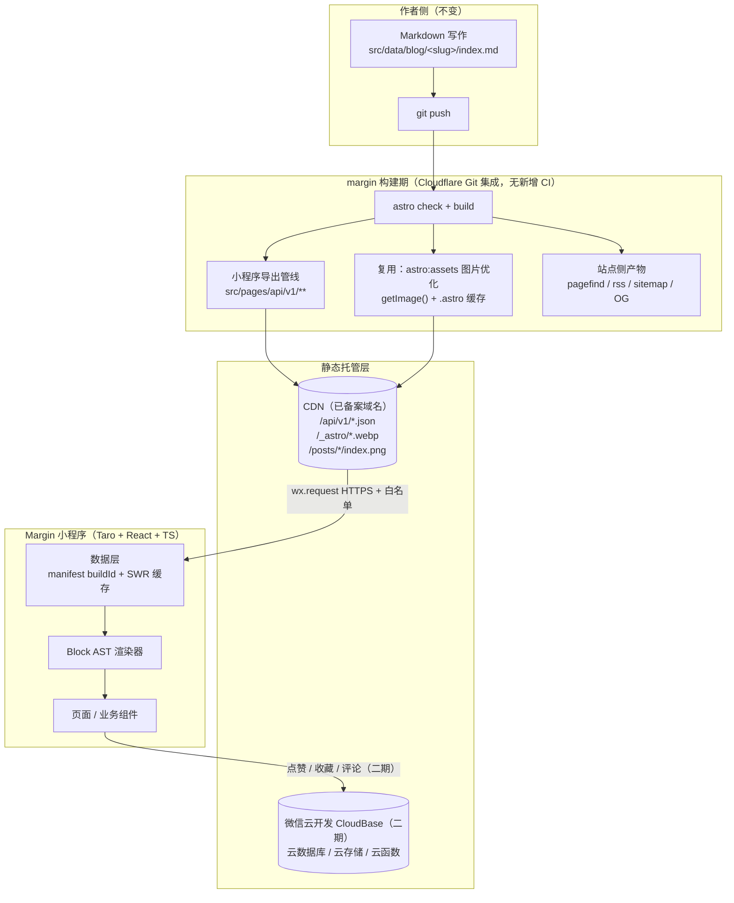

# Margin 小程序 · 需求文档（主文档）

| 项 | 内容 |
| --- | --- |
| 项目代号 | margin-app |
| 文档版本 | **v1.0**（2026-09-29，文档组重建）：UI 唯一基准 = **margin 博客原设计**（转向决策 D1，uni-halo/demo 基准作废）；M0 完成部署、M1-a 基建完成真机验收全绿，UI 层按新基准重做中（M1-b） |
| 内容源 | `E:\personal-project\margin`（Astro 7 纯静态博客，线上 https://www.baiwumm.com/） |
| 视觉基准 | **margin 原设计**：源码为唯一事实（`src/styles/global.css` 令牌 + 页面/组件样式），线上站移动端（≤640px 断点）样式为端上排版参考；无独立设计稿 |
| 配套文件 | [api-contract.md](api-contract.md) · [design.md](design.md) · [compliance.md](compliance.md) · [decisions.md](decisions.md) · [research.md](research.md) |

## 0. 一句话

把 margin 博客的**原设计**在微信小程序端原样还原：内容走构建期导出静态 JSON + Block AST，端上零后端、零运维，视觉与交互以 margin 源码为唯一基准，端上做不到的功能按 design.md §9 明确取舍。

## 1. 背景与目标

### 1.1 背景

- `margin` 是纯静态站：Astro SSG，内容为本地 Markdown/MDX（`src/data/blog|galleries|moments`），部署在 Cloudflare Workers Static Assets，**无任何运行时后端**。
- 内容规模：文章 **74** 篇、画廊 **3** 个（75 图）、瞬间 **9** 条（16 图）、标签 **62** 个（blog+galleries 口径）。
- 站点自带成熟设计体系：终端/等宽气质（全站 Maple Mono CN）、细边框极简卡片、双主题、五色 accent 轮换、aurora/网格/噪点装饰层——**这就是小程序要对齐的全部**。
- uni-halo 曾作结构与视觉参考（至 2026-09-29），现**全面转向 margin 原设计**，不再作为任何基准（D1）。
- 站内搜索是 Pagefind（WASM 分片），小程序不可复用，检索自建（§5.5）。

### 1.2 目标

| # | 目标 | 可验证标准 |
| --- | --- | --- |
| G1 | 内容零维护接入 | 发一篇文章 → 构建 → 小程序看到更新，人工操作 0 步 |
| G2 | 端上零后端 | 一期不新增任何服务器；静态内容全走 CDN 静态文件 |
| G3 | 阅读体验与站点一致 | 含代码/表格/图片/自定义块的 6 类文章真机渲染正确，字号/行距/主题可调；正文排版对齐 margin typography |
| G4 | 视觉与 margin 站点一致 | 令牌/卡片/装饰/双主题对照 margin 源码与线上站移动端，打样清单（design.md §8）全过 |
| G5 | 包体与性能达标 | 主包 ≤ 1.5MB；冷启动 TTI < 1.5s（4G，A1 实测 ≈880ms ✅），缓存命中 < 500ms |

### 1.3 非目标

- ❌ 不做多用户/注册登录、后台管理端（内容仍在 margin 的 Markdown 里写）。
- ❌ 不把博客 HTML 搬进小程序（Block AST 方案，§5.3）。
- ❌ 一期不做评论/点赞云同步（降级为本地，二期视审核情况再定）。
- ❌ 不做端上无法成立的 margin 功能（快捷键/TTS/电台/giscus 等，清单见 design.md §9，D6/D7）。

## 2. 范围

- **一期（M0–M4）**：内容浏览为主——首页、标签、图库、瞬间、我的 5 个 tab + 文章详情、搜索、归档、标签详情、画廊详情、图片浏览、友链、项目、关于/免责声明、偏好设置、收藏（本地）等二级页。
- **二期（M5，可选）**：微信云开发承载 UGC——点赞/收藏云同步、评论（含内容安全）、订阅消息、作者发布瞬间；提审发布。

## 3. 整体架构

### 3.1 总图



### 3.2 分层职责

| 层 | 职责 | 关键约束 |
| --- | --- | --- |
| 内容层 | Markdown 源文件，唯一事实来源 | 写作流程与 margin AGENTS.md 规范不变 |
| 导出层（margin 内） | 内容编译成面向小程序的 JSON + Block AST；图片给绝对 URL 与尺寸 | 纯构建期；站点 HTML 产物字节不变 |
| 分发层 | CDN 静态分发 JSON 与图片 | 图片 immutable 强缓存；JSON 走 ETag 再验证 |
| 端上数据层 | manifest 版本比对、缓存、预取、失败降级 | 首屏不依赖网络（读缓存渲染） |
| 渲染层 | Block AST → 小程序原生组件 | 框架无关，纯数据驱动 |
| 交互层 | 页面、组件、偏好、动画 | 令牌统一，双主题 + accent 轮换可用 |

### 3.3 边界原则

> **内容（读）走静态 CDN，用户数据（写）走云开发。** 两条链路互不依赖——二期不上云开发，一期功能也完整可用。

## 4. 技术选型

### 4.1 结论

| 维度 | 选型 | 理由 |
| --- | --- | --- |
| 框架 | **Taro 4.2.1（D11）** | React/TS 肌肉记忆；跨端保留 |
| 语言 | TypeScript 5+（strict） | 数据契约需要类型约束 |
| UI 运行时 | **React 18.3.1（已定案）** | 19 运行时验证失败（内部 API 改名 × Taro reconciler 未跟上），关闭待 Taro 升级后再验 |
| 构建 | **webpack5 + babel**（Vite 因 pnpm trustPolicy 与 peer 冲突回退，迁移另验） | 工程可行优先 |
| 状态管理 | Zustand + storage 持久化中间件 | 体积极小 |
| 数据请求 | 自研轻量 request（拦截器 + SWR 缓存 + 重试） | 已实现，22 单测 |
| 样式 | CSS 变量令牌层 + **Tailwind v4 + weapp-tailwindcss v5** | 令牌层负责主题/accent 切换 |
| 基础组件 | 自研为主 | 视觉高度定制，组件库收益为负 |
| 富文本正文 | 自研 Block AST 渲染器（不引 mp-html） | §5.3 |
| 代码高亮 | 构建期 Shiki 预高亮 → 端上按 token 上色（margin 双主题色） | 端上零解析 |
| 图片 | Taro `<Image>` + 自研 `CacheImage`（三态 + 占位色 + 懒加载） | 已实现 |
| 图表 | 自研视图网格（贡献日历）/canvas 轻量绘制 | stats 数据已就绪 |
| 站点字体 | 系统栈默认 + `wx.loadFontFace` 异步 Maple Mono 子集（偏好项，D4） | 不打包、不阻塞首屏 |
| 云能力（二期） | 微信云开发 CloudBase | 免备案域名、天然 openid |
| 包管理 | pnpm | 与 margin 一致 |

### 4.2 明确不采用

| 不采用 | 原因 |
| --- | --- |
| mp-html / towxml | 体积大；无法表达三个自定义指令块；样式不可控 |
| 魔改 uni-halo | 基准已随 D1 作废 |
| Pagefind 索引搬进小程序 | WASM 分片，技术不可行 |
| 为小程序加 SSR/接口服务 | 与零运维目标冲突 |
| 全套 UI 库 | 视觉高度定制；虚拟列表等硬骨头出现时按需引单个组件 |
| 打包中文字体进包体 | 中文子集 MB 级，爆主包 1.5MB 红线（D4） |

## 5. 数据层方案

### 5.1 核心判断

> **不在运行时把博客当接口用**：在 margin 构建期增设「小程序导出管线」，产出静态 JSON + Block AST，与站点同域部署；端上只消费 JSON 与图片，不解析 HTML、不依赖任何服务端。

1. margin 纯静态，任何接口化都要新起运行时服务，与 G1/G2 冲突。
2. 正文结构化/高亮/图片变体/聚合/索引全部构建期算完，端上零计算。
3. 内容更新频率 = 发文频率（低频），与 Cloudflare Git 自动构建天然契合，**无需新 CI**。
4. 失败模式好：CDN 没有「接口挂了」，最坏读到旧缓存仍可用。

### 5.2 契约概览（全文与类型见 api-contract.md）

- 统一 `ApiEnvelope`（`schemaVersion` / `buildId` / `generatedAt` / `data`）；`schemaVersion` 不匹配 = **软降级**；硬性版本隔离靠 `/api/v1` 与 `/api/v2` 目录并存（D12）。
- **13 个端点**，全部列表一次给全量、不做服务端分页。
- `assetBase = https://www.baiwumm.com`（无尾斜杠）；端上代码不出现硬编码域名。
- 类型 M0 已冻结进 api-contract.md（D17）。

### 5.3 正文 = Block AST（类型见 api-contract.md §4）

- 三个自定义指令 `::link-card` / `::music` / `::video` 在标准 HTML 无对应物——选 AST 的决定性理由；端上主题切换、图片占位防抖、代码 token 上色、TOC 都只有 AST 能干净支撑。
- 前置重构（三插件抽 `parse*Card(node)`）已完成并经同环境双管线逐字节比对证明等价；**验收硬闸门 = 站点 HTML 产物字节不变**（M0 实测唯一差异为有界例外，D17）。
- **禁止联网**：导出层不重跑外链 TDK 抓取，只读已入库缓存。
- 兜底：未识别节点落 `unknown` 块 + 构建期告警清单（警告不阻断发布）。

### 5.4 图片管线

- **只选择、不生成**（D13）：从集合自身已有档位按「≤目标宽度的最大可用档」挑，变体零新增。
- AssetRef 给绝对 URL + 实际宽度 + `avgColor` 占位色（布局不抖动、加载不白闪）。
- `/_astro/*` → `max-age=31536000, immutable` 已上线生产（只加这一组；JSON 维持 must-revalidate + ETag）。

### 5.5 检索（D15）

- 自建双层索引、端上本地检索：第一层 `titles.json` 随首屏（标题/标签/摘要/小标题 + 拼音）；第二层 `terms.json` 输入 ≥2 字懒加载（全文倒排）。
- 中文 bigram 滑窗；建索引与端上共用同一纯函数。
- 体积超 400 KB 先「正文只索引前 N 段」，不放宽上限（实测 379KB）。

### 5.6 标签口径（D14）

| 项 | 口径 |
| --- | --- |
| 数据源 | blog + galleries 合并去重 = **62**（moments 的 2 个标签不进标签页，与站点一致） |
| slug | 沿用 margin 的 slugify |
| 配色 | 契约构建期下发 `color` / `colorDark` / `ink`（WCAG 断言全过）；**端上按 margin 标签卡风格渲染，暂不消费三色字段，契约不动** |
| 相关标签 | 标签详情页底部按共现推荐，端上从 posts/index.json 现算 |

### 5.7 版本、缓存与存储（D16）

| 机制 | 设计 |
| --- | --- |
| buildId | git short sha（可读标签）+ 内容 hash（**主键**）；热力图按 `pubDatetime` 聚合 |
| 服务端缓存 | 图片 `/_astro/*` immutable；JSON 维持 must-revalidate + ETag（304） |
| 启动流程 | ① 读缓存渲染（0 等待）② 后台 GET manifest（If-None-Match）③ 304 结束 / 200 且 buildId 变 → 后台刷新 + 清旧 |
| 存储键 | `api:<name>:<buildId>` / `manifest` / `prefs` |
| 正文缓存 | 4 MB 按字节 LRU；单篇 >1MB 只留内存；**快照与 prefs 不参与淘汰** |
| 水位守卫 | `getStorageInfo`：>70% 触发淘汰、>90% 停预取（真机实测配额 10MB） |
| 预取 / 省流 | 首屏预取 3 篇（WiFi 6 篇）；省流 = 全用 thumb + 不预取 |

### 5.8 端上数据层

```
src/services/
├── request.ts        # 统一请求：baseURL 收敛、超时、重试、错误归一、并发去重
├── api/              # manifest(版本比对唯一入口) / collections(site/posts/galleries/moments/tags)
└── cache.ts          # storage 读写 + buildId 失效 + LRU + 体积统计
```

| 关注点 | 设计 |
| --- | --- |
| 统一响应 | 只认 HTTP 状态 + `ApiEnvelope`；4xx/5xx/超时/解析失败/schemaVersion 不认识 → 归一为 `LocalError` 枚举 |
| 并发去重 | 同资源飞行中请求共享同一 Promise |
| 降级 | 网络失败 → 缓存；无缓存 → 内置最小 site 兜底 + 空态 + 重试；**上次成功全量快照写 storage 且不随 buildId 清空** |
| 域名 | `assetBase` 与 API baseURL 同取 `manifest.assetBase`，零硬编码 |
| 错误上报 | 仅本地记录 + 微信自带数据，不接第三方埋点 |

## 6. 页面与模块

### 6.1 目录结构（Taro 工程）

```
margin-app/
├── config/                      # Taro 编译配置
├── docs/                        # 本文档组
├── src/
│   ├── app.ts / app.config.ts / app.scss
│   ├── assets/                  # logo、tabBar 图标、装饰贴片（噪点/光球）、兜底图
│   ├── components/
│   │   ├── base/                # NavBar SectionTitle TerminalBadge Card Tag Empty Skeleton SafeArea
│   │   ├── block/               # Block 渲染器：Paragraph Heading Image Code Quote List Table
│   │   │                        #             LinkCard Music Video Divider Unknown
│   │   ├── media/               # CacheImage ImageGrid VideoPlayer AudioCard
│   │   └── business/            # PostCard TagCard GalleryCard MomentCard StatsCalendar
│   ├── hooks/                   # useCollection useManifest useTheme(主题+accent) usePagination …
│   ├── services/                # §5.8
│   ├── styles/                  # tokens.css（margin 令牌 + accent 五套）、Tailwind 入口
│   ├── types/                   # 与 /api/v1 契约对齐（api-contract.md）
│   ├── utils/                   # 日期、格式化、检索、存储、节流
│   └── pages/                   # §6.2
└── project.config.json
```

### 6.2 页面清单

**主包（5 tab，自定义 tabBar）**（D3：集合不变，视觉按 margin）

| 页面 | 路径 | margin 对应 | 数据来源 |
| --- | --- | --- | --- |
| 首页 | `pages/home/index` | `/`（hero + featured + recent） | site + posts/index |
| 标签 | `pages/tags/index` | `/tags`（aurora hero + tag 卡） | tags/index |
| 图库 | `pages/gallery/index` | `/galleries` | galleries/index |
| 瞬间 | `pages/moment/index` | `/moments` | moments/index（端上聚合月份轴） |
| 我的 | `pages/mine/index` | `/about` 元素 + 端上特有 | site + stats + 本地收藏/记录 |

**分包 A（`pagesA`，内容与浏览）**：文章详情 `post`、搜索 `search`（双层索引）、归档 `archive`（对应 `/archives`）、标签详情 `tag-detail`（对应 `/tags/<tag>`）、画廊详情 `gallery-detail`（对应 `/galleries/<slug>`）、图片浏览 `photo-view`、友链 `friends`（对应 `/friends`）、项目 `projects`（对应 `/projects`）、关于 `about` + 免责声明 `disclaimer`。

**分包 B（`pagesB`，个人与设置）**：偏好设置 `preference`（**站点字体 D4 / accent D5**、主题、首页布局、字号/行距、代码换行、省流）、我的收藏 `favorite`（本地）、阅读记录 `history`（本地）、数据看板 `stats`（对应 margin 贡献日历/统计）、联系博主 `contact`（复制到剪贴板）。

### 6.3 margin → 端上映射要点

| 模块 | 口径 |
| --- | --- |
| 首页 Hero | **纯文字终端 hero**（badge + glow 大标题 + 描述 + 作者/社交），无 banner 图、无搜索框（搜索在顶栏入口）；`~ /ready-to-go $` 徽章 + ping 点按 margin 源码还原 |
| 首页列表 | FEATURED（featured 琥珀卡）+ RECENT（`[n/74]` 等宽计数）+ 「查看全部文章」outline CTA → 归档页；文章卡无图（站点 `showCoverImages: false` 本就如此） |
| 标签页 | aurora hero（`~ ls -la $` 徽章 + glow 标题 + 统计徽章）+ tag 卡网格；**不用彩色块**（D14） |
| 图库 | hero + 画廊卡（cover aspect-video + gallery 紫罗兰语义色 tint）；筛选 = 全部 + 画廊名 |
| 瞬间 | 瞬间卡（日期 + 正文 + 1/2/3 列图网格 + tag pill + featured 星标）；月份导航为端上组件（margin 无对应物），按 margin 视觉语言绘制 |
| 我的 | 头像 + 简介 + 社交 + 统计卡 + 贡献日历 + 端上特有列表（收藏/历史/偏好/联系/免责声明）+ 备案号（M4） |
| 发布入口 | 瞬间发布入口一期隐藏（个人主体 UGC 风险） |

### 6.4 核心组件清单

| 组件 | 职责 | 复杂度 |
| --- | --- | --- |
| BlockRenderer | AST → 组件树分发，unknown 兜底 | 高 |
| CodeBlock | 按 token 上色（margin shiki 双主题）、行号、语言角标、复制、换行/滚动切换 | 高 |
| CacheImage | 三态 + avgColor 占位 + 懒加载 + 预览 | 中（已实现） |
| AuroraHero / TerminalBadge / SectionTitle | margin 标志性 hero、终端徽章、大写小节标题 + 横线 | 低 |
| ImageGrid / MonthPicker / TabBar | 网格、月份选择、custom-tab-bar（D19 机制） | 中 |
| StatsCalendar | 贡献日历视图网格 | 低 |
| Skeleton / Empty | 骨架屏、空态/错误态 | 低 |
| usePagination | 纯端上切片 | 中（已实现） |

## 7. 视觉与交互

→ 全部见 [design.md](design.md)（margin 令牌、五屏结构、字体策略、装饰层实现、CSS 硬约束、打样 6 项、端上不做清单）。两条先记：

- 浅色/暗色令牌 = margin 源码原值（真实双主题稿）；accent 五套随偏好切换（D5）。
- 端上做不到或明确不做的 margin 功能清单在 design.md §9，验收时别当 bug 查。

## 8. 备案与发布合规

→ 全部见 [compliance.md](compliance.md)。当前要点：个人主体已备案已认证；域名白名单已配；**变更备案审核中**；接入商核查闭环（接受风险 + 快照兜底）；上线前 checklist 见其 §12。

## 9. 里程碑

| 里程碑 | 内容 | 状态 / 验收 |
| --- | --- | --- |
| **M0 契约与导出管线** | 冻结 schema + 13 端点 + toBlocks + toAssetRef + bigram 索引 + `_headers` | ✅ **完成并生产验收（2026-09-29，D17）** |
| **M1-a 基建 + 真机验收** | Taro 工程 / Tailwind v4+weapp-tw / request+cache+manifest（22 单测）/ Block 渲染器基础块 / 五页骨架 / custom-tab-bar | ✅ **完成 + A1 真机全绿（D18）**：TTI ≈880ms、缓存命中 <500ms、切 tab 滚动保留、存储实测 10MB 配额 |
| **M1-b UI 按 margin 基准重做（✅ 完结）** | tokens 全量换 margin 令牌（含 accent 五套）；五页视图层重写；tabBar/图标/NavBar 换 margin 皮；装饰层（网格/噪点/aurora/glow）；字体 loadFontFace 管线 | ✅ **代码侧完成（2026-09-29，D25）+ 打样模拟器侧通过（2026-10-06，D27）+ 真机复核通过（2026-10-06，D28）**：§10 十一步走完（步骤 10 字体子集按批示跳过）；打样 6 项 = 1/2/4/6 模拟器 PASS、3 数值 PASS（对比度口径 A：装饰性小件 ≥3，保 margin 原值）、5 豁免；真机 = accent 即点即效 PASS、切 tab 滚动保留 PASS、缓存命中首屏 70ms + 存储 56/10240KB PASS，低版本降级观感与冷启动 TTI **按批示豁免**（依据见 D28）；附带修复真机挂项两处（tabBar 遮挡安全区、贡献日历稀疏数据渲染）。**→ 视觉基线已宣告并冻结，M1-b 完结，进 M2** |
| **M2 文章详情（进行中）** | Block 全量块 + TOC + 进度 + 字号/行距/主题 + 代码块（margin shiki 双主题）+ 图片预览 + 上下篇 + 分享 + 阅读模式（偏好开关） | 🔶 **进行中（2026-10-07，D30–D34）**：步 1+2 详情页、步 3/3b 偏好（含阅读模式）、步 4 正文排版、步 5 代码配色（margin `aab843b` 已部署，端上 924 token 双主题实测分色正确）、步 6 TOC/进度/返回顶部、步 8 linkcard/video 引用卡 + music 黑胶播放卡 **已落**；**未做** = 步 7 图片预览/长按存图（卡在他先在后台勾《用户隐私保护指引》相册写入）、步 9 千行代码不卡、步 10 分享卡 + 10 篇抽样。本轮两处返工：TOC 折角由 unicode 字符改 CSS 画法（`b8d15ec`）、music 块补 `name/artist/cover`（D33，margin `e3ca922` **待他部署**，端上消费代码已就绪）。验收三条仍未判定：① 10 篇抽样渲染与站点一致（含三类指令块）；② 1000 行代码不卡；③ 分享卡图正确。**运行时口径注意**：自动化通道本轮反复卡死（服务层应答、渲染层所有选择器返 null，未改动的首页同样量不到），故折角观感、播放态视觉均标未验；另 D34 记一条待复测的既有结论矛盾（D31「transform 内 rpx 不换算」与产物单位自相矛盾），复测前不动那三处动画代码 |
| **M3 图库与瞬间** | 画廊列表/详情/图片浏览；瞬间年月导航/卡片/图组/视频音乐块 | ① 75+16 图全可浏览；② 月份切换计数正确；③ 大图手势顺畅 |
| **M4 检索、归档与个人中心** | 搜索（双层+拼音+高亮+历史）、归档、标签详情、友链、项目、关于（**备案号展示**）、数据看板 | ① 一层 <40KB 即时、二层 ≤400KB、拼音首字母命中；② 偏好全生效持久化；③ 主包 ≤1.5MB；④ 备案号可见可复制 |
| **M5 云能力与发布（二期）** | 云开发（点赞/收藏同步、评论+msgSecCheck、订阅消息、发布瞬间）；提审（先移除打点探针 D21） | ① 审核通过；② 内容安全自检过；③ 云数据按 openid 隔离 |

**验证策略**：本地只跑 `astro check` + 单测 + dev 冒烟（margin 本地完整 build 会随机卡死）；合并前信号 = 分支构建 check-run（构建内断言，违规即失败）；合并后 = 生产域（www）复核。

## 10. 非功能性需求

| 类别 | 要求 |
| --- | --- |
| 包体 | 主包 ≤1.5MB；总包 ≤6MB；大资源（字体/图片）走网络或按需，不进包 |
| 性能 | 冷启动 TTI <1.5s（4G；实测 ≈880ms）；缓存命中 <500ms；字体加载异步不阻塞首屏；列表 60fps；长文分段渲染 |
| 网络 | 单请求 ≤400KB；首页 JSON 合计 ≤120KB（gzip 后）；弱网走缓存可读；全部请求走 www、不依赖 301 |
| 存储 | 单 key ≈1MB / 总 ≈10MB 边界（真机实测 10240KB）；正文 4MB + 索引 0.5MB + 快照/prefs 1MB；70%/90% 双水位 |
| 兼容 | 基础库 ≥2.30（loadFontFace global 需 ≥2.10.1）；iOS 14+ / Android 8+；仅竖屏 |
| 暗色 | 跟随系统 + 手动覆盖；令牌 = margin 暗色原值 |
| accent | 五套 accent（blue/green/purple/orange/rose）随偏好切换，明暗各有数值 |
| 无障碍 | 正文 26–40rpx 可调；对比度正文 ≥4.5:1、大字 ≥3:1 |
| 安全 / 隐私 | 端上无 token；云数据按 openid 隔离；不采集设备信息、不接埋点、不请求非必要权限 |

## 11. 当前状态与风险

### 11.1 风险登记（重建后现行集）

| # | 风险 | 状态 | 缓解 |
| --- | --- | --- | --- |
| R1 | 境外托管与备案的张力 | P2 接受 | 快照兜底 + `_astro` 长缓存（compliance §7） |
| R2 | 个人主体硬限制 | P0 约束 | compliance §3 |
| R3 | 内容结构漂移缺块 | P1 | unknown 兜底 + 告警 + schemaVersion |
| R4 | 音乐/视频块端上不可播 | P1 | 卡片 + 复制链接 / 封面跳转 / 自托管媒体（D6 同理不新增服务） |
| R5 | 超长文章单文件过大 | P2 | 单篇实测中位 12KB、最大 42.6KB；仍超再分块 |
| R6 | 字体子集加载失败/慢 | P2 | 系统栈兜底 + 静默回落（D4）；不阻塞首屏 |
| R7 | 大 blur/装饰层安卓性能 | P2 | 光球预渲染 PNG / 降档（design.md §6） |
| R8 | 备案联系方式失效 | 持续注意 | 保持可达（compliance §6） |

（已关闭：图片落盘/插件等价探针、构建增量、`wx.setStorage` 配额、React 19、tabBar 路线、备案号悬挂、接入商核查、workers.dev 验证口径——结论并入 decisions.md D8–D21。）

## 12. 文档地图

| 文件 | 内容 | 何时读 |
| --- | --- | --- |
| **requirements.md**（本文） | 目标 / 架构 / 选型 / 数据层 / 页面 / 里程碑 / 状态 | 总览 |
| **api-contract.md** | 13 端点 + 全部类型 + Block AST + 图片档位 + 检索索引 + 缓存规则；**M0 冻结对象** | 数据层开发每天 |
| **design.md** | margin 令牌 / 五屏结构 / 字体 / 装饰层 / CSS 硬约束 / 打样清单 / 不做清单 | UI 开发每天 |
| **compliance.md** | 备案 / 域名 / 个人主体限制 / 接入商核查留档 / 免责声明 / 上线 checklist | 备案事务与发布前 |
| **decisions.md** | D1–D30 一行结论（2026-09-29 重建，历史论证见 git 历史） | 查口径 |
| **research.md** | 内容源事实 / margin 设计体系事实 / M0 实测证据 / 方法论 | 追溯依据 |

## 13. 变更记录

- **v1.0（2026-09-29）**：文档组整体重建。起因 = UI 方向转向（D1：放弃 uni-halo 基准，全量对齐 margin 博客原设计），旧版（requirements v1.0–v3.6、决策旧编号 D1–D55、archive 快照、demo/）删除，git 历史可考古。重建时把仍然有效的历史结论浓缩为 decisions.md D8–D22，契约与合规事实原样承接。
